# Awesome GPT-6.2 Astra and Sol Videos

[简体中文](README.zh-CN.md)

A credited list of **78 videos made with OpenAI's GPT-6.2 Astra and Sol** and shared on X since their release on November 17, 2026: 3D scenes, small games, motion graphics, music and side-by-side tests against other models. The model wrote code that draws every frame.

Watch them all, with filters, at **[claude-motion.com/gpt-6-2-videos](https://claude-motion.com/gpt-6-2-videos)**

## Motion graphics

<table>
<tr>
<td width="33%" valign="top"> <b><a href="https://x.com/petergostev/status/2122816629402910859">A lifelike peacock in a misty forest, drawn in SVG</a></b> <a href="https://x.com/petergostev">@petergostev</a> · 0:55 · <a href="https://x.com/petergostev/status/2122816629402910859">original post on X</a></td>
<td width="33%" valign="top"> <b><a href="https://x.com/lepadphone/status/2122760193226449212">A 3D web page of a cloaked girl on a mirror lake, 13 min 32 s at High</a></b> <a href="https://x.com/lepadphone">@lepadphone</a> · 0:56 · <a href="https://x.com/lepadphone/status/2122760193226449212">original post on X</a></td>
<td width="33%" valign="top"> <b><a href="https://x.com/benchmark_lb900/status/2122761948903449045">A pixel-art elf character sheet, walking in four directions</a></b> <a href="https://x.com/benchmark_lb900">@benchmark_lb900</a> · 0:07 · <a href="https://x.com/benchmark_lb900/status/2122761948903449045">original post on X</a></td>
</tr>
<tr>
<td width="33%" valign="top"><a href="https://x.com/studio_yebisu/status/2122766921498325224">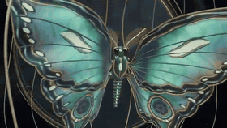</a> <b><a href="https://x.com/studio_yebisu/status/2122766921498325224">A moth in a golden cage, a three.js music video demo</a></b> <a href="https://x.com/studio_yebisu">@studio_yebisu</a> · 1:07 · <a href="https://x.com/studio_yebisu/status/2122766921498325224">original post on X</a></td>
<td width="33%" valign="top"> <b><a href="https://x.com/clairevo/status/2122845185512271959">An interactive storybook where a girl and a ghost follow the cursor</a></b> <a href="https://x.com/clairevo">@clairevo</a> · 0:12 · <a href="https://x.com/clairevo/status/2122845185512271959">original post on X</a></td>
<td width="33%" valign="top"> <b><a href="https://x.com/GKev1n/status/2122887519864070480">A cow running across a meadow, animated in SVG</a></b> <a href="https://x.com/GKev1n">@GKev1n</a> · 0:12 · <a href="https://x.com/GKev1n/status/2122887519864070480">original post on X</a></td>
</tr>
<tr>
<td width="33%" valign="top"> <b><a href="https://x.com/ShadeLurk/status/2122831337321349384">A CD jukebox in the browser, five songs in one HTML file</a></b> <a href="https://x.com/ShadeLurk">@ShadeLurk</a> · 0:20 · <a href="https://x.com/ShadeLurk/status/2122831337321349384">original post on X</a></td>
<td width="33%" valign="top"> <b><a href="https://x.com/Leviwoyun/status/2122846422676701267">A 15-second motion graphics reel from the same prompt: Astra vs Sol</a></b> <a href="https://x.com/Leviwoyun">@Leviwoyun</a> · 0:15 · <a href="https://x.com/Leviwoyun/status/2122846422676701267">original post on X</a></td>
</tr>
</table>

## Explainers

<table>
<tr>
<td width="33%" valign="top"> <b><a href="https://x.com/gabrielchua/status/2122772868270579949">A short video on how the Singapore replica was made</a></b> <a href="https://x.com/gabrielchua">@gabrielchua</a> · 1:59 · <a href="https://x.com/gabrielchua/status/2122772868270579949">original post on X</a></td>
</tr>
</table>

## 3D scenes and games

<table>
<tr>
<td width="33%" valign="top"> <b><a href="https://x.com/soyukke_game/status/2122767541823225891">A little steam train through a pink city in the sky, at xhigh</a></b> <a href="https://x.com/soyukke_game">@soyukke_game</a> · 0:24 · <a href="https://x.com/soyukke_game/status/2122767541823225891">original post on X</a></td>
<td width="33%" valign="top"> <b><a href="https://x.com/Dimillian/status/2122753859281928626">Paris at 1:1, walkable and drivable, with traffic and 50+ landmarks</a></b> <a href="https://x.com/Dimillian">@Dimillian</a> · 0:30 · <a href="https://x.com/Dimillian/status/2122753859281928626">original post on X</a></td>
<td width="33%" valign="top"><a href="https://x.com/Dimillian/status/2122750651998355800">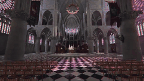</a> <b><a href="https://x.com/Dimillian/status/2122750651998355800">The nave of Notre-Dame in Unreal Engine 5, from photos and a historic floor plan</a></b> <a href="https://x.com/Dimillian">@Dimillian</a> · 0:56 · <a href="https://x.com/Dimillian/status/2122750651998355800">original post on X</a></td>
</tr>
<tr>
<td width="33%" valign="top"> <b><a href="https://x.com/givros/status/2122816304071803109">Kasane Valley, a Japanese village in a green valley, in Blender and three.js</a></b> <a href="https://x.com/givros">@givros</a> · 1:20 · <a href="https://x.com/givros/status/2122816304071803109">original post on X</a></td>
<td width="33%" valign="top"><a href="https://x.com/vib3coded/status/2122800268706259244">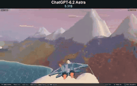</a> <b><a href="https://x.com/vib3coded/status/2122800268706259244">A pixel-art jet game in one HTML file, 36 minutes and $5.31</a></b> <a href="https://x.com/vib3coded">@vib3coded</a> · 0:14 · <a href="https://x.com/vib3coded/status/2122800268706259244">original post on X</a></td>
<td width="33%" valign="top"> <b><a href="https://x.com/Da7_Tech/status/2122826218764439645">A pirate ship under a skull-and-crossbones sail at sunset</a></b> <a href="https://x.com/Da7_Tech">@Da7_Tech</a> · 0:29 · <a href="https://x.com/Da7_Tech/status/2122826218764439645">original post on X</a></td>
</tr>
<tr>
<td width="33%" valign="top"> <b><a href="https://x.com/soya_da_yoot/status/2122801036247376224">A stylized 3D girl in a yellow jacket, with the run still going</a></b> <a href="https://x.com/soya_da_yoot">@soya_da_yoot</a> · 0:19 · <a href="https://x.com/soya_da_yoot/status/2122801036247376224">original post on X</a></td>
<td width="33%" valign="top"><a href="https://x.com/AmirMushich/status/2122790354781192518">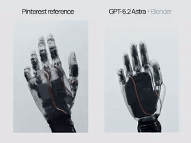</a> <b><a href="https://x.com/AmirMushich/status/2122790354781192518">A robotic hand in Blender, beside its reference image</a></b> <a href="https://x.com/AmirMushich">@AmirMushich</a> · 0:12 · <a href="https://x.com/AmirMushich/status/2122790354781192518">original post on X</a></td>
<td width="33%" valign="top"> <b><a href="https://x.com/emollick/status/2122781928726437902">A Coast Guard cutter game in the War of Independence, made in Blender and Unity</a></b> <a href="https://x.com/emollick">@emollick</a> · 0:45 · <a href="https://x.com/emollick/status/2122781928726437902">original post on X</a></td>
</tr>
<tr>
<td width="33%" valign="top"><a href="https://x.com/gabrielchua/status/2122762679760883967">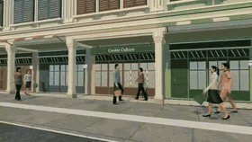</a> <b><a href="https://x.com/gabrielchua/status/2122762679760883967">All of Singapore at 1:1 scale, over 100 hours of work</a></b> <a href="https://x.com/gabrielchua">@gabrielchua</a> · 0:30 · <a href="https://x.com/gabrielchua/status/2122762679760883967">original post on X</a></td>
<td width="33%" valign="top"> <b><a href="https://x.com/gamemangaanime/status/2122810072447521194">A chibi 3D character from a reference image, one shot with Blender MCP</a></b> <a href="https://x.com/gamemangaanime">@gamemangaanime</a> · 0:11 · <a href="https://x.com/gamemangaanime/status/2122810072447521194">original post on X</a></td>
<td width="33%" valign="top"> <b><a href="https://x.com/Super_Nius/status/2122755138414920061">An island in a jelly sea with adjustable tide and light, made with Sol in 14 minutes</a></b> <a href="https://x.com/Super_Nius">@Super_Nius</a> · 0:32 · <a href="https://x.com/Super_Nius/status/2122755138414920061">original post on X</a></td>
</tr>
<tr>
<td width="33%" valign="top"> <b><a href="https://x.com/aarondelasy/status/2122784351322865740">A snowy city crossing full of umbrellas, one-shot in Blender</a></b> <a href="https://x.com/aarondelasy">@aarondelasy</a> · 0:14 · <a href="https://x.com/aarondelasy/status/2122784351322865740">original post on X</a></td>
<td width="33%" valign="top"> <b><a href="https://x.com/Bhavani_00007/status/2122767429193646141">Meridian Sound Racing, a 3D racing game</a></b> <a href="https://x.com/Bhavani_00007">@Bhavani_00007</a> · 1:00 · <a href="https://x.com/Bhavani_00007/status/2122767429193646141">original post on X</a></td>
<td width="33%" valign="top"><a href="https://x.com/Dimillian/status/2122799400061960611">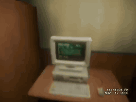</a> <b><a href="https://x.com/Dimillian/status/2122799400061960611">A backrooms walk with a VHS camcorder look, full of props and biomes</a></b> <a href="https://x.com/Dimillian">@Dimillian</a> · 0:40 · <a href="https://x.com/Dimillian/status/2122799400061960611">original post on X</a></td>
</tr>
<tr>
<td width="33%" valign="top"><a href="https://x.com/Dimillian/status/2122783245976908195">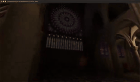</a> <b><a href="https://x.com/Dimillian/status/2122783245976908195">A walk around Notre-Dame after the move from the web to Unreal Engine 5</a></b> <a href="https://x.com/Dimillian">@Dimillian</a> · 1:21 · <a href="https://x.com/Dimillian/status/2122783245976908195">original post on X</a></td>
<td width="33%" valign="top"><a href="https://x.com/FlorianGallwitz/status/2122805196938231879">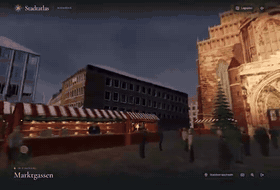</a> <b><a href="https://x.com/FlorianGallwitz/status/2122805196938231879">A walkable Nuremberg Christmas market, half a year on with the same prompt</a></b> <a href="https://x.com/FlorianGallwitz">@FlorianGallwitz</a> · 1:23 · <a href="https://x.com/FlorianGallwitz/status/2122805196938231879">original post on X</a></td>
<td width="33%" valign="top"><a href="https://x.com/DeryaTR_/status/2122814594737684568">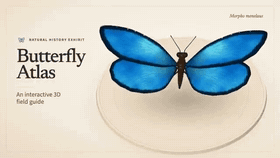</a> <b><a href="https://x.com/DeryaTR_/status/2122814594737684568">A butterfly gallery website made with Sol in Blender</a></b> <a href="https://x.com/DeryaTR_">@DeryaTR_</a> · 1:30 · <a href="https://x.com/DeryaTR_/status/2122814594737684568">original post on X</a></td>
</tr>
<tr>
<td width="33%" valign="top"><a href="https://x.com/KanaWorks_AI/status/2122878806436589861">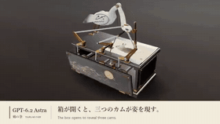</a> <b><a href="https://x.com/KanaWorks_AI/status/2122878806436589861">A porcelain crane machine painting a rabbit's tail, after a 4-hour run</a></b> <a href="https://x.com/KanaWorks_AI">@KanaWorks_AI</a> · 0:25 · <a href="https://x.com/KanaWorks_AI/status/2122878806436589861">original post on X</a></td>
<td width="33%" valign="top"> <b><a href="https://x.com/Ananth7e/status/2122764162124353906">A night-flight game over moonlit hills, built in 60 seconds</a></b> <a href="https://x.com/Ananth7e">@Ananth7e</a> · 0:30 · <a href="https://x.com/Ananth7e/status/2122764162124353906">original post on X</a></td>
<td width="33%" valign="top"><a href="https://x.com/klausbrave/status/2122808960071917953">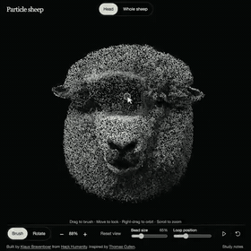</a> <b><a href="https://x.com/klausbrave/status/2122808960071917953">Particle Sheep, a particle sheep built in 20 minutes from a video reference</a></b> <a href="https://x.com/klausbrave">@klausbrave</a> · 0:15 · <a href="https://x.com/klausbrave/status/2122808960071917953">original post on X</a></td>
</tr>
<tr>
<td width="33%" valign="top"><a href="https://x.com/JesusIsGod/status/2122899824722772297">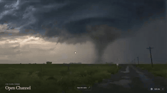</a> <b><a href="https://x.com/JesusIsGod/status/2122899824722772297">Open Channel, a short game on an empty road under a storm, made in 1 hour</a></b> <a href="https://x.com/JesusIsGod">@JesusIsGod</a> · 1:57 · <a href="https://x.com/JesusIsGod/status/2122899824722772297">original post on X</a></td>
<td width="33%" valign="top"><a href="https://x.com/fxtrader/status/2122756192791662752">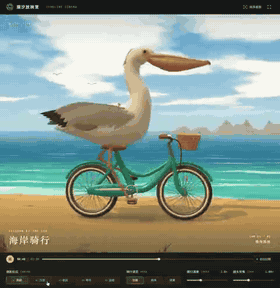</a> <b><a href="https://x.com/fxtrader/status/2122756192791662752">A pelican cycling along a beach in three.js, from internal knowledge only, at High</a></b> <a href="https://x.com/fxtrader">@fxtrader</a> · 1:14 · <a href="https://x.com/fxtrader/status/2122756192791662752">original post on X</a></td>
<td width="33%" valign="top"> <b><a href="https://x.com/danveloper/status/2122766260811313326">A green city of terraced towers, built in 16 minutes at Ultra</a></b> <a href="https://x.com/danveloper">@danveloper</a> · 0:12 · <a href="https://x.com/danveloper/status/2122766260811313326">original post on X</a></td>
</tr>
<tr>
<td width="33%" valign="top"><a href="https://x.com/CodeByNZ/status/2122760051454562368">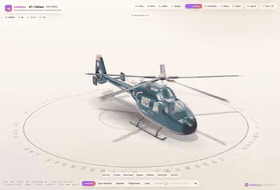</a> <b><a href="https://x.com/CodeByNZ/status/2122760051454562368">A flying 3D helicopter with assembly and exploded views, made with Sol in 7 minutes</a></b> <a href="https://x.com/CodeByNZ">@CodeByNZ</a> · 1:15 · <a href="https://x.com/CodeByNZ/status/2122760051454562368">original post on X</a></td>
<td width="33%" valign="top"><a href="https://x.com/Masimo_Blue/status/2122846803477537071">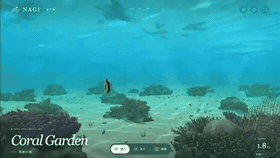</a> <b><a href="https://x.com/Masimo_Blue/status/2122846803477537071">Coral Garden, a website where you swim under the sea and poke the fish</a></b> <a href="https://x.com/Masimo_Blue">@Masimo_Blue</a> · 2:18 · <a href="https://x.com/Masimo_Blue/status/2122846803477537071">original post on X</a></td>
<td width="33%" valign="top"><a href="https://x.com/lucian__03/status/2122782073102663874">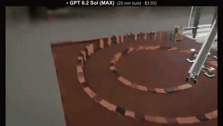</a> <b><a href="https://x.com/lucian__03/status/2122782073102663874">A 3D Rube Goldberg machine in HTML, made with Sol at Max in 25 minutes for $3.03</a></b> <a href="https://x.com/lucian__03">@lucian__03</a> · 0:21 · <a href="https://x.com/lucian__03/status/2122782073102663874">original post on X</a></td>
</tr>
<tr>
<td width="33%" valign="top"><a href="https://x.com/lucian__03/status/2122770012234805383">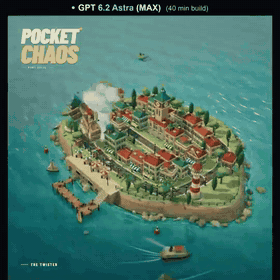</a> <b><a href="https://x.com/lucian__03/status/2122770012234805383">A 3D city disaster simulator with tornadoes, meteors and floods, about 40 min at Max</a></b> <a href="https://x.com/lucian__03">@lucian__03</a> · 0:18 · <a href="https://x.com/lucian__03/status/2122770012234805383">original post on X</a></td>
<td width="33%" valign="top"> <b><a href="https://x.com/Maxq5xs/status/2122772121940308343">A lifelike pelican in a red scarf cycling by the sea at sunset</a></b> <a href="https://x.com/Maxq5xs">@Maxq5xs</a> · 0:12 · <a href="https://x.com/Maxq5xs/status/2122772121940308343">original post on X</a></td>
<td width="33%" valign="top"><a href="https://x.com/pankajkumar_dev/status/2122785662734868949">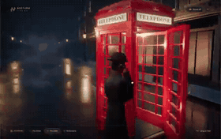</a> <b><a href="https://x.com/pankajkumar_dev/status/2122785662734868949">The Last Phone Call, a foggy noir street with a red phone box in the rain</a></b> <a href="https://x.com/pankajkumar_dev">@pankajkumar_dev</a> · 0:31 · <a href="https://x.com/pankajkumar_dev/status/2122785662734868949">original post on X</a></td>
</tr>
<tr>
<td width="33%" valign="top"> <b><a href="https://x.com/DFintelligence/status/2122798818274017712">Marseille in 3D, its harbor at sunset</a></b> <a href="https://x.com/DFintelligence">@DFintelligence</a> · 0:35 · <a href="https://x.com/DFintelligence/status/2122798818274017712">original post on X</a></td>
</tr>
</table>

## Music

<table>
<tr>
<td width="33%" valign="top"> <b><a href="https://x.com/rvm0n_/status/2122768551354208665">An original classical piano piece, played as falling notes</a></b> <a href="https://x.com/rvm0n_">@rvm0n_</a> · 1:40 · <a href="https://x.com/rvm0n_/status/2122768551354208665">original post on X</a></td>
<td width="33%" valign="top"><a href="https://x.com/aug5thmusic/status/2122767673570607401">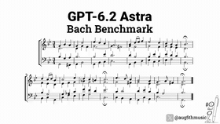</a> <b><a href="https://x.com/aug5thmusic/status/2122767673570607401">A chorale on the Bach Benchmark, shown as a score</a></b> <a href="https://x.com/aug5thmusic">@aug5thmusic</a> · 0:51 · <a href="https://x.com/aug5thmusic/status/2122767673570607401">original post on X</a></td>
<td width="33%" valign="top"> <b><a href="https://x.com/Angaisb_/status/2122759047107444948">All the Swifts Return, a song over an illustrated harbor town</a></b> <a href="https://x.com/Angaisb_">@Angaisb_</a> · 1:50 · <a href="https://x.com/Angaisb_/status/2122759047107444948">original post on X</a></td>
</tr>
<tr>
<td width="33%" valign="top"><a href="https://x.com/aug5thmusic/status/2122773822348874149">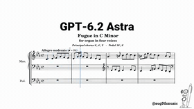</a> <b><a href="https://x.com/aug5thmusic/status/2122773822348874149">An organ fugue in C minor written in LilyPond, at Extra High effort</a></b> <a href="https://x.com/aug5thmusic">@aug5thmusic</a> · 2:47 · <a href="https://x.com/aug5thmusic/status/2122773822348874149">original post on X</a></td>
</tr>
</table>

## Model comparisons

<table>
<tr>
<td width="33%" valign="top"><a href="https://x.com/EnvolDev/status/2122773694783349144">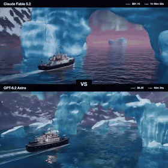</a> <b><a href="https://x.com/EnvolDev/status/2122773694783349144">A cathedral of ice from the same prompt: GPT-6.2 Astra vs Fable 5.2</a></b> <a href="https://x.com/EnvolDev">@EnvolDev</a> · 0:25 · <a href="https://x.com/EnvolDev/status/2122773694783349144">original post on X</a></td>
<td width="33%" valign="top"><a href="https://x.com/EnvolDev/status/2122803967272866254">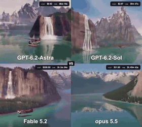</a> <b><a href="https://x.com/EnvolDev/status/2122803967272866254">A plane from the Alpine Gold prompt: GPT-6.2 Astra vs GPT-6.2 Sol vs Fable 5.2 vs Opus 5.5</a></b> <a href="https://x.com/EnvolDev">@EnvolDev</a> · 0:25 · <a href="https://x.com/EnvolDev/status/2122803967272866254">original post on X</a></td>
<td width="33%" valign="top"><a href="https://x.com/ChrisGPT/status/2122837291874070590">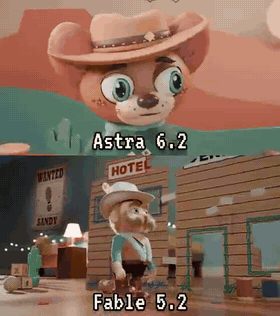</a> <b><a href="https://x.com/ChrisGPT/status/2122837291874070590">A 10-second cowboy toy film in Blender: GPT-6.2 Astra vs Fable 5.2</a></b> <a href="https://x.com/ChrisGPT">@ChrisGPT</a> · 0:10 · <a href="https://x.com/ChrisGPT/status/2122837291874070590">original post on X</a></td>
</tr>
<tr>
<td width="33%" valign="top"> <b><a href="https://x.com/AmirMushich/status/2122815524124152216">A robotic hand modeled and animated in Blender: GPT-6.2 Astra vs Fable 5.2</a></b> <a href="https://x.com/AmirMushich">@AmirMushich</a> · 0:12 · <a href="https://x.com/AmirMushich/status/2122815524124152216">original post on X</a></td>
<td width="33%" valign="top"><a href="https://x.com/dom_scholz/status/2122862040326807696">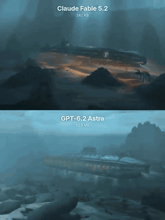</a> <b><a href="https://x.com/dom_scholz/status/2122862040326807696">A seabed submarine in three.js: Fable 5.2 at 242 KB vs GPT-6.2 Astra at 32.9 MB</a></b> <a href="https://x.com/dom_scholz">@dom_scholz</a> · 0:40 · <a href="https://x.com/dom_scholz/status/2122862040326807696">original post on X</a></td>
<td width="33%" valign="top"><a href="https://x.com/LuminaBench/status/2122758425520029886">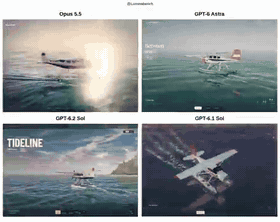</a> <b><a href="https://x.com/LuminaBench/status/2122758425520029886">The 3D seaplane test: GPT-6.2 Sol vs GPT-6.1 Sol</a></b> <a href="https://x.com/LuminaBench">@LuminaBench</a> · 0:39 · <a href="https://x.com/LuminaBench/status/2122758425520029886">original post on X</a></td>
</tr>
<tr>
<td width="33%" valign="top"><a href="https://x.com/MrTacticalX/status/2122806350543774075">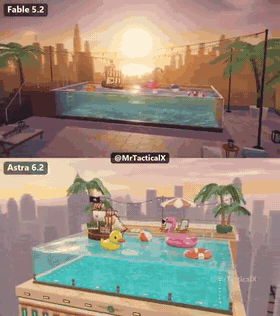</a> <b><a href="https://x.com/MrTacticalX/status/2122806350543774075">A glass pool from the same prompt: Fable 5.2 vs GPT-6.2 Astra</a></b> <a href="https://x.com/MrTacticalX">@MrTacticalX</a> · 0:30 · <a href="https://x.com/MrTacticalX/status/2122806350543774075">original post on X</a></td>
<td width="33%" valign="top"><a href="https://x.com/rubenssoto_ai/status/2122793788087193650">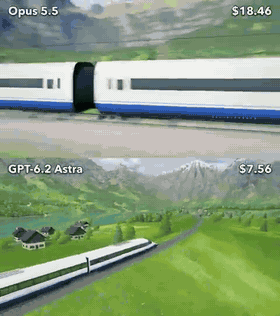</a> <b><a href="https://x.com/rubenssoto_ai/status/2122793788087193650">An alpine meadow with a passing train: GPT-6.2 Astra vs Opus 5.5</a></b> <a href="https://x.com/rubenssoto_ai">@rubenssoto_ai</a> · 0:30 · <a href="https://x.com/rubenssoto_ai/status/2122793788087193650">original post on X</a></td>
<td width="33%" valign="top"><a href="https://x.com/simonw/status/2122822310428279136">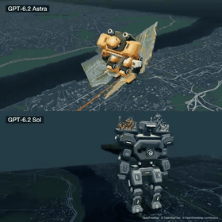</a> <b><a href="https://x.com/simonw/status/2122822310428279136">Yonkers rising as a mech to stomp across New York: GPT-6.2 Astra vs GPT-6.2 Sol</a></b> <a href="https://x.com/simonw">@simonw</a> · 0:20 · <a href="https://x.com/simonw/status/2122822310428279136">original post on X</a></td>
</tr>
<tr>
<td width="33%" valign="top"><a href="https://x.com/rubenssoto_ai/status/2122879969420566740">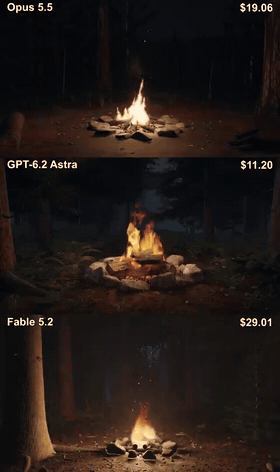</a> <b><a href="https://x.com/rubenssoto_ai/status/2122879969420566740">A campfire in a forest at night: GPT-6.2 Astra vs Fable 5.2 vs Opus 5.5</a></b> <a href="https://x.com/rubenssoto_ai">@rubenssoto_ai</a> · 0:30 · <a href="https://x.com/rubenssoto_ai/status/2122879969420566740">original post on X</a></td>
<td width="33%" valign="top"><a href="https://x.com/EnvolDev/status/2122788867694858629">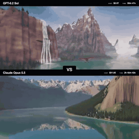</a> <b><a href="https://x.com/EnvolDev/status/2122788867694858629">The Alpine Gold plane: GPT-6.2 Sol at $2.07 vs Opus 5.5 at $31.85</a></b> <a href="https://x.com/EnvolDev">@EnvolDev</a> · 0:25 · <a href="https://x.com/EnvolDev/status/2122788867694858629">original post on X</a></td>
<td width="33%" valign="top"><a href="https://x.com/PhysAIAnalysis/status/2122830478663434403">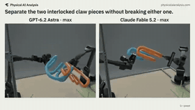</a> <b><a href="https://x.com/PhysAIAnalysis/status/2122830478663434403">Pulling apart two interlocked claw pieces: GPT-6.2 Astra vs Fable 5.2</a></b> <a href="https://x.com/PhysAIAnalysis">@PhysAIAnalysis</a> · 0:19 · <a href="https://x.com/PhysAIAnalysis/status/2122830478663434403">original post on X</a></td>
</tr>
<tr>
<td width="33%" valign="top"><a href="https://x.com/camperaigg/status/2122794828266377538">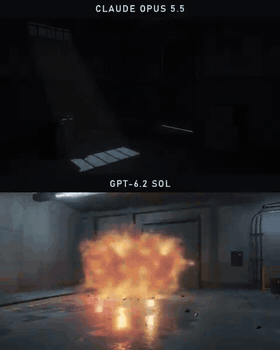</a> <b><a href="https://x.com/camperaigg/status/2122794828266377538">An explosion with fire and sound, all in code: GPT-6.2 Sol vs Opus 5.5 on Xhigh</a></b> <a href="https://x.com/camperaigg">@camperaigg</a> · 0:24 · <a href="https://x.com/camperaigg/status/2122794828266377538">original post on X</a></td>
<td width="33%" valign="top"><a href="https://x.com/R2Cdev_/status/2122763544194330627">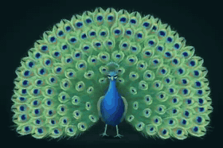</a> <b><a href="https://x.com/R2Cdev_/status/2122763544194330627">The peacock SVG test at Max: GPT-6.2 Astra vs Fable 5.2</a></b> <a href="https://x.com/R2Cdev_">@R2Cdev_</a> · 0:16 · <a href="https://x.com/R2Cdev_/status/2122763544194330627">original post on X</a></td>
<td width="33%" valign="top"> <b><a href="https://x.com/Angaisb_/status/2122762815757017410">A coin passing between two phones in SVG: Gemini 4 Carbon vs GPT-6.2 Astra</a></b> <a href="https://x.com/Angaisb_">@Angaisb_</a> · 0:28 · <a href="https://x.com/Angaisb_/status/2122762815757017410">original post on X</a></td>
</tr>
<tr>
<td width="33%" valign="top"><a href="https://x.com/Da7_Tech/status/2122835492500893992">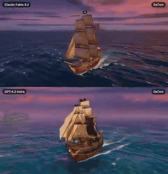</a> <b><a href="https://x.com/Da7_Tech/status/2122835492500893992">A pirate ship at sunset: GPT-6.2 Astra vs Fable 5.2</a></b> <a href="https://x.com/Da7_Tech">@Da7_Tech</a> · 0:29 · <a href="https://x.com/Da7_Tech/status/2122835492500893992">original post on X</a></td>
<td width="33%" valign="top"><a href="https://x.com/sshayahmet/status/2122778769597554693">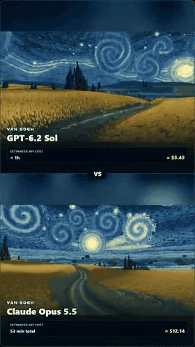</a> <b><a href="https://x.com/sshayahmet/status/2122778769597554693">A Van Gogh-style Gaussian splat world: GPT-6.2 Sol vs Opus 5.5</a></b> <a href="https://x.com/sshayahmet">@sshayahmet</a> · 0:20 · <a href="https://x.com/sshayahmet/status/2122778769597554693">original post on X</a></td>
<td width="33%" valign="top"><a href="https://x.com/LuminaBench/status/2122768776663839206">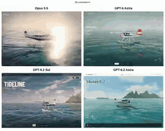</a> <b><a href="https://x.com/LuminaBench/status/2122768776663839206">The 3D seaplane test, now with GPT-6.2 Astra</a></b> <a href="https://x.com/LuminaBench">@LuminaBench</a> · 0:39 · <a href="https://x.com/LuminaBench/status/2122768776663839206">original post on X</a></td>
</tr>
<tr>
<td width="33%" valign="top"><a href="https://x.com/Super_Nius/status/2122763107793850483">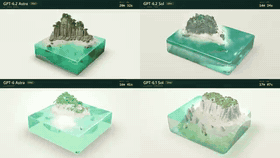</a> <b><a href="https://x.com/Super_Nius/status/2122763107793850483">An island in a block of clear sea: GPT-6.2 Astra and Sol vs GPT-6 Astra and GPT-6.1 Sol</a></b> <a href="https://x.com/Super_Nius">@Super_Nius</a> · 0:24 · <a href="https://x.com/Super_Nius/status/2122763107793850483">original post on X</a></td>
<td width="33%" valign="top"><a href="https://x.com/MrTacticalX/status/2122810159970029910">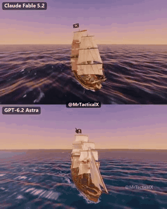</a> <b><a href="https://x.com/MrTacticalX/status/2122810159970029910">A pirate ship from the same prompt: GPT-6.2 Astra at $3.20 vs Fable 5.2 at $34.41</a></b> <a href="https://x.com/MrTacticalX">@MrTacticalX</a> · 0:25 · <a href="https://x.com/MrTacticalX/status/2122810159970029910">original post on X</a></td>
<td width="33%" valign="top"><a href="https://x.com/fawnunwrap/status/2122809542660825292">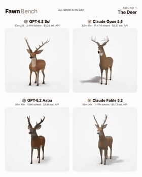</a> <b><a href="https://x.com/fawnunwrap/status/2122809542660825292">A 3D deer on FawnBench: GPT-6.2 Sol and Astra vs Opus 5.5 and Fable 5.2</a></b> <a href="https://x.com/fawnunwrap">@fawnunwrap</a> · 0:16 · <a href="https://x.com/fawnunwrap/status/2122809542660825292">original post on X</a></td>
</tr>
<tr>
<td width="33%" valign="top"><a href="https://x.com/jony_palino/status/2122796926961647919">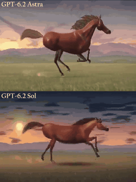</a> <b><a href="https://x.com/jony_palino/status/2122796926961647919">A horse galloping at sunset: GPT-6.2 Astra vs GPT-6.2 Sol</a></b> <a href="https://x.com/jony_palino">@jony_palino</a> · 0:17 · <a href="https://x.com/jony_palino/status/2122796926961647919">original post on X</a></td>
<td width="33%" valign="top"> <b><a href="https://x.com/thtbee_/status/2122810531669311645">A mechanical bee: GPT-6.2 Astra in 1 h 12 min vs GPT-6.2 Sol in 43 min</a></b> <a href="https://x.com/thtbee_">@thtbee_</a> · 0:34 · <a href="https://x.com/thtbee_/status/2122810531669311645">original post on X</a></td>
<td width="33%" valign="top"><a href="https://x.com/Angaisb_/status/2122808937154052311">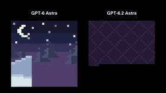</a> <b><a href="https://x.com/Angaisb_/status/2122808937154052311">Pixel art side by side: GPT-6 Astra vs GPT-6.2 Astra</a></b> <a href="https://x.com/Angaisb_">@Angaisb_</a> · 0:10 · <a href="https://x.com/Angaisb_/status/2122808937154052311">original post on X</a></td>
</tr>
<tr>
<td width="33%" valign="top"><a href="https://x.com/maxt3chno/status/2122855198913663480">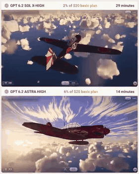</a> <b><a href="https://x.com/maxt3chno/status/2122855198913663480">A propeller fighter above the clouds in Three.js: GPT-6.2 Sol vs GPT-6.2 Astra</a></b> <a href="https://x.com/maxt3chno">@maxt3chno</a> · 0:20 · <a href="https://x.com/maxt3chno/status/2122855198913663480">original post on X</a></td>
<td width="33%" valign="top"><a href="https://x.com/RezAIT00/status/2122758069784621228">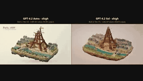</a> <b><a href="https://x.com/RezAIT00/status/2122758069784621228">A Paris diorama with the Eiffel Tower at xhigh: GPT-6.2 Astra vs GPT-6.2 Sol</a></b> <a href="https://x.com/RezAIT00">@RezAIT00</a> · 0:14 · <a href="https://x.com/RezAIT00/status/2122758069784621228">original post on X</a></td>
<td width="33%" valign="top"> <b><a href="https://x.com/itssotsot/status/2122815187010883798">An ink drop spreading into a Rorschach shape: GPT-6.2 Astra vs Fable 5.2 on high</a></b> <a href="https://x.com/itssotsot">@itssotsot</a> · 0:17 · <a href="https://x.com/itssotsot/status/2122815187010883798">original post on X</a></td>
</tr>
<tr>
<td width="33%" valign="top"> <b><a href="https://x.com/vib3coded/status/2122871498792964445">A wobbly pineapple jelly to poke: GPT-6.2 Astra vs Opus 5.5</a></b> <a href="https://x.com/vib3coded">@vib3coded</a> · 0:18 · <a href="https://x.com/vib3coded/status/2122871498792964445">original post on X</a></td>
<td width="33%" valign="top"> <b><a href="https://x.com/HyunSeob_/status/2122885341862645774">A paper crane unfolds a night city in Blender: GPT-6.2 Astra vs Fable 5.2 vs Gemini 4 Carbon</a></b> <a href="https://x.com/HyunSeob_">@HyunSeob_</a> · 0:24 · <a href="https://x.com/HyunSeob_/status/2122885341862645774">original post on X</a></td>
<td width="33%" valign="top"><a href="https://x.com/kickingkeys/status/2122820440070693323">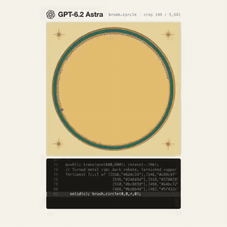</a> <b><a href="https://x.com/kickingkeys/status/2122820440070693323">Painting by writing code: GPT-6.2 Astra vs GPT-6 Astra, Fable 5.2 and Gemini 4 Carbon</a></b> <a href="https://x.com/kickingkeys">@kickingkeys</a> · 0:26 · <a href="https://x.com/kickingkeys/status/2122820440070693323">original post on X</a></td>
</tr>
<tr>
<td width="33%" valign="top"><a href="https://x.com/GKev1n/status/2122862960179884241">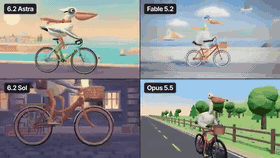</a> <b><a href="https://x.com/GKev1n/status/2122862960179884241">A pelican riding a bicycle, all in code: GPT-6.2 Astra vs Fable 5.2 and Opus 5.5</a></b> <a href="https://x.com/GKev1n">@GKev1n</a> · 0:11 · <a href="https://x.com/GKev1n/status/2122862960179884241">original post on X</a></td>
<td width="33%" valign="top"><a href="https://x.com/Mr_Salio/status/2122790293095448948">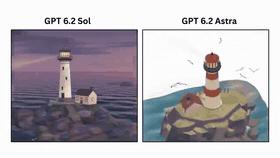</a> <b><a href="https://x.com/Mr_Salio/status/2122790293095448948">A lighthouse on a rocky islet, each rendering its own video: GPT-6.2 Sol vs GPT-6.2 Astra</a></b> <a href="https://x.com/Mr_Salio">@Mr_Salio</a> · 0:20 · <a href="https://x.com/Mr_Salio/status/2122790293095448948">original post on X</a></td>
<td width="33%" valign="top"><a href="https://x.com/DanielZambrini/status/2122759375337214121">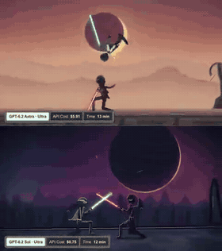</a> <b><a href="https://x.com/DanielZambrini/status/2122759375337214121">A stickman duel with glowing blades at Ultra: Astra in 13 min vs Sol in 12 min</a></b> <a href="https://x.com/DanielZambrini">@DanielZambrini</a> · 0:15 · <a href="https://x.com/DanielZambrini/status/2122759375337214121">original post on X</a></td>
</tr>
<tr>
<td width="33%" valign="top"> <b><a href="https://x.com/MrTacticalX/status/2122790417628610914">A Rubik's cube shattering: GPT-6.2 Astra in 47 min for $3.77 vs Fable 5.2</a></b> <a href="https://x.com/MrTacticalX">@MrTacticalX</a> · 0:16 · <a href="https://x.com/MrTacticalX/status/2122790417628610914">original post on X</a></td>
</tr>
</table>

## Make your own

- [Claude Fable 5.2 videos](https://claude-motion.com/fable-5-2-videos): the same kind of list for Anthropic's model ([GitHub](https://github.com/hideewsj-maker/awesome-fable-5-2-videos)).
- [HTML to video](https://claude-motion.com/html-to-video): paste the HTML the model wrote and save it as MP4, GIF or WebM, free, in your browser.
- [Motion Director](https://github.com/hideewsj-maker/motion-skills): a free skill for Codex, Claude Code and Cursor that makes a whole film with music.

## Add a video

Open an issue or a pull request with the link to the post on X. The post should say it was made with GPT-6.2 Astra or Sol. Entries are checked by hand.

## Credit and removal

Every video belongs to the person who made it; each entry names its maker and links to the original post. Titles are descriptions of what the post says. If an entry is yours and you want it removed, open an issue or write to the takedown address on claude-motion.com and it comes down.

The list itself (titles, categories, this text) is CC BY 4.0. The videos and prompts are their makers'.
