# Awesome GPT-6.2 Astra and Sol Videos

[简体中文](README.zh-CN.md)

A credited list of **226 videos made with OpenAI's GPT-6.2 Astra and Sol** and shared on X since their release on November 17, 2026: 3D scenes, small games, motion graphics, music and side-by-side tests against other models. The model wrote code that draws every frame.

Watch them all, with filters, at **[claude-motion.com/gpt-6-2-videos](https://claude-motion.com/gpt-6-2-videos)**

## Motion graphics

<table>
<tr>
<td width="33%" valign="top"> <b><a href="https://x.com/viktoroddy/status/2123932620212072581">Thought That Lasts, a landing page with a point-cloud marble bust that follows the cursor</a></b> <a href="https://x.com/viktoroddy">@viktoroddy</a> · 0:07 · <a href="https://x.com/viktoroddy/status/2123932620212072581">original post on X</a></td>
<td width="33%" valign="top"><a href="https://x.com/soya_da_yoot/status/2123268369369514311">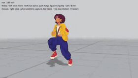</a> <b><a href="https://x.com/soya_da_yoot/status/2123268369369514311">A stylized girl running and jumping in a playable test scene</a></b> <a href="https://x.com/soya_da_yoot">@soya_da_yoot</a> · 0:16 · <a href="https://x.com/soya_da_yoot/status/2123268369369514311">original post on X</a></td>
<td width="33%" valign="top"> <b><a href="https://x.com/petergostev/status/2122816629402910859">A lifelike peacock in a misty forest, drawn in SVG</a></b> <a href="https://x.com/petergostev">@petergostev</a> · 0:55 · <a href="https://x.com/petergostev/status/2122816629402910859">original post on X</a></td>
</tr>
<tr>
<td width="33%" valign="top"> <b><a href="https://x.com/MengTo/status/2123794210721804750">A three.js landing page with mossy rocks and fog drifting between sections</a></b> <a href="https://x.com/MengTo">@MengTo</a> · 0:30 · <a href="https://x.com/MengTo/status/2123794210721804750">original post on X</a></td>
<td width="33%" valign="top"><a href="https://x.com/JungleSilicon/status/2123198696867373386">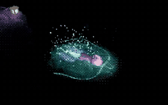</a> <b><a href="https://x.com/JungleSilicon/status/2123198696867373386">Pixel-art Gaussian splat effects: a creature trailing glowing particles through a portal</a></b> <a href="https://x.com/JungleSilicon">@JungleSilicon</a> · 0:10 · <a href="https://x.com/JungleSilicon/status/2123198696867373386">original post on X</a></td>
<td width="33%" valign="top"> <b><a href="https://x.com/gokayfem/status/2123776799188672521">A mountain lake at sunrise with mist and pines, drawn in a shader</a></b> <a href="https://x.com/gokayfem">@gokayfem</a> · 0:05 · <a href="https://x.com/gokayfem/status/2123776799188672521">original post on X</a></td>
</tr>
<tr>
<td width="33%" valign="top"> <b><a href="https://x.com/lepadphone/status/2122760193226449212">A 3D web page of a cloaked girl on a mirror lake, 13 min 32 s at High</a></b> <a href="https://x.com/lepadphone">@lepadphone</a> · 0:56 · <a href="https://x.com/lepadphone/status/2122760193226449212">original post on X</a></td>
<td width="33%" valign="top"> <b><a href="https://x.com/gokayfem/status/2123083869562003745">Sunset Ride, a shader film of a cyclist among blue monoliths in 10 KB of code</a></b> <a href="https://x.com/gokayfem">@gokayfem</a> · 0:28 · <a href="https://x.com/gokayfem/status/2123083869562003745">original post on X</a></td>
<td width="33%" valign="top"> <b><a href="https://x.com/ryoma_nakajima/status/2122995414878269633">A paper crane folding itself on a wooden table</a></b> <a href="https://x.com/ryoma_nakajima">@ryoma_nakajima</a> · 0:26 · <a href="https://x.com/ryoma_nakajima/status/2122995414878269633">original post on X</a></td>
</tr>
<tr>
<td width="33%" valign="top"> <b><a href="https://x.com/ryanflorence/status/2123809517758713977">A stylized sword-and-shield girl with combat animations</a></b> <a href="https://x.com/ryanflorence">@ryanflorence</a> · 0:12 · <a href="https://x.com/ryanflorence/status/2123809517758713977">original post on X</a></td>
<td width="33%" valign="top"> <b><a href="https://x.com/p_rabtsevich/status/2123045457958191393">A game's nebula shader, before and after a GPT-6.2 Astra pass</a></b> <a href="https://x.com/p_rabtsevich">@p_rabtsevich</a> · 0:10 · <a href="https://x.com/p_rabtsevich/status/2123045457958191393">original post on X</a></td>
<td width="33%" valign="top"> <b><a href="https://x.com/benchmark_lb900/status/2122761948903449045">A pixel-art elf character sheet, walking in four directions</a></b> <a href="https://x.com/benchmark_lb900">@benchmark_lb900</a> · 0:07 · <a href="https://x.com/benchmark_lb900/status/2122761948903449045">original post on X</a></td>
</tr>
<tr>
<td width="33%" valign="top"> <b><a href="https://x.com/studio_yebisu/status/2122766921498325224">A moth in a golden cage, a three.js music video demo</a></b> <a href="https://x.com/studio_yebisu">@studio_yebisu</a> · 1:07 · <a href="https://x.com/studio_yebisu/status/2122766921498325224">original post on X</a></td>
<td width="33%" valign="top"><a href="https://x.com/LurkShade/status/2122874484046901613">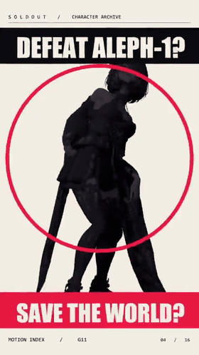</a> <b><a href="https://x.com/LurkShade/status/2122874484046901613">A poster-style motion graphic of a character striking a strange pose</a></b> <a href="https://x.com/LurkShade">@LurkShade</a> · 0:22 · <a href="https://x.com/LurkShade/status/2122874484046901613">original post on X</a></td>
<td width="33%" valign="top"> <b><a href="https://x.com/clairevo/status/2122845185512271959">An interactive storybook where a girl and a ghost follow the cursor</a></b> <a href="https://x.com/clairevo">@clairevo</a> · 0:12 · <a href="https://x.com/clairevo/status/2122845185512271959">original post on X</a></td>
</tr>
<tr>
<td width="33%" valign="top"><a href="https://x.com/loktar00/status/2123674453120840143">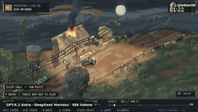</a> <b><a href="https://x.com/loktar00/status/2123674453120840143">A pixel-art dispatch rider game across a passing landscape</a></b> <a href="https://x.com/loktar00">@loktar00</a> · 0:30 · <a href="https://x.com/loktar00/status/2123674453120840143">original post on X</a></td>
<td width="33%" valign="top"> <b><a href="https://x.com/GKev1n/status/2122887519864070480">A cow running across a meadow, animated in SVG</a></b> <a href="https://x.com/GKev1n">@GKev1n</a> · 0:12 · <a href="https://x.com/GKev1n/status/2122887519864070480">original post on X</a></td>
<td width="33%" valign="top"><a href="https://x.com/ShadeLurk/status/2122831337321349384">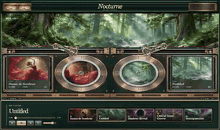</a> <b><a href="https://x.com/ShadeLurk/status/2122831337321349384">A CD jukebox in the browser, five songs in one HTML file</a></b> <a href="https://x.com/ShadeLurk">@ShadeLurk</a> · 0:20 · <a href="https://x.com/ShadeLurk/status/2122831337321349384">original post on X</a></td>
</tr>
<tr>
<td width="33%" valign="top"> <b><a href="https://x.com/Leviwoyun/status/2123681305951187449">A Dada-style paper collage animation of a drummer and a trumpeter, with sound</a></b> <a href="https://x.com/Leviwoyun">@Leviwoyun</a> · 0:59 · <a href="https://x.com/Leviwoyun/status/2123681305951187449">original post on X</a></td>
<td width="33%" valign="top"> <b><a href="https://x.com/Leviwoyun/status/2122846422676701267">A 15-second motion graphics reel from the same prompt: Astra vs Sol</a></b> <a href="https://x.com/Leviwoyun">@Leviwoyun</a> · 0:15 · <a href="https://x.com/Leviwoyun/status/2122846422676701267">original post on X</a></td>
<td width="33%" valign="top"><a href="https://x.com/camperaigg/status/2123061165735686224">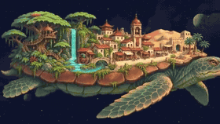</a> <b><a href="https://x.com/camperaigg/status/2123061165735686224">A pixel-art World Turtle carrying a whole town, in 23 min for $2.88</a></b> <a href="https://x.com/camperaigg">@camperaigg</a> · 0:30 · <a href="https://x.com/camperaigg/status/2123061165735686224">original post on X</a></td>
</tr>
<tr>
<td width="33%" valign="top"> <b><a href="https://x.com/AINetworkTech/status/2124780083294437585">A 3D hand designed, rigged and animated to close into a fist, fully automated</a></b> <a href="https://x.com/AINetworkTech">@AINetworkTech</a> · 0:04 · <a href="https://x.com/AINetworkTech/status/2124780083294437585">original post on X</a></td>
<td width="33%" valign="top"><a href="https://x.com/momotomo1/status/2122931210917990653">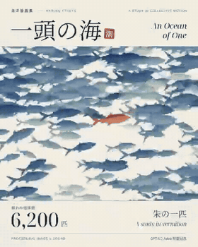</a> <b><a href="https://x.com/momotomo1/status/2122931210917990653">An Ocean of One, a red fish among 6,200 whose school becomes a whale</a></b> <a href="https://x.com/momotomo1">@momotomo1</a> · 0:18 · <a href="https://x.com/momotomo1/status/2122931210917990653">original post on X</a></td>
</tr>
</table>

## Explainers

<table>
<tr>
<td width="33%" valign="top"><a href="https://x.com/TokenGremlin/status/2124171631320875451">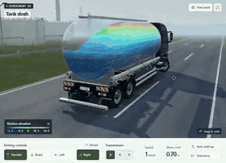</a> <b><a href="https://x.com/TokenGremlin/status/2124171631320875451">A tank truck sloshing simulation with a fluid heatmap, modeled in Blender</a></b> <a href="https://x.com/TokenGremlin">@TokenGremlin</a> · 0:44 · <a href="https://x.com/TokenGremlin/status/2124171631320875451">original post on X</a></td>
<td width="33%" valign="top"><a href="https://x.com/gabrielchua/status/2122772868270579949">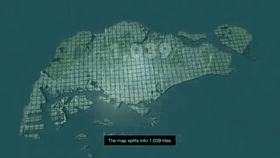</a> <b><a href="https://x.com/gabrielchua/status/2122772868270579949">A short video on how the Singapore replica was made</a></b> <a href="https://x.com/gabrielchua">@gabrielchua</a> · 1:59 · <a href="https://x.com/gabrielchua/status/2122772868270579949">original post on X</a></td>
<td width="33%" valign="top"> <b><a href="https://x.com/csaba_kissi/status/2124806236696891466">Cycle Lab, an interactive heat pump explainer with a 3D unit and narration</a></b> <a href="https://x.com/csaba_kissi">@csaba_kissi</a> · 1:32 · <a href="https://x.com/csaba_kissi/status/2124806236696891466">original post on X</a></td>
</tr>
<tr>
<td width="33%" valign="top"> <b><a href="https://x.com/MelissaKampers/status/2124286667288891534">A short explainer of the Riemann Hypothesis, every frame and sound made by code, Sol in 12 minutes</a></b> <a href="https://x.com/MelissaKampers">@MelissaKampers</a> · 0:59 · <a href="https://x.com/MelissaKampers/status/2124286667288891534">original post on X</a></td>
<td width="33%" valign="top"> <b><a href="https://x.com/RohanArun/status/2123601627412038120">How GPT-6.2 Astra disproved a geometry conjecture in 30 minutes, explained with dots on a curve</a></b> <a href="https://x.com/RohanArun">@RohanArun</a> · 1:53 · <a href="https://x.com/RohanArun/status/2123601627412038120">original post on X</a></td>
<td width="33%" valign="top"> <b><a href="https://x.com/Skoorbkaz/status/2123205785245134924">The Paths They Took, an interpretive explainer where a starling murmuration turns into particle trails</a></b> <a href="https://x.com/Skoorbkaz">@Skoorbkaz</a> · 2:00 · <a href="https://x.com/Skoorbkaz/status/2123205785245134924">original post on X</a></td>
</tr>
</table>

## Animated films

<table>
<tr>
<td width="33%" valign="top"><a href="https://x.com/chetaslua/status/2123051098730799214">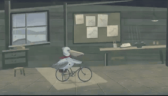</a> <b><a href="https://x.com/chetaslua/status/2123051098730799214">Pelicans on bicycles by the sea, a hand-drawn-look short in pure code</a></b> <a href="https://x.com/chetaslua">@chetaslua</a> · 0:57 · <a href="https://x.com/chetaslua/status/2123051098730799214">original post on X</a></td>
<td width="33%" valign="top"> <b><a href="https://x.com/rockeymen/status/2123605250825486383">A kitten's adventure in a room, a 3D scene rendered in code and open-sourced under MIT</a></b> <a href="https://x.com/rockeymen">@rockeymen</a> · 0:20 · <a href="https://x.com/rockeymen/status/2123605250825486383">original post on X</a></td>
<td width="33%" valign="top"> <b><a href="https://x.com/dingchilling/status/2124166516476461488">Little cartoon explorers crossing a desert to a treasure chest, made in Blender</a></b> <a href="https://x.com/dingchilling">@dingchilling</a> · 0:27 · <a href="https://x.com/dingchilling/status/2124166516476461488">original post on X</a></td>
</tr>
<tr>
<td width="33%" valign="top"><a href="https://x.com/notjazii/status/2123455282806456524">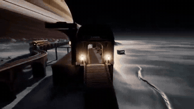</a> <b><a href="https://x.com/notjazii/status/2123455282806456524">Last Train to Saturn, a train ride toward Saturn made in Blender and rendered in Unreal Engine</a></b> <a href="https://x.com/notjazii">@notjazii</a> · 1:22 · <a href="https://x.com/notjazii/status/2123455282806456524">original post on X</a></td>
<td width="33%" valign="top"> <b><a href="https://x.com/sarischerika/status/2123631976284602806">Cheeky Angel Runs Through the Palace City, 3D by GPT-6.2 Astra, video and music by Fable 5.2</a></b> <a href="https://x.com/sarischerika">@sarischerika</a> · 0:36 · <a href="https://x.com/sarischerika/status/2123631976284602806">original post on X</a></td>
<td width="33%" valign="top"> <b><a href="https://x.com/sonuv_dev/status/2124757635530698771">A papercraft animation of a mouse on a boat, sound effects and all in code, 30 minutes</a></b> <a href="https://x.com/sonuv_dev">@sonuv_dev</a> · 0:28 · <a href="https://x.com/sonuv_dev/status/2124757635530698771">original post on X</a></td>
</tr>
</table>

## 3D scenes and games

<table>
<tr>
<td width="33%" valign="top"><a href="https://x.com/soyukke_game/status/2122767541823225891">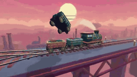</a> <b><a href="https://x.com/soyukke_game/status/2122767541823225891">A little steam train through a pink city in the sky, at xhigh</a></b> <a href="https://x.com/soyukke_game">@soyukke_game</a> · 0:24 · <a href="https://x.com/soyukke_game/status/2122767541823225891">original post on X</a></td>
<td width="33%" valign="top"> <b><a href="https://x.com/anshuc/status/2124295323602542976">An explorable robot city, built by 28 Astra subagents in 6 hours</a></b> <a href="https://x.com/anshuc">@anshuc</a> · 0:28 · <a href="https://x.com/anshuc/status/2124295323602542976">original post on X</a></td>
<td width="33%" valign="top"> <b><a href="https://x.com/Aprilzz423/status/2123788440714260673">Pocket City, tiny hand-drawn cities measured from OpenStreetMap</a></b> <a href="https://x.com/Aprilzz423">@Aprilzz423</a> · 0:24 · <a href="https://x.com/Aprilzz423/status/2123788440714260673">original post on X</a></td>
</tr>
<tr>
<td width="33%" valign="top"> <b><a href="https://x.com/MengTo/status/2124431846859813234">A three.js desk by a window where a glass UI switches the light to sunset</a></b> <a href="https://x.com/MengTo">@MengTo</a> · 0:33 · <a href="https://x.com/MengTo/status/2124431846859813234">original post on X</a></td>
<td width="33%" valign="top"><a href="https://x.com/Aprilzz423/status/2123250179952484477">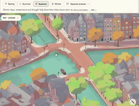</a> <b><a href="https://x.com/Aprilzz423/status/2123250179952484477">Pocket City at street level: an Amsterdam canal and Shanghai's Anfu Road through the seasons</a></b> <a href="https://x.com/Aprilzz423">@Aprilzz423</a> · 0:32 · <a href="https://x.com/Aprilzz423/status/2123250179952484477">original post on X</a></td>
<td width="33%" valign="top"> <b><a href="https://x.com/Dimillian/status/2122753859281928626">Paris at 1:1, walkable and drivable, with traffic and 50+ landmarks</a></b> <a href="https://x.com/Dimillian">@Dimillian</a> · 0:30 · <a href="https://x.com/Dimillian/status/2122753859281928626">original post on X</a></td>
</tr>
<tr>
<td width="33%" valign="top"> <b><a href="https://x.com/Dimillian/status/2122750651998355800">The nave of Notre-Dame in Unreal Engine 5, from photos and a historic floor plan</a></b> <a href="https://x.com/Dimillian">@Dimillian</a> · 0:56 · <a href="https://x.com/Dimillian/status/2122750651998355800">original post on X</a></td>
<td width="33%" valign="top"> <b><a href="https://x.com/HaileyAILabs/status/2123240665794687370">A 3D fairy-tale village from one reference image: eight houses and a turning waterwheel</a></b> <a href="https://x.com/HaileyAILabs">@HaileyAILabs</a> · 0:31 · <a href="https://x.com/HaileyAILabs/status/2123240665794687370">original post on X</a></td>
<td width="33%" valign="top"><a href="https://x.com/givros/status/2122816304071803109">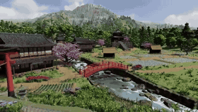</a> <b><a href="https://x.com/givros/status/2122816304071803109">Kasane Valley, a Japanese village in a green valley, in Blender and three.js</a></b> <a href="https://x.com/givros">@givros</a> · 1:20 · <a href="https://x.com/givros/status/2122816304071803109">original post on X</a></td>
</tr>
<tr>
<td width="33%" valign="top"> <b><a href="https://x.com/mark_k/status/2123027307560583230">A photoreal Gothic cathedral facade under a blue sky</a></b> <a href="https://x.com/mark_k">@mark_k</a> · 0:14 · <a href="https://x.com/mark_k/status/2123027307560583230">original post on X</a></td>
<td width="33%" valign="top"> <b><a href="https://x.com/vib3coded/status/2122800268706259244">A pixel-art jet game in one HTML file, 36 minutes and $5.31</a></b> <a href="https://x.com/vib3coded">@vib3coded</a> · 0:14 · <a href="https://x.com/vib3coded/status/2122800268706259244">original post on X</a></td>
<td width="33%" valign="top"> <b><a href="https://x.com/neviannn/status/2123859318936064193">A moonlit forest creek with a cabin on the hill, explorable in the browser</a></b> <a href="https://x.com/neviannn">@neviannn</a> · 0:57 · <a href="https://x.com/neviannn/status/2123859318936064193">original post on X</a></td>
</tr>
<tr>
<td width="33%" valign="top"> <b><a href="https://x.com/javpixel_art/status/2124209140700533065">The Hall, a walk down a dark sci-fi corridor, all procedural geometry in three.js</a></b> <a href="https://x.com/javpixel_art">@javpixel_art</a> · 0:28 · <a href="https://x.com/javpixel_art/status/2124209140700533065">original post on X</a></td>
<td width="33%" valign="top"> <b><a href="https://x.com/Da7_Tech/status/2122826218764439645">A pirate ship under a skull-and-crossbones sail at sunset</a></b> <a href="https://x.com/Da7_Tech">@Da7_Tech</a> · 0:29 · <a href="https://x.com/Da7_Tech/status/2122826218764439645">original post on X</a></td>
<td width="33%" valign="top"><a href="https://x.com/soya_da_yoot/status/2122801036247376224">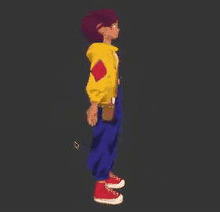</a> <b><a href="https://x.com/soya_da_yoot/status/2122801036247376224">A stylized 3D girl in a yellow jacket, with the run still going</a></b> <a href="https://x.com/soya_da_yoot">@soya_da_yoot</a> · 0:19 · <a href="https://x.com/soya_da_yoot/status/2122801036247376224">original post on X</a></td>
</tr>
<tr>
<td width="33%" valign="top"> <b><a href="https://x.com/AmirMushich/status/2122790354781192518">A robotic hand in Blender, beside its reference image</a></b> <a href="https://x.com/AmirMushich">@AmirMushich</a> · 0:12 · <a href="https://x.com/AmirMushich/status/2122790354781192518">original post on X</a></td>
<td width="33%" valign="top"> <b><a href="https://x.com/givros/status/2124404063802429838">Valley of the Aqueduct, a walk past vineyards and a Roman aqueduct, made with Sol in 44 minutes</a></b> <a href="https://x.com/givros">@givros</a> · 1:12 · <a href="https://x.com/givros/status/2124404063802429838">original post on X</a></td>
<td width="33%" valign="top"> <b><a href="https://x.com/givros/status/2123306526878437857">Temple of the Canopy, an FPS built in 4 h 54 min with Blender, Three.js and Unreal Engine 5.9</a></b> <a href="https://x.com/givros">@givros</a> · 1:28 · <a href="https://x.com/givros/status/2123306526878437857">original post on X</a></td>
</tr>
<tr>
<td width="33%" valign="top"> <b><a href="https://x.com/RicardoJrkxl/status/2123753043971784997">A tactical auto-battler on a lunar campaign map, made in under an hour</a></b> <a href="https://x.com/RicardoJrkxl">@RicardoJrkxl</a> · 0:42 · <a href="https://x.com/RicardoJrkxl/status/2123753043971784997">original post on X</a></td>
<td width="33%" valign="top"> <b><a href="https://x.com/BeamManP/status/2123695711120420988">A sprite-stacked pixel island where little ships leave ripples</a></b> <a href="https://x.com/BeamManP">@BeamManP</a> · 0:25 · <a href="https://x.com/BeamManP/status/2123695711120420988">original post on X</a></td>
<td width="33%" valign="top"> <b><a href="https://x.com/emollick/status/2122781928726437902">A Coast Guard cutter game in the War of Independence, made in Blender and Unity</a></b> <a href="https://x.com/emollick">@emollick</a> · 0:45 · <a href="https://x.com/emollick/status/2122781928726437902">original post on X</a></td>
</tr>
<tr>
<td width="33%" valign="top"> <b><a href="https://x.com/gabrielchua/status/2122762679760883967">All of Singapore at 1:1 scale, over 100 hours of work</a></b> <a href="https://x.com/gabrielchua">@gabrielchua</a> · 0:30 · <a href="https://x.com/gabrielchua/status/2122762679760883967">original post on X</a></td>
<td width="33%" valign="top"> <b><a href="https://x.com/diegocabezas01/status/2124854982235373664">A window seat on a train crossing the Swiss Alps, all code in one HTML file</a></b> <a href="https://x.com/diegocabezas01">@diegocabezas01</a> · 0:46 · <a href="https://x.com/diegocabezas01/status/2124854982235373664">original post on X</a></td>
<td width="33%" valign="top"> <b><a href="https://x.com/vib3coded/status/2123475293575037089">A Three.js game running across a mirror sea under a solar eclipse, built for $18.21</a></b> <a href="https://x.com/vib3coded">@vib3coded</a> · 0:18 · <a href="https://x.com/vib3coded/status/2123475293575037089">original post on X</a></td>
</tr>
<tr>
<td width="33%" valign="top"><a href="https://x.com/MengTo/status/2123079701384269871">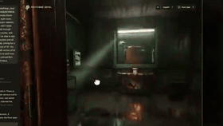</a> <b><a href="https://x.com/MengTo/status/2123079701384269871">three.js and Blender web scenes: a lantern-lit room, a pagoda stairway and misty falls</a></b> <a href="https://x.com/MengTo">@MengTo</a> · 0:39 · <a href="https://x.com/MengTo/status/2123079701384269871">original post on X</a></td>
<td width="33%" valign="top"><a href="https://x.com/givros/status/2123133158124036295">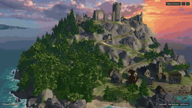</a> <b><a href="https://x.com/givros/status/2123133158124036295">Gullwatch Isle, a walk from a timbered village to castle ruins at sunset, in Blender and three.js</a></b> <a href="https://x.com/givros">@givros</a> · 1:29 · <a href="https://x.com/givros/status/2123133158124036295">original post on X</a></td>
<td width="33%" valign="top"><a href="https://x.com/emollick/status/2123256864125202670">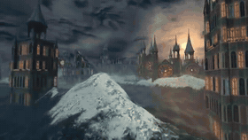</a> <b><a href="https://x.com/emollick/status/2123256864125202670">A procedural shader of a drowned neo-Gothic city, waves crashing between spires</a></b> <a href="https://x.com/emollick">@emollick</a> · 0:20 · <a href="https://x.com/emollick/status/2123256864125202670">original post on X</a></td>
</tr>
<tr>
<td width="33%" valign="top"> <b><a href="https://x.com/Fomsky_Wei/status/2123114460470747220">A photoreal lakeside cabin with a wooden dock and rowboat, in three.js</a></b> <a href="https://x.com/Fomsky_Wei">@Fomsky_Wei</a> · 0:12 · <a href="https://x.com/Fomsky_Wei/status/2123114460470747220">original post on X</a></td>
<td width="33%" valign="top"><a href="https://x.com/TokenGremlin/status/2123797090274885924">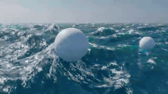</a> <b><a href="https://x.com/TokenGremlin/status/2123797090274885924">Floating balls bobbing on an ocean simulation, from a reference image, in one HTML file</a></b> <a href="https://x.com/TokenGremlin">@TokenGremlin</a> · 0:16 · <a href="https://x.com/TokenGremlin/status/2123797090274885924">original post on X</a></td>
<td width="33%" valign="top"> <b><a href="https://x.com/gamemangaanime/status/2122810072447521194">A chibi 3D character from a reference image, one shot with Blender MCP</a></b> <a href="https://x.com/gamemangaanime">@gamemangaanime</a> · 0:11 · <a href="https://x.com/gamemangaanime/status/2122810072447521194">original post on X</a></td>
</tr>
<tr>
<td width="33%" valign="top"><a href="https://x.com/TokenGremlin/status/2124186601118990667">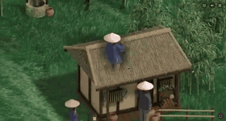</a> <b><a href="https://x.com/TokenGremlin/status/2124186601118990667">3D village assets with thatched huts and villagers, modeled by Sol in Blender and animated by Astra</a></b> <a href="https://x.com/TokenGremlin">@TokenGremlin</a> · 0:19 · <a href="https://x.com/TokenGremlin/status/2124186601118990667">original post on X</a></td>
<td width="33%" valign="top"> <b><a href="https://x.com/vib3coded/status/2124460137976942676">A stormy sea with bobbing buoys, made in 15 minutes for $11.87</a></b> <a href="https://x.com/vib3coded">@vib3coded</a> · 0:18 · <a href="https://x.com/vib3coded/status/2124460137976942676">original post on X</a></td>
<td width="33%" valign="top"><a href="https://x.com/itssotsot/status/2123752414679334944">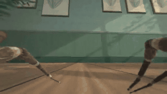</a> <b><a href="https://x.com/itssotsot/status/2123752414679334944">A spider's point of view crawling across a room, legs in frame</a></b> <a href="https://x.com/itssotsot">@itssotsot</a> · 0:38 · <a href="https://x.com/itssotsot/status/2123752414679334944">original post on X</a></td>
</tr>
<tr>
<td width="33%" valign="top"> <b><a href="https://x.com/TokenGremlin/status/2123973599488798865">An ocean survival game with storms and a leviathan, Blender assets in one three.js HTML file</a></b> <a href="https://x.com/TokenGremlin">@TokenGremlin</a> · 1:25 · <a href="https://x.com/TokenGremlin/status/2123973599488798865">original post on X</a></td>
<td width="33%" valign="top"> <b><a href="https://x.com/imnotchalk/status/2123164754898514354">Vancouver's Science World at night with the SkyTrain, in Blender and three.js</a></b> <a href="https://x.com/imnotchalk">@imnotchalk</a> · 1:00 · <a href="https://x.com/imnotchalk/status/2123164754898514354">original post on X</a></td>
<td width="33%" valign="top"> <b><a href="https://x.com/diegocabezas01/status/2123040525997719797">Tokyo Nocturne, a walk down a rainy neon alley at night, GPT-6.2 Astra Ultra</a></b> <a href="https://x.com/diegocabezas01">@diegocabezas01</a> · 1:28 · <a href="https://x.com/diegocabezas01/status/2123040525997719797">original post on X</a></td>
</tr>
<tr>
<td width="33%" valign="top"><a href="https://x.com/PawelJLisowski/status/2122977741993660867">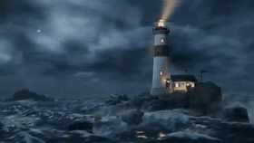</a> <b><a href="https://x.com/PawelJLisowski/status/2122977741993660867">A lighthouse in a violent night storm, one Python script in Blender: GPT-6.2 Astra's version</a></b> <a href="https://x.com/PawelJLisowski">@PawelJLisowski</a> · 0:10 · <a href="https://x.com/PawelJLisowski/status/2122977741993660867">original post on X</a></td>
<td width="33%" valign="top"><a href="https://x.com/diegocabezas01/status/2124125928640885180">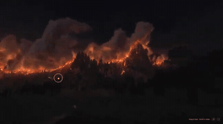</a> <b><a href="https://x.com/diegocabezas01/status/2124125928640885180">A wildfire along a mountain ridge at night, seen from the valley, in one HTML file</a></b> <a href="https://x.com/diegocabezas01">@diegocabezas01</a> · 0:48 · <a href="https://x.com/diegocabezas01/status/2124125928640885180">original post on X</a></td>
<td width="33%" valign="top"> <b><a href="https://x.com/ouchi/status/2123707803932274901">A cute robot turned from an image into a 3D model that walks in the browser</a></b> <a href="https://x.com/ouchi">@ouchi</a> · 0:20 · <a href="https://x.com/ouchi/status/2123707803932274901">original post on X</a></td>
</tr>
<tr>
<td width="33%" valign="top"><a href="https://x.com/Dimillian/status/2123065728697778446">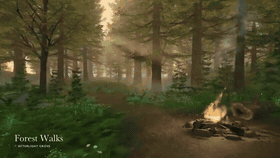</a> <b><a href="https://x.com/Dimillian/status/2123065728697778446">One forest at dusk in three styles: photoreal, storybook and liquid glass</a></b> <a href="https://x.com/Dimillian">@Dimillian</a> · 0:30 · <a href="https://x.com/Dimillian/status/2123065728697778446">original post on X</a></td>
<td width="33%" valign="top"> <b><a href="https://x.com/semichenkko/status/2123837890182414567">A floating New York diorama growing piece by piece in sprite stacking</a></b> <a href="https://x.com/semichenkko">@semichenkko</a> · 0:24 · <a href="https://x.com/semichenkko/status/2123837890182414567">original post on X</a></td>
<td width="33%" valign="top"> <b><a href="https://x.com/HaileyAILabs/status/2123938048996245591">Feng Mian Town, a Miyazaki-style 3D dream town in pure code, refined over 7 versions</a></b> <a href="https://x.com/HaileyAILabs">@HaileyAILabs</a> · 0:24 · <a href="https://x.com/HaileyAILabs/status/2123938048996245591">original post on X</a></td>
</tr>
<tr>
<td width="33%" valign="top"> <b><a href="https://x.com/LuminaBench/status/2123833392386957812">A fully flyable 3D seaplane over a lake in the Alaskan mountains</a></b> <a href="https://x.com/LuminaBench">@LuminaBench</a> · 1:42 · <a href="https://x.com/LuminaBench/status/2123833392386957812">original post on X</a></td>
<td width="33%" valign="top"> <b><a href="https://x.com/petergostev/status/2123175702719824292">Ancient Rome to fly over, down into the Colosseum with its gladiators</a></b> <a href="https://x.com/petergostev">@petergostev</a> · 1:56 · <a href="https://x.com/petergostev/status/2123175702719824292">original post on X</a></td>
<td width="33%" valign="top"><a href="https://x.com/venturetwins/status/2123609687484698714">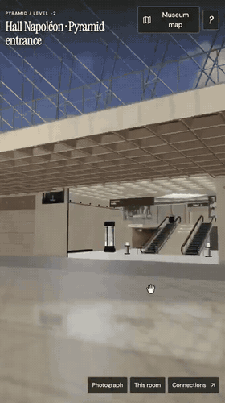</a> <b><a href="https://x.com/venturetwins/status/2123609687484698714">A walkable Louvre, from the grand staircase to the Mona Lisa room, with a card for every painting</a></b> <a href="https://x.com/venturetwins">@venturetwins</a> · 0:49 · <a href="https://x.com/venturetwins/status/2123609687484698714">original post on X</a></td>
</tr>
<tr>
<td width="33%" valign="top"><a href="https://x.com/Super_Nius/status/2122755138414920061">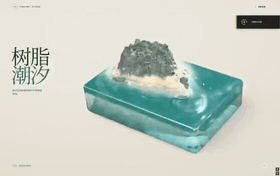</a> <b><a href="https://x.com/Super_Nius/status/2122755138414920061">An island in a jelly sea with adjustable tide and light, made with Sol in 14 minutes</a></b> <a href="https://x.com/Super_Nius">@Super_Nius</a> · 0:32 · <a href="https://x.com/Super_Nius/status/2122755138414920061">original post on X</a></td>
<td width="33%" valign="top"> <b><a href="https://x.com/neviannn/status/2124130353480626223">A moonlit swamp with cypress trees and a drifting boat, explorable in the browser</a></b> <a href="https://x.com/neviannn">@neviannn</a> · 0:18 · <a href="https://x.com/neviannn/status/2124130353480626223">original post on X</a></td>
<td width="33%" valign="top"> <b><a href="https://x.com/_satyam_ai/status/2123787482747764918">A racing game on WebGPU in Chrome, on a from-scratch engine</a></b> <a href="https://x.com/_satyam_ai">@_satyam_ai</a> · 1:09 · <a href="https://x.com/_satyam_ai/status/2123787482747764918">original post on X</a></td>
</tr>
<tr>
<td width="33%" valign="top"> <b><a href="https://x.com/Avenoxai/status/2122989369783206203">A spaceship mining in Saturn's rings, built in Blender</a></b> <a href="https://x.com/Avenoxai">@Avenoxai</a> · 0:36 · <a href="https://x.com/Avenoxai/status/2122989369783206203">original post on X</a></td>
<td width="33%" valign="top"> <b><a href="https://x.com/lemomo_ai/status/2122978121444184315">Galaxy in the Sea, 10,000 sardines scattering and re-forming around a predator, in hand-written code</a></b> <a href="https://x.com/lemomo_ai">@lemomo_ai</a> · 0:20 · <a href="https://x.com/lemomo_ai/status/2122978121444184315">original post on X</a></td>
<td width="33%" valign="top"> <b><a href="https://x.com/aarondelasy/status/2122784351322865740">A snowy city crossing full of umbrellas, one-shot in Blender</a></b> <a href="https://x.com/aarondelasy">@aarondelasy</a> · 0:14 · <a href="https://x.com/aarondelasy/status/2122784351322865740">original post on X</a></td>
</tr>
<tr>
<td width="33%" valign="top"> <b><a href="https://x.com/Bhavani_00007/status/2122767429193646141">Meridian Sound Racing, a 3D racing game</a></b> <a href="https://x.com/Bhavani_00007">@Bhavani_00007</a> · 1:00 · <a href="https://x.com/Bhavani_00007/status/2122767429193646141">original post on X</a></td>
<td width="33%" valign="top"><a href="https://x.com/Mortezabihzadeh/status/2122996874827210922">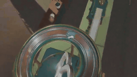</a> <b><a href="https://x.com/Mortezabihzadeh/status/2122996874827210922">A 3D desk world with a marble rolling through a machine, playable in the browser</a></b> <a href="https://x.com/Mortezabihzadeh">@Mortezabihzadeh</a> · 0:49 · <a href="https://x.com/Mortezabihzadeh/status/2122996874827210922">original post on X</a></td>
<td width="33%" valign="top"> <b><a href="https://x.com/Dimillian/status/2122799400061960611">A backrooms walk with a VHS camcorder look, full of props and biomes</a></b> <a href="https://x.com/Dimillian">@Dimillian</a> · 0:40 · <a href="https://x.com/Dimillian/status/2122799400061960611">original post on X</a></td>
</tr>
<tr>
<td width="33%" valign="top"><a href="https://x.com/kloss_xyz/status/2124646782433124652">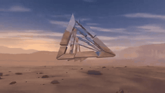</a> <b><a href="https://x.com/kloss_xyz/status/2124646782433124652">Three hyper-real scenes in raw WebGL and GLSL shaders, each in one HTML file</a></b> <a href="https://x.com/kloss_xyz">@kloss_xyz</a> · 0:28 · <a href="https://x.com/kloss_xyz/status/2124646782433124652">original post on X</a></td>
<td width="33%" valign="top"> <b><a href="https://x.com/Akki_AI7/status/2123211478241271829">Mount Fuji above a sea of clouds at sunrise, 15 seconds drawn entirely in code</a></b> <a href="https://x.com/Akki_AI7">@Akki_AI7</a> · 0:15 · <a href="https://x.com/Akki_AI7/status/2123211478241271829">original post on X</a></td>
<td width="33%" valign="top"> <b><a href="https://x.com/Dimillian/status/2122783245976908195">A walk around Notre-Dame after the move from the web to Unreal Engine 5</a></b> <a href="https://x.com/Dimillian">@Dimillian</a> · 1:21 · <a href="https://x.com/Dimillian/status/2122783245976908195">original post on X</a></td>
</tr>
<tr>
<td width="33%" valign="top"><a href="https://x.com/LexnLin/status/2123156510339465525">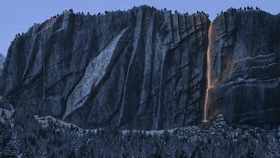</a> <b><a href="https://x.com/LexnLin/status/2123156510339465525">A firefall glowing orange down a granite cliff in winter, all code</a></b> <a href="https://x.com/LexnLin">@LexnLin</a> · 0:40 · <a href="https://x.com/LexnLin/status/2123156510339465525">original post on X</a></td>
<td width="33%" valign="top"><a href="https://x.com/coldmountainlab/status/2123075963965898864">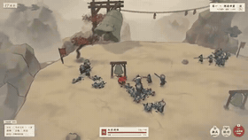</a> <b><a href="https://x.com/coldmountainlab/status/2123075963965898864">An ink-wash 3D wuxia game, with characters, effects, music and UI all made by AI</a></b> <a href="https://x.com/coldmountainlab">@coldmountainlab</a> · 1:00 · <a href="https://x.com/coldmountainlab/status/2123075963965898864">original post on X</a></td>
<td width="33%" valign="top"> <b><a href="https://x.com/FlorianGallwitz/status/2122805196938231879">A walkable Nuremberg Christmas market, half a year on with the same prompt</a></b> <a href="https://x.com/FlorianGallwitz">@FlorianGallwitz</a> · 1:23 · <a href="https://x.com/FlorianGallwitz/status/2122805196938231879">original post on X</a></td>
</tr>
<tr>
<td width="33%" valign="top"> <b><a href="https://x.com/DeryaTR_/status/2122814594737684568">A butterfly gallery website made with Sol in Blender</a></b> <a href="https://x.com/DeryaTR_">@DeryaTR_</a> · 1:30 · <a href="https://x.com/DeryaTR_/status/2122814594737684568">original post on X</a></td>
<td width="33%" valign="top"> <b><a href="https://x.com/dken_w/status/2123081219537785006">A photographer's darkroom under red safelight, in about 2,500 lines of C++</a></b> <a href="https://x.com/dken_w">@dken_w</a> · 0:14 · <a href="https://x.com/dken_w/status/2123081219537785006">original post on X</a></td>
<td width="33%" valign="top"> <b><a href="https://x.com/loktar00/status/2123778891642998857">A space battle with fighter ships and explosions</a></b> <a href="https://x.com/loktar00">@loktar00</a> · 0:30 · <a href="https://x.com/loktar00/status/2123778891642998857">original post on X</a></td>
</tr>
<tr>
<td width="33%" valign="top"> <b><a href="https://x.com/Ssr360535694/status/2124359724837863588">Yuhui, a 68 KB pixel-art flight game over lakes and autumn hills</a></b> <a href="https://x.com/Ssr360535694">@Ssr360535694</a> · 0:20 · <a href="https://x.com/Ssr360535694/status/2124359724837863588">original post on X</a></td>
<td width="33%" valign="top"> <b><a href="https://x.com/KanaWorks_AI/status/2122878806436589861">A porcelain crane machine painting a rabbit's tail, after a 4-hour run</a></b> <a href="https://x.com/KanaWorks_AI">@KanaWorks_AI</a> · 0:25 · <a href="https://x.com/KanaWorks_AI/status/2122878806436589861">original post on X</a></td>
<td width="33%" valign="top"><a href="https://x.com/Ananth7e/status/2122764162124353906">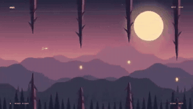</a> <b><a href="https://x.com/Ananth7e/status/2122764162124353906">A night-flight game over moonlit hills, built in 60 seconds</a></b> <a href="https://x.com/Ananth7e">@Ananth7e</a> · 0:30 · <a href="https://x.com/Ananth7e/status/2122764162124353906">original post on X</a></td>
</tr>
<tr>
<td width="33%" valign="top"><a href="https://x.com/majidmanzarpour/status/2123986686107377776">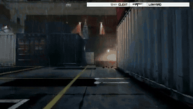</a> <b><a href="https://x.com/majidmanzarpour/status/2123986686107377776">KILLFEED, a fast browser FPS built by more than 100 AI agents</a></b> <a href="https://x.com/majidmanzarpour">@majidmanzarpour</a> · 1:16 · <a href="https://x.com/majidmanzarpour/status/2123986686107377776">original post on X</a></td>
<td width="33%" valign="top"> <b><a href="https://x.com/klausbrave/status/2122808960071917953">Particle Sheep, a particle sheep built in 20 minutes from a video reference</a></b> <a href="https://x.com/klausbrave">@klausbrave</a> · 0:15 · <a href="https://x.com/klausbrave/status/2122808960071917953">original post on X</a></td>
<td width="33%" valign="top"> <b><a href="https://x.com/xikhar/status/2123124656316219725">A wilderness game to hunt, fish and chop wood for fire, after 10 hours on xhigh</a></b> <a href="https://x.com/xikhar">@xikhar</a> · 1:40 · <a href="https://x.com/xikhar/status/2123124656316219725">original post on X</a></td>
</tr>
<tr>
<td width="33%" valign="top"><a href="https://x.com/fleetingbits/status/2124998107884867704">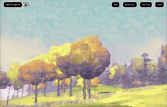</a> <b><a href="https://x.com/fleetingbits/status/2124998107884867704">A painted 3D render of Philip Johnson's Glass House among autumn trees, for a website</a></b> <a href="https://x.com/fleetingbits">@fleetingbits</a> · 0:29 · <a href="https://x.com/fleetingbits/status/2124998107884867704">original post on X</a></td>
<td width="33%" valign="top"> <b><a href="https://x.com/rubenssoto_ai/status/2124188465747173595">An open-road driving game with real crashes, built with Opus 5.5 and Astra in 2 days</a></b> <a href="https://x.com/rubenssoto_ai">@rubenssoto_ai</a> · 0:40 · <a href="https://x.com/rubenssoto_ai/status/2124188465747173595">original post on X</a></td>
<td width="33%" valign="top"> <b><a href="https://x.com/DeryaTR_/status/2122925157086114283">A walkable New York, from a subway ride under the East River up the stairs to the street</a></b> <a href="https://x.com/DeryaTR_">@DeryaTR_</a> · 2:00 · <a href="https://x.com/DeryaTR_/status/2122925157086114283">original post on X</a></td>
</tr>
<tr>
<td width="33%" valign="top"><a href="https://x.com/loktar00/status/2124876876003058040">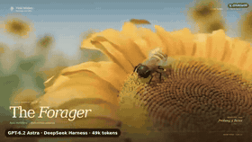</a> <b><a href="https://x.com/loktar00/status/2124876876003058040">The Forager, a photoreal honeybee on a sunflower</a></b> <a href="https://x.com/loktar00">@loktar00</a> · 0:30 · <a href="https://x.com/loktar00/status/2124876876003058040">original post on X</a></td>
<td width="33%" valign="top"><a href="https://x.com/pritopian/status/2122955868497178905">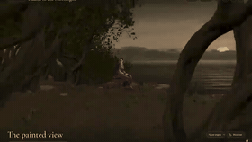</a> <b><a href="https://x.com/pritopian/status/2122955868497178905">Raja Ravi Varma's Radha in the Moonlight in 3D, with detailed sari, motifs and jewelry</a></b> <a href="https://x.com/pritopian">@pritopian</a> · 0:20 · <a href="https://x.com/pritopian/status/2122955868497178905">original post on X</a></td>
<td width="33%" valign="top"> <b><a href="https://x.com/JesusIsGod/status/2122899824722772297">Open Channel, a short game on an empty road under a storm, made in 1 hour</a></b> <a href="https://x.com/JesusIsGod">@JesusIsGod</a> · 1:57 · <a href="https://x.com/JesusIsGod/status/2122899824722772297">original post on X</a></td>
</tr>
<tr>
<td width="33%" valign="top"> <b><a href="https://x.com/op7418/status/2123071662199583137">A stone dragon coiled around a Chinese pagoda in the clouds</a></b> <a href="https://x.com/op7418">@op7418</a> · 0:08 · <a href="https://x.com/op7418/status/2123071662199583137">original post on X</a></td>
<td width="33%" valign="top"> <b><a href="https://x.com/OmoiroProject/status/2122954817144512612">A drone flight over a Kyoto-style townscape, in three.js and Blender</a></b> <a href="https://x.com/OmoiroProject">@OmoiroProject</a> · 0:30 · <a href="https://x.com/OmoiroProject/status/2122954817144512612">original post on X</a></td>
<td width="33%" valign="top"><a href="https://x.com/kloss_xyz/status/2125038756264837301">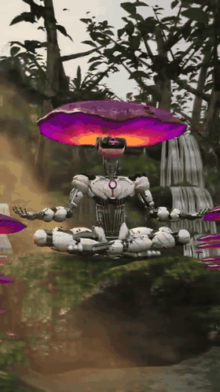</a> <b><a href="https://x.com/kloss_xyz/status/2125038756264837301">A robot under a giant pink mushroom in a mossy forest, one-shot in one HTML file</a></b> <a href="https://x.com/kloss_xyz">@kloss_xyz</a> · 0:29 · <a href="https://x.com/kloss_xyz/status/2125038756264837301">original post on X</a></td>
</tr>
<tr>
<td width="33%" valign="top"> <b><a href="https://x.com/Lokastaz/status/2123072990359232690">A pixel-art splat mini game: a little 4x4 jumping ramps and splashing through water</a></b> <a href="https://x.com/Lokastaz">@Lokastaz</a> · 0:11 · <a href="https://x.com/Lokastaz/status/2123072990359232690">original post on X</a></td>
<td width="33%" valign="top"><a href="https://x.com/baku_lab/status/2122900918941434287">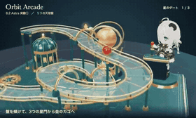</a> <b><a href="https://x.com/baku_lab/status/2122900918941434287">Orbit Arcade, a 2.74 MB marble game with a panda avatar, made without Unity</a></b> <a href="https://x.com/baku_lab">@baku_lab</a> · 0:14 · <a href="https://x.com/baku_lab/status/2122900918941434287">original post on X</a></td>
<td width="33%" valign="top"> <b><a href="https://x.com/maxt3chno/status/2123064075802296326">A playable warships mini-game built by Opus 5.5 and GPT-6.2 working in parallel</a></b> <a href="https://x.com/maxt3chno">@maxt3chno</a> · 1:10 · <a href="https://x.com/maxt3chno/status/2123064075802296326">original post on X</a></td>
</tr>
<tr>
<td width="33%" valign="top"> <b><a href="https://x.com/fxtrader/status/2122756192791662752">A pelican cycling along a beach in three.js, from internal knowledge only, at High</a></b> <a href="https://x.com/fxtrader">@fxtrader</a> · 1:14 · <a href="https://x.com/fxtrader/status/2122756192791662752">original post on X</a></td>
<td width="33%" valign="top"><a href="https://x.com/danveloper/status/2122766260811313326">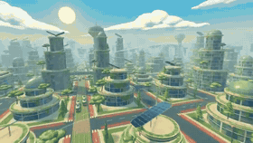</a> <b><a href="https://x.com/danveloper/status/2122766260811313326">A green city of terraced towers, built in 16 minutes at Ultra</a></b> <a href="https://x.com/danveloper">@danveloper</a> · 0:12 · <a href="https://x.com/danveloper/status/2122766260811313326">original post on X</a></td>
<td width="33%" valign="top"><a href="https://x.com/yyuntng177680/status/2123258802334310455">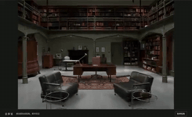</a> <b><a href="https://x.com/yyuntng177680/status/2123258802334310455">A photoreal library room with leather armchairs, modeled and ray-traced from one blurry screenshot</a></b> <a href="https://x.com/yyuntng177680">@yyuntng177680</a> · 0:14 · <a href="https://x.com/yyuntng177680/status/2123258802334310455">original post on X</a></td>
</tr>
<tr>
<td width="33%" valign="top"> <b><a href="https://x.com/muku_sns/status/2123048325247373643">Valbrune, a Swiss mountain village built in Blender with no human at the controls</a></b> <a href="https://x.com/muku_sns">@muku_sns</a> · 0:29 · <a href="https://x.com/muku_sns/status/2123048325247373643">original post on X</a></td>
<td width="33%" valign="top"> <b><a href="https://x.com/CodeByNZ/status/2122760051454562368">A flying 3D helicopter with assembly and exploded views, made with Sol in 7 minutes</a></b> <a href="https://x.com/CodeByNZ">@CodeByNZ</a> · 1:15 · <a href="https://x.com/CodeByNZ/status/2122760051454562368">original post on X</a></td>
<td width="33%" valign="top"> <b><a href="https://x.com/Masimo_Blue/status/2122846803477537071">Coral Garden, a website where you swim under the sea and poke the fish</a></b> <a href="https://x.com/Masimo_Blue">@Masimo_Blue</a> · 2:18 · <a href="https://x.com/Masimo_Blue/status/2122846803477537071">original post on X</a></td>
</tr>
<tr>
<td width="33%" valign="top"> <b><a href="https://x.com/pieash4/status/2124489245343760883">Yakiimo Catch, a cute pixel game of cat shopkeepers, made with Sol in 5 messages</a></b> <a href="https://x.com/pieash4">@pieash4</a> · 0:14 · <a href="https://x.com/pieash4/status/2124489245343760883">original post on X</a></td>
<td width="33%" valign="top"> <b><a href="https://x.com/lucian__03/status/2122782073102663874">A 3D Rube Goldberg machine in HTML, made with Sol at Max in 25 minutes for $3.03</a></b> <a href="https://x.com/lucian__03">@lucian__03</a> · 0:21 · <a href="https://x.com/lucian__03/status/2122782073102663874">original post on X</a></td>
<td width="33%" valign="top"><a href="https://x.com/mansfieldrv6/status/2123508977224831336">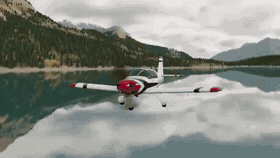</a> <b><a href="https://x.com/mansfieldrv6/status/2123508977224831336">A small aerobatic plane built from its owner's photos and blueprints, flying over mountains and a lake</a></b> <a href="https://x.com/mansfieldrv6">@mansfieldrv6</a> · 1:02 · <a href="https://x.com/mansfieldrv6/status/2123508977224831336">original post on X</a></td>
</tr>
<tr>
<td width="33%" valign="top"> <b><a href="https://x.com/lucian__03/status/2122770012234805383">A 3D city disaster simulator with tornadoes, meteors and floods, about 40 min at Max</a></b> <a href="https://x.com/lucian__03">@lucian__03</a> · 0:18 · <a href="https://x.com/lucian__03/status/2122770012234805383">original post on X</a></td>
<td width="33%" valign="top"> <b><a href="https://x.com/pr0mptcat/status/2123188810942931447">A cinematic pirate ship sailing at sunset, built for $4.86</a></b> <a href="https://x.com/pr0mptcat">@pr0mptcat</a> · 0:16 · <a href="https://x.com/pr0mptcat/status/2123188810942931447">original post on X</a></td>
<td width="33%" valign="top"><a href="https://x.com/koguGameDev/status/2123414745034400161">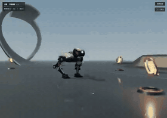</a> <b><a href="https://x.com/koguGameDev/status/2123414745034400161">mlegged, a giant spider robot and a crawler on a dark ramp, playable in Three.js</a></b> <a href="https://x.com/koguGameDev">@koguGameDev</a> · 2:03 · <a href="https://x.com/koguGameDev/status/2123414745034400161">original post on X</a></td>
</tr>
<tr>
<td width="33%" valign="top"> <b><a href="https://x.com/lemomo_ai/status/2122916161839038862">Afternoon Pool, colorful rubber ducks on rippling water, a 32 KB page of hand-written WebGL</a></b> <a href="https://x.com/lemomo_ai">@lemomo_ai</a> · 0:20 · <a href="https://x.com/lemomo_ai/status/2122916161839038862">original post on X</a></td>
<td width="33%" valign="top"> <b><a href="https://x.com/Maxq5xs/status/2122772121940308343">A lifelike pelican in a red scarf cycling by the sea at sunset</a></b> <a href="https://x.com/Maxq5xs">@Maxq5xs</a> · 0:12 · <a href="https://x.com/Maxq5xs/status/2122772121940308343">original post on X</a></td>
<td width="33%" valign="top"> <b><a href="https://x.com/pankajkumar_dev/status/2122785662734868949">The Last Phone Call, a foggy noir street with a red phone box in the rain</a></b> <a href="https://x.com/pankajkumar_dev">@pankajkumar_dev</a> · 0:31 · <a href="https://x.com/pankajkumar_dev/status/2122785662734868949">original post on X</a></td>
</tr>
<tr>
<td width="33%" valign="top"> <b><a href="https://x.com/DFintelligence/status/2122798818274017712">Marseille in 3D, its harbor at sunset</a></b> <a href="https://x.com/DFintelligence">@DFintelligence</a> · 0:35 · <a href="https://x.com/DFintelligence/status/2122798818274017712">original post on X</a></td>
</tr>
</table>

## Music

<table>
<tr>
<td width="33%" valign="top"><a href="https://x.com/rvm0n_/status/2122768551354208665">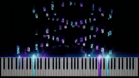</a> <b><a href="https://x.com/rvm0n_/status/2122768551354208665">An original classical piano piece, played as falling notes</a></b> <a href="https://x.com/rvm0n_">@rvm0n_</a> · 1:40 · <a href="https://x.com/rvm0n_/status/2122768551354208665">original post on X</a></td>
<td width="33%" valign="top"> <b><a href="https://x.com/aug5thmusic/status/2122767673570607401">A chorale on the Bach Benchmark, shown as a score</a></b> <a href="https://x.com/aug5thmusic">@aug5thmusic</a> · 0:51 · <a href="https://x.com/aug5thmusic/status/2122767673570607401">original post on X</a></td>
<td width="33%" valign="top"> <b><a href="https://x.com/Angaisb_/status/2122759047107444948">All the Swifts Return, a song over an illustrated harbor town</a></b> <a href="https://x.com/Angaisb_">@Angaisb_</a> · 1:50 · <a href="https://x.com/Angaisb_/status/2122759047107444948">original post on X</a></td>
</tr>
<tr>
<td width="33%" valign="top"> <b><a href="https://x.com/aug5thmusic/status/2122773822348874149">An organ fugue in C minor written in LilyPond, at Extra High effort</a></b> <a href="https://x.com/aug5thmusic">@aug5thmusic</a> · 2:47 · <a href="https://x.com/aug5thmusic/status/2122773822348874149">original post on X</a></td>
<td width="33%" valign="top"><a href="https://x.com/aug5thmusic/status/2123140487368642799">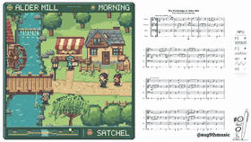</a> <b><a href="https://x.com/aug5thmusic/status/2123140487368642799">Alder Mill, a retro handheld-style pixel RPG with its music written in LilyPond, at Extra High effort</a></b> <a href="https://x.com/aug5thmusic">@aug5thmusic</a> · 1:47 · <a href="https://x.com/aug5thmusic/status/2123140487368642799">original post on X</a></td>
</tr>
</table>

## Model comparisons

<table>
<tr>
<td width="33%" valign="top"> <b><a href="https://x.com/kinderlayer/status/2124465319087308918">An engine cylinder firing in cross-section: Fable 5.2 vs GPT-6.2 Astra vs Gemini 4 Neon vs Grok 4.7</a></b> <a href="https://x.com/kinderlayer">@kinderlayer</a> · 0:12 · <a href="https://x.com/kinderlayer/status/2124465319087308918">original post on X</a></td>
<td width="33%" valign="top"> <b><a href="https://x.com/eliadele/status/2123878763624857693">A seaplane landing at Bora Bora on OutputBench: Gemini 4 Neon vs Fable 5.2 vs GPT-6.2 Astra vs Opus 5.5</a></b> <a href="https://x.com/eliadele">@eliadele</a> · 1:16 · <a href="https://x.com/eliadele/status/2123878763624857693">original post on X</a></td>
<td width="33%" valign="top"><a href="https://x.com/mizugame_22/status/2123756243827486822">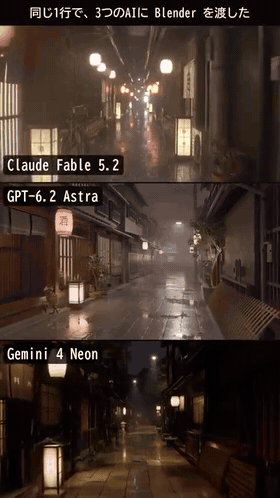</a> <b><a href="https://x.com/mizugame_22/status/2123756243827486822">A rainy night alley in Kyoto in Blender from one line: Fable 5.2 vs GPT-6.2 Astra vs Gemini 4 Neon</a></b> <a href="https://x.com/mizugame_22">@mizugame_22</a> · 0:13 · <a href="https://x.com/mizugame_22/status/2123756243827486822">original post on X</a></td>
</tr>
<tr>
<td width="33%" valign="top"> <b><a href="https://x.com/EnvolDev/status/2122773694783349144">A cathedral of ice from the same prompt: GPT-6.2 Astra vs Fable 5.2</a></b> <a href="https://x.com/EnvolDev">@EnvolDev</a> · 0:25 · <a href="https://x.com/EnvolDev/status/2122773694783349144">original post on X</a></td>
<td width="33%" valign="top"> <b><a href="https://x.com/jony_palino/status/2123889278501495127">A cyclist riding at sunset in 2D: Gemini 4 Neon vs GPT-6.2 Sol vs DeepSeek V4.1 Flash vs Fable 5.2</a></b> <a href="https://x.com/jony_palino">@jony_palino</a> · 0:16 · <a href="https://x.com/jony_palino/status/2123889278501495127">original post on X</a></td>
<td width="33%" valign="top"> <b><a href="https://x.com/EnvolDev/status/2122803967272866254">A plane from the Alpine Gold prompt: GPT-6.2 Astra vs GPT-6.2 Sol vs Fable 5.2 vs Opus 5.5</a></b> <a href="https://x.com/EnvolDev">@EnvolDev</a> · 0:25 · <a href="https://x.com/EnvolDev/status/2122803967272866254">original post on X</a></td>
</tr>
<tr>
<td width="33%" valign="top"> <b><a href="https://x.com/ChrisGPT/status/2122837291874070590">A 10-second cowboy toy film in Blender: GPT-6.2 Astra vs Fable 5.2</a></b> <a href="https://x.com/ChrisGPT">@ChrisGPT</a> · 0:10 · <a href="https://x.com/ChrisGPT/status/2122837291874070590">original post on X</a></td>
<td width="33%" valign="top"> <b><a href="https://x.com/AmirMushich/status/2122815524124152216">A robotic hand modeled and animated in Blender: GPT-6.2 Astra vs Fable 5.2</a></b> <a href="https://x.com/AmirMushich">@AmirMushich</a> · 0:12 · <a href="https://x.com/AmirMushich/status/2122815524124152216">original post on X</a></td>
<td width="33%" valign="top"> <b><a href="https://x.com/dom_scholz/status/2122862040326807696">A seabed submarine in three.js: Fable 5.2 at 242 KB vs GPT-6.2 Astra at 32.9 MB</a></b> <a href="https://x.com/dom_scholz">@dom_scholz</a> · 0:40 · <a href="https://x.com/dom_scholz/status/2122862040326807696">original post on X</a></td>
</tr>
<tr>
<td width="33%" valign="top"> <b><a href="https://x.com/LuminaBench/status/2122758425520029886">The 3D seaplane test: GPT-6.2 Sol vs GPT-6.1 Sol</a></b> <a href="https://x.com/LuminaBench">@LuminaBench</a> · 0:39 · <a href="https://x.com/LuminaBench/status/2122758425520029886">original post on X</a></td>
<td width="33%" valign="top"> <b><a href="https://x.com/MrTacticalX/status/2122806350543774075">A glass pool from the same prompt: Fable 5.2 vs GPT-6.2 Astra</a></b> <a href="https://x.com/MrTacticalX">@MrTacticalX</a> · 0:30 · <a href="https://x.com/MrTacticalX/status/2122806350543774075">original post on X</a></td>
<td width="33%" valign="top"> <b><a href="https://x.com/lemomo_ai/status/2123305001804333337">A strawberry in a melting ice cube, all on High: GPT-6.2 Astra vs Gemini 4 Neon vs Fable 5.2 vs Opus 5.5</a></b> <a href="https://x.com/lemomo_ai">@lemomo_ai</a> · 0:20 · <a href="https://x.com/lemomo_ai/status/2123305001804333337">original post on X</a></td>
</tr>
<tr>
<td width="33%" valign="top"><a href="https://x.com/N1n3VASthR33H/status/2122972313989845173">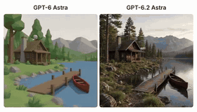</a> <b><a href="https://x.com/N1n3VASthR33H/status/2122972313989845173">A lakeside cabin with a dock and a red boat: GPT-6 Astra vs GPT-6.2 Astra</a></b> <a href="https://x.com/N1n3VASthR33H">@N1n3VASthR33H</a> · 0:08 · <a href="https://x.com/N1n3VASthR33H/status/2122972313989845173">original post on X</a></td>
<td width="33%" valign="top"> <b><a href="https://x.com/nicochristie/status/2123185990923874325">Draw With Me, a seaside cherry-blossom scene painted stroke by stroke: Fable 5.2 vs GPT-6.2 Astra</a></b> <a href="https://x.com/nicochristie">@nicochristie</a> · 0:30 · <a href="https://x.com/nicochristie/status/2123185990923874325">original post on X</a></td>
<td width="33%" valign="top"><a href="https://x.com/ZryMiller/status/2124897056280219998">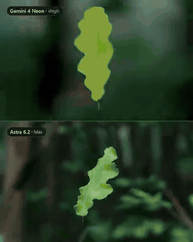</a> <b><a href="https://x.com/ZryMiller/status/2124897056280219998">A leaf falling through the four seasons: GPT-6.2 Astra at $10.15 vs Gemini 4 Neon at $15.36</a></b> <a href="https://x.com/ZryMiller">@ZryMiller</a> · 0:20 · <a href="https://x.com/ZryMiller/status/2124897056280219998">original post on X</a></td>
</tr>
<tr>
<td width="33%" valign="top"> <b><a href="https://x.com/rubenssoto_ai/status/2122793788087193650">An alpine meadow with a passing train: GPT-6.2 Astra vs Opus 5.5</a></b> <a href="https://x.com/rubenssoto_ai">@rubenssoto_ai</a> · 0:30 · <a href="https://x.com/rubenssoto_ai/status/2122793788087193650">original post on X</a></td>
<td width="33%" valign="top"><a href="https://x.com/vib3coded/status/2124245249786855836">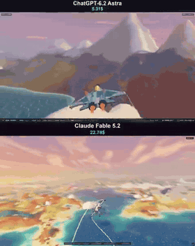</a> <b><a href="https://x.com/vib3coded/status/2124245249786855836">A flight sim over low-poly mountains: GPT-6.2 Astra at $5.31 vs Fable 5.2 at $22.78</a></b> <a href="https://x.com/vib3coded">@vib3coded</a> · 0:16 · <a href="https://x.com/vib3coded/status/2124245249786855836">original post on X</a></td>
<td width="33%" valign="top"> <b><a href="https://x.com/vib3coded/status/2124612292490752267">A koi pond from above: GPT-6.2 Astra in 28 min for $8.71 vs Fable 5.2 in 16 min for $12.44</a></b> <a href="https://x.com/vib3coded">@vib3coded</a> · 0:17 · <a href="https://x.com/vib3coded/status/2124612292490752267">original post on X</a></td>
</tr>
<tr>
<td width="33%" valign="top"> <b><a href="https://x.com/DanielZambrini/status/2123891957529510012">Life in the Eyes of a Squirrel, a 30-second code-only film: Gemini 4 Neon vs GPT-6.2 Astra vs Fable 5.2</a></b> <a href="https://x.com/DanielZambrini">@DanielZambrini</a> · 0:30 · <a href="https://x.com/DanielZambrini/status/2123891957529510012">original post on X</a></td>
<td width="33%" valign="top"> <b><a href="https://x.com/ivanainai/status/2123406931075441111">A cutaway jet engine: Gemini 4 Neon vs GPT-6.2 Astra</a></b> <a href="https://x.com/ivanainai">@ivanainai</a> · 0:26 · <a href="https://x.com/ivanainai/status/2123406931075441111">original post on X</a></td>
<td width="33%" valign="top"><a href="https://x.com/EnvolDev/status/2123815633347543159">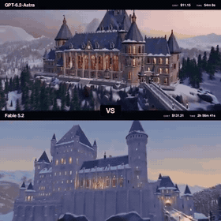</a> <b><a href="https://x.com/EnvolDev/status/2123815633347543159">A winter castle in one shot: GPT-6.2 Astra in 54 min for $11.15 vs Fable 5.2 in 2 h 57 min for $131.31</a></b> <a href="https://x.com/EnvolDev">@EnvolDev</a> · 0:25 · <a href="https://x.com/EnvolDev/status/2123815633347543159">original post on X</a></td>
</tr>
<tr>
<td width="33%" valign="top"> <b><a href="https://x.com/simonw/status/2122822310428279136">Yonkers rising as a mech to stomp across New York: GPT-6.2 Astra vs GPT-6.2 Sol</a></b> <a href="https://x.com/simonw">@simonw</a> · 0:20 · <a href="https://x.com/simonw/status/2122822310428279136">original post on X</a></td>
<td width="33%" valign="top"> <b><a href="https://x.com/rubenssoto_ai/status/2122879969420566740">A campfire in a forest at night: GPT-6.2 Astra vs Fable 5.2 vs Opus 5.5</a></b> <a href="https://x.com/rubenssoto_ai">@rubenssoto_ai</a> · 0:30 · <a href="https://x.com/rubenssoto_ai/status/2122879969420566740">original post on X</a></td>
<td width="33%" valign="top"> <b><a href="https://x.com/EnvolDev/status/2122788867694858629">The Alpine Gold plane: GPT-6.2 Sol at $2.07 vs Opus 5.5 at $31.85</a></b> <a href="https://x.com/EnvolDev">@EnvolDev</a> · 0:25 · <a href="https://x.com/EnvolDev/status/2122788867694858629">original post on X</a></td>
</tr>
<tr>
<td width="33%" valign="top"> <b><a href="https://x.com/PhysAIAnalysis/status/2122830478663434403">Pulling apart two interlocked claw pieces: GPT-6.2 Astra vs Fable 5.2</a></b> <a href="https://x.com/PhysAIAnalysis">@PhysAIAnalysis</a> · 0:19 · <a href="https://x.com/PhysAIAnalysis/status/2122830478663434403">original post on X</a></td>
<td width="33%" valign="top"> <b><a href="https://x.com/ZryMiller/status/2123228351984980040">An octopus sailor on a unicycle: GPT-6.2 Astra in 21 min for $2.52 vs Gemini 4 Neon in 41 min for $4.02</a></b> <a href="https://x.com/ZryMiller">@ZryMiller</a> · 0:12 · <a href="https://x.com/ZryMiller/status/2123228351984980040">original post on X</a></td>
<td width="33%" valign="top"> <b><a href="https://x.com/Da7_Tech/status/2123712489443713478">A tall ship sailing at sunset: Fable 5.2 vs GPT-6.2 Astra vs Gemini 4 Neon</a></b> <a href="https://x.com/Da7_Tech">@Da7_Tech</a> · 0:29 · <a href="https://x.com/Da7_Tech/status/2123712489443713478">original post on X</a></td>
</tr>
<tr>
<td width="33%" valign="top"> <b><a href="https://x.com/kinderlayer/status/2123379979119444471">A bear rising from a rug into the snow: Fable 5.2 vs GPT-6.2 Astra</a></b> <a href="https://x.com/kinderlayer">@kinderlayer</a> · 0:30 · <a href="https://x.com/kinderlayer/status/2123379979119444471">original post on X</a></td>
<td width="33%" valign="top"><a href="https://x.com/teddyaisi/status/2124353151646200097">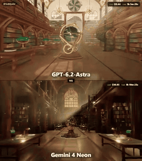</a> <b><a href="https://x.com/teddyaisi/status/2124353151646200097">A 20-second walk through a Baroque library in three.js: GPT-6.2 Astra vs Gemini 4 Neon</a></b> <a href="https://x.com/teddyaisi">@teddyaisi</a> · 0:20 · <a href="https://x.com/teddyaisi/status/2124353151646200097">original post on X</a></td>
<td width="33%" valign="top"><a href="https://x.com/jony_palino/status/2123521701891748223">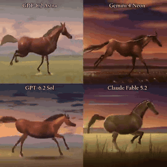</a> <b><a href="https://x.com/jony_palino/status/2123521701891748223">A galloping horse: GPT-6.2 Astra vs GPT-6.2 Sol vs Gemini 4 Neon vs Fable 5.2</a></b> <a href="https://x.com/jony_palino">@jony_palino</a> · 0:16 · <a href="https://x.com/jony_palino/status/2123521701891748223">original post on X</a></td>
</tr>
<tr>
<td width="33%" valign="top"> <b><a href="https://x.com/camperaigg/status/2122794828266377538">An explosion with fire and sound, all in code: GPT-6.2 Sol vs Opus 5.5 on Xhigh</a></b> <a href="https://x.com/camperaigg">@camperaigg</a> · 0:24 · <a href="https://x.com/camperaigg/status/2122794828266377538">original post on X</a></td>
<td width="33%" valign="top"> <b><a href="https://x.com/0xShoopy/status/2123518721981374468">A floating-island 3D app in one shot: GPT-6.2 Astra at $1.10 vs Fable 5.2 at $9.77 vs Opus 5.5 with a Fable advisor at $5.94</a></b> <a href="https://x.com/0xShoopy">@0xShoopy</a> · 0:20 · <a href="https://x.com/0xShoopy/status/2123518721981374468">original post on X</a></td>
<td width="33%" valign="top"> <b><a href="https://x.com/EnvolDev/status/2124238419140444661">A seaplane by a fjord waterfall from the Alpine Gold prompt: GPT-6.2 Astra vs Fable 5.2 vs Gemini 4 Neon vs Gemini 4 Argon</a></b> <a href="https://x.com/EnvolDev">@EnvolDev</a> · 0:25 · <a href="https://x.com/EnvolDev/status/2124238419140444661">original post on X</a></td>
</tr>
<tr>
<td width="33%" valign="top"> <b><a href="https://x.com/R2Cdev_/status/2122763544194330627">The peacock SVG test at Max: GPT-6.2 Astra vs Fable 5.2</a></b> <a href="https://x.com/R2Cdev_">@R2Cdev_</a> · 0:16 · <a href="https://x.com/R2Cdev_/status/2122763544194330627">original post on X</a></td>
<td width="33%" valign="top"> <b><a href="https://x.com/ivanainai/status/2123160875611623711">A Gothic cathedral built up step by step: Fable 5.2 vs GPT-6.2 Astra</a></b> <a href="https://x.com/ivanainai">@ivanainai</a> · 0:35 · <a href="https://x.com/ivanainai/status/2123160875611623711">original post on X</a></td>
<td width="33%" valign="top"> <b><a href="https://x.com/Dav338876/status/2123811456525459754">A stylized lighthouse coast: GPT-6.2 Astra in 31 min 46 s vs Gemini 4 Neon in 16 min 28 s</a></b> <a href="https://x.com/Dav338876">@Dav338876</a> · 0:16 · <a href="https://x.com/Dav338876/status/2123811456525459754">original post on X</a></td>
</tr>
<tr>
<td width="33%" valign="top"> <b><a href="https://x.com/vib3coded/status/2124999025505993078">Bloom Pool, flowers floating on a pool: GPT-6.2 Astra in 25 min vs Fable 5.2 in 1 h 12 min</a></b> <a href="https://x.com/vib3coded">@vib3coded</a> · 0:18 · <a href="https://x.com/vib3coded/status/2124999025505993078">original post on X</a></td>
<td width="33%" valign="top"> <b><a href="https://x.com/Layton_Gott/status/2123202081259495833">A WWII naval battle at sunset: GPT-6.2 Astra at about $68 in 3 h 49 min vs Fable 5.2 at about $111 in 6 h 19 min</a></b> <a href="https://x.com/Layton_Gott">@Layton_Gott</a> · 2:00 · <a href="https://x.com/Layton_Gott/status/2123202081259495833">original post on X</a></td>
<td width="33%" valign="top"> <b><a href="https://x.com/Angaisb_/status/2122762815757017410">A coin passing between two phones in SVG: Gemini 4 Carbon vs GPT-6.2 Astra</a></b> <a href="https://x.com/Angaisb_">@Angaisb_</a> · 0:28 · <a href="https://x.com/Angaisb_/status/2122762815757017410">original post on X</a></td>
</tr>
<tr>
<td width="33%" valign="top"> <b><a href="https://x.com/MiaAI_lab/status/2123085518418182199">Glossy gummy bears falling and squishing: Gemini 4 Carbon vs GPT-6.2 Astra</a></b> <a href="https://x.com/MiaAI_lab">@MiaAI_lab</a> · 0:29 · <a href="https://x.com/MiaAI_lab/status/2123085518418182199">original post on X</a></td>
<td width="33%" valign="top"> <b><a href="https://x.com/Da7_Tech/status/2122835492500893992">A pirate ship at sunset: GPT-6.2 Astra vs Fable 5.2</a></b> <a href="https://x.com/Da7_Tech">@Da7_Tech</a> · 0:29 · <a href="https://x.com/Da7_Tech/status/2122835492500893992">original post on X</a></td>
<td width="33%" valign="top"> <b><a href="https://x.com/teddyaisi/status/2124190810900140286">A sunset gondola ride under a Venetian bridge in three.js: GPT-6.2 Astra vs Gemini 4 Neon</a></b> <a href="https://x.com/teddyaisi">@teddyaisi</a> · 0:20 · <a href="https://x.com/teddyaisi/status/2124190810900140286">original post on X</a></td>
</tr>
<tr>
<td width="33%" valign="top"> <b><a href="https://x.com/choopyplug1/status/2123105267139383530">A lighthouse by the sea at night in four shots: GPT-6.2 Astra at $5.54 vs Fable 5.2 at $18.40 vs Opus 5.5 at $21.95</a></b> <a href="https://x.com/choopyplug1">@choopyplug1</a> · 0:24 · <a href="https://x.com/choopyplug1/status/2123105267139383530">original post on X</a></td>
<td width="33%" valign="top"> <b><a href="https://x.com/alohaproxy/status/2123030965777821985">A sci-fi mech assembling itself and taking off in Three.js: GPT-6.2 Astra vs GPT-6.2 Sol</a></b> <a href="https://x.com/alohaproxy">@alohaproxy</a> · 0:48 · <a href="https://x.com/alohaproxy/status/2123030965777821985">original post on X</a></td>
<td width="33%" valign="top"> <b><a href="https://x.com/rubenssoto_ai/status/2124335094819119426">A red formula race car: Opus 5.5 vs Gemini 4 Neon vs GPT-6.2 Astra</a></b> <a href="https://x.com/rubenssoto_ai">@rubenssoto_ai</a> · 0:40 · <a href="https://x.com/rubenssoto_ai/status/2124335094819119426">original post on X</a></td>
</tr>
<tr>
<td width="33%" valign="top"> <b><a href="https://x.com/RezAIT00/status/2124923926522614078">A luxury watch breaking into its parts: Gemini 4 Neon at about $7.26 vs GPT-6.2 Sol at about $1.50</a></b> <a href="https://x.com/RezAIT00">@RezAIT00</a> · 0:30 · <a href="https://x.com/RezAIT00/status/2124923926522614078">original post on X</a></td>
<td width="33%" valign="top"> <b><a href="https://x.com/argofowl/status/2123100495976046964">A cat on a desk at night knocking things off: GPT-6.2 Astra at $9.43 vs Fable 5.2 at $116.68</a></b> <a href="https://x.com/argofowl">@argofowl</a> · 0:40 · <a href="https://x.com/argofowl/status/2123100495976046964">original post on X</a></td>
<td width="33%" valign="top"> <b><a href="https://x.com/maxt3chno/status/2123911052832190818">A battle axe in a blind Blender MCP test with no references: GPT-6.2 Astra vs Gemini 4 Neon vs Opus 5.5</a></b> <a href="https://x.com/maxt3chno">@maxt3chno</a> · 0:40 · <a href="https://x.com/maxt3chno/status/2123911052832190818">original post on X</a></td>
</tr>
<tr>
<td width="33%" valign="top"> <b><a href="https://x.com/aura_uniiiii/status/2122915684086849611">A pen signing &quot;ChatGPT&quot; in calligraphy, made with Remotion at Max: GPT-6.2 Astra vs GPT-6.2 Sol</a></b> <a href="https://x.com/aura_uniiiii">@aura_uniiiii</a> · 0:30 · <a href="https://x.com/aura_uniiiii/status/2122915684086849611">original post on X</a></td>
<td width="33%" valign="top"> <b><a href="https://x.com/sshayahmet/status/2122778769597554693">A Van Gogh-style Gaussian splat world: GPT-6.2 Sol vs Opus 5.5</a></b> <a href="https://x.com/sshayahmet">@sshayahmet</a> · 0:20 · <a href="https://x.com/sshayahmet/status/2122778769597554693">original post on X</a></td>
<td width="33%" valign="top"> <b><a href="https://x.com/LuminaBench/status/2122768776663839206">The 3D seaplane test, now with GPT-6.2 Astra</a></b> <a href="https://x.com/LuminaBench">@LuminaBench</a> · 0:39 · <a href="https://x.com/LuminaBench/status/2122768776663839206">original post on X</a></td>
</tr>
<tr>
<td width="33%" valign="top"> <b><a href="https://x.com/Super_Nius/status/2123169627815698522">An isometric convenience store on a rainy night: GPT-6.2 Sol in 5 min 29 s vs Gemini 4 Neon in 2 min</a></b> <a href="https://x.com/Super_Nius">@Super_Nius</a> · 0:24 · <a href="https://x.com/Super_Nius/status/2123169627815698522">original post on X</a></td>
<td width="33%" valign="top"> <b><a href="https://x.com/Bhavani_00007/status/2124203254011854973">The Eiffel Tower in three.js: Gemini 4 Neon vs GPT-6.2 Astra vs GPT-6.2 Sol vs Opus 5.5</a></b> <a href="https://x.com/Bhavani_00007">@Bhavani_00007</a> · 0:30 · <a href="https://x.com/Bhavani_00007/status/2124203254011854973">original post on X</a></td>
<td width="33%" valign="top"> <b><a href="https://x.com/Super_Nius/status/2122763107793850483">An island in a block of clear sea: GPT-6.2 Astra and Sol vs GPT-6 Astra and GPT-6.1 Sol</a></b> <a href="https://x.com/Super_Nius">@Super_Nius</a> · 0:24 · <a href="https://x.com/Super_Nius/status/2122763107793850483">original post on X</a></td>
</tr>
<tr>
<td width="33%" valign="top"> <b><a href="https://x.com/AIMind_Ai/status/2124474268079567329">A watermelon frozen in ice, melted and blown up: Fable 5.2 vs Opus 5.5 vs Gemini 4 Neon vs GPT-6.2 Astra</a></b> <a href="https://x.com/AIMind_Ai">@AIMind_Ai</a> · 0:32 · <a href="https://x.com/AIMind_Ai/status/2124474268079567329">original post on X</a></td>
<td width="33%" valign="top"> <b><a href="https://x.com/kinderlayer/status/2124840020691284174">A blade strikes a palace floor and an ice mammoth rises: Fable 5.2 vs GPT-6.2 Astra</a></b> <a href="https://x.com/kinderlayer">@kinderlayer</a> · 0:25 · <a href="https://x.com/kinderlayer/status/2124840020691284174">original post on X</a></td>
<td width="33%" valign="top"> <b><a href="https://x.com/MrTacticalX/status/2122810159970029910">A pirate ship from the same prompt: GPT-6.2 Astra at $3.20 vs Fable 5.2 at $34.41</a></b> <a href="https://x.com/MrTacticalX">@MrTacticalX</a> · 0:25 · <a href="https://x.com/MrTacticalX/status/2122810159970029910">original post on X</a></td>
</tr>
<tr>
<td width="33%" valign="top"> <b><a href="https://x.com/fawnunwrap/status/2122809542660825292">A 3D deer on FawnBench: GPT-6.2 Sol and Astra vs Opus 5.5 and Fable 5.2</a></b> <a href="https://x.com/fawnunwrap">@fawnunwrap</a> · 0:16 · <a href="https://x.com/fawnunwrap/status/2122809542660825292">original post on X</a></td>
<td width="33%" valign="top"> <b><a href="https://x.com/jony_palino/status/2122796926961647919">A horse galloping at sunset: GPT-6.2 Astra vs GPT-6.2 Sol</a></b> <a href="https://x.com/jony_palino">@jony_palino</a> · 0:17 · <a href="https://x.com/jony_palino/status/2122796926961647919">original post on X</a></td>
<td width="33%" valign="top"> <b><a href="https://x.com/thtbee_/status/2122810531669311645">A mechanical bee: GPT-6.2 Astra in 1 h 12 min vs GPT-6.2 Sol in 43 min</a></b> <a href="https://x.com/thtbee_">@thtbee_</a> · 0:34 · <a href="https://x.com/thtbee_/status/2122810531669311645">original post on X</a></td>
</tr>
<tr>
<td width="33%" valign="top"> <b><a href="https://x.com/Angaisb_/status/2122808937154052311">Pixel art side by side: GPT-6 Astra vs GPT-6.2 Astra</a></b> <a href="https://x.com/Angaisb_">@Angaisb_</a> · 0:10 · <a href="https://x.com/Angaisb_/status/2122808937154052311">original post on X</a></td>
<td width="33%" valign="top"> <b><a href="https://x.com/ivanainai/status/2123787634787098976">A rally car on a gravel mountain road: Opus 5.5 vs Gemini 4 Neon vs GPT-6.2 Astra</a></b> <a href="https://x.com/ivanainai">@ivanainai</a> · 0:16 · <a href="https://x.com/ivanainai/status/2123787634787098976">original post on X</a></td>
<td width="33%" valign="top"> <b><a href="https://x.com/maxt3chno/status/2122855198913663480">A propeller fighter above the clouds in Three.js: GPT-6.2 Sol vs GPT-6.2 Astra</a></b> <a href="https://x.com/maxt3chno">@maxt3chno</a> · 0:20 · <a href="https://x.com/maxt3chno/status/2122855198913663480">original post on X</a></td>
</tr>
<tr>
<td width="33%" valign="top"> <b><a href="https://x.com/PawelJLisowski/status/2123177445150859743">A flying game among floating islands in 90 minutes: GPT-6.2 Astra vs Fable 5.2 vs GPT-6.2 Sol vs Opus 5.5</a></b> <a href="https://x.com/PawelJLisowski">@PawelJLisowski</a> · 0:38 · <a href="https://x.com/PawelJLisowski/status/2123177445150859743">original post on X</a></td>
<td width="33%" valign="top"> <b><a href="https://x.com/marcthecreatorr/status/2123004538974294470">Tandem Ride in SVG, a girl and a cat on a bicycle: GPT-6.2 Sol at about $1.90 vs Opus 5.5 at about $18</a></b> <a href="https://x.com/marcthecreatorr">@marcthecreatorr</a> · 0:28 · <a href="https://x.com/marcthecreatorr/status/2123004538974294470">original post on X</a></td>
<td width="33%" valign="top"> <b><a href="https://x.com/RezAIT00/status/2122758069784621228">A Paris diorama with the Eiffel Tower at xhigh: GPT-6.2 Astra vs GPT-6.2 Sol</a></b> <a href="https://x.com/RezAIT00">@RezAIT00</a> · 0:14 · <a href="https://x.com/RezAIT00/status/2122758069784621228">original post on X</a></td>
</tr>
<tr>
<td width="33%" valign="top"> <b><a href="https://x.com/FabianoFirmo/status/2124112687668109752">A submarine in dark water: GPT-6.2 Astra vs Fable 5.2</a></b> <a href="https://x.com/FabianoFirmo">@FabianoFirmo</a> · 0:40 · <a href="https://x.com/FabianoFirmo/status/2124112687668109752">original post on X</a></td>
<td width="33%" valign="top"> <b><a href="https://x.com/EnvolDev/status/2124178021154431319">Lava pouring into the sea from the Black Coast Burns prompt: GPT-6.2 Astra at $10.19 vs Fable 5.2 at $41.11</a></b> <a href="https://x.com/EnvolDev">@EnvolDev</a> · 0:25 · <a href="https://x.com/EnvolDev/status/2124178021154431319">original post on X</a></td>
<td width="33%" valign="top"> <b><a href="https://x.com/itssotsot/status/2122815187010883798">An ink drop spreading into a Rorschach shape: GPT-6.2 Astra vs Fable 5.2 on high</a></b> <a href="https://x.com/itssotsot">@itssotsot</a> · 0:17 · <a href="https://x.com/itssotsot/status/2122815187010883798">original post on X</a></td>
</tr>
<tr>
<td width="33%" valign="top"> <b><a href="https://x.com/PawelJLisowski/status/2123035052992762312">Concept art to a rigged, animated steampunk character in Blender: GPT-6.2 Astra vs GPT-6.2 Sol vs Fable 5.2</a></b> <a href="https://x.com/PawelJLisowski">@PawelJLisowski</a> · 0:20 · <a href="https://x.com/PawelJLisowski/status/2123035052992762312">original post on X</a></td>
<td width="33%" valign="top"> <b><a href="https://x.com/yohakujpn/status/2123309854227915031">Neon light rings and starbursts: Gemini 4 Neon in 5 min for $0.30 vs GPT-6.2 Astra in 19 min for $1.20</a></b> <a href="https://x.com/yohakujpn">@yohakujpn</a> · 0:20 · <a href="https://x.com/yohakujpn/status/2123309854227915031">original post on X</a></td>
<td width="33%" valign="top"> <b><a href="https://x.com/riffydays/status/2123334046797410563">A one-prompt cartoon of a man at a canal-side cafe: Opus 5.5 vs Gemini 4 Neon vs GPT-6.2 Astra</a></b> <a href="https://x.com/riffydays">@riffydays</a> · 0:46 · <a href="https://x.com/riffydays/status/2123334046797410563">original post on X</a></td>
</tr>
<tr>
<td width="33%" valign="top"> <b><a href="https://x.com/vib3coded/status/2122871498792964445">A wobbly pineapple jelly to poke: GPT-6.2 Astra vs Opus 5.5</a></b> <a href="https://x.com/vib3coded">@vib3coded</a> · 0:18 · <a href="https://x.com/vib3coded/status/2122871498792964445">original post on X</a></td>
<td width="33%" valign="top"> <b><a href="https://x.com/HyunSeob_/status/2122885341862645774">A paper crane unfolds a night city in Blender: GPT-6.2 Astra vs Fable 5.2 vs Gemini 4 Carbon</a></b> <a href="https://x.com/HyunSeob_">@HyunSeob_</a> · 0:24 · <a href="https://x.com/HyunSeob_/status/2122885341862645774">original post on X</a></td>
<td width="33%" valign="top"> <b><a href="https://x.com/kickingkeys/status/2122820440070693323">Painting by writing code: GPT-6.2 Astra vs GPT-6 Astra, Fable 5.2 and Gemini 4 Carbon</a></b> <a href="https://x.com/kickingkeys">@kickingkeys</a> · 0:26 · <a href="https://x.com/kickingkeys/status/2122820440070693323">original post on X</a></td>
</tr>
<tr>
<td width="33%" valign="top"> <b><a href="https://x.com/AI_Screening/status/2122923183812776157">A zebra galloping across a savanna: Fable 5.2 vs Opus 5.5 vs GPT-6.2 Astra vs GPT-6.2 Sol</a></b> <a href="https://x.com/AI_Screening">@AI_Screening</a> · 0:18 · <a href="https://x.com/AI_Screening/status/2122923183812776157">original post on X</a></td>
<td width="33%" valign="top"> <b><a href="https://x.com/thomas_guilcher/status/2123019185554862135">Rue du Jerzual in Dinan recreated: GPT-6 Astra vs GPT-6.2 Astra</a></b> <a href="https://x.com/thomas_guilcher">@thomas_guilcher</a> · 1:12 · <a href="https://x.com/thomas_guilcher/status/2123019185554862135">original post on X</a></td>
<td width="33%" valign="top"> <b><a href="https://x.com/takamasa045/status/2122842995162763637">An Azuchi-Momoyama castle town diorama in Three.js at Max: GPT-6.2 Astra vs GPT-6.2 Sol</a></b> <a href="https://x.com/takamasa045">@takamasa045</a> · 0:30 · <a href="https://x.com/takamasa045/status/2122842995162763637">original post on X</a></td>
</tr>
<tr>
<td width="33%" valign="top"> <b><a href="https://x.com/tobiadonadon_/status/2123126087269957998">A robot head from a reference image, built and animated in Blender: Fable 5.2 vs GPT-6.2 Astra</a></b> <a href="https://x.com/tobiadonadon_">@tobiadonadon_</a> · 0:12 · <a href="https://x.com/tobiadonadon_/status/2123126087269957998">original post on X</a></td>
<td width="33%" valign="top"> <b><a href="https://x.com/camperaigg/status/2123438651656818901">A snow wolf running through a forest in Three.js: Gemini 4 Neon in 25 min for $5.45 vs GPT-6.2 Astra in 7 min for $1.56</a></b> <a href="https://x.com/camperaigg">@camperaigg</a> · 0:10 · <a href="https://x.com/camperaigg/status/2123438651656818901">original post on X</a></td>
<td width="33%" valign="top"> <b><a href="https://x.com/GKev1n/status/2122862960179884241">A pelican riding a bicycle, all in code: GPT-6.2 Astra vs Fable 5.2 and Opus 5.5</a></b> <a href="https://x.com/GKev1n">@GKev1n</a> · 0:11 · <a href="https://x.com/GKev1n/status/2122862960179884241">original post on X</a></td>
</tr>
<tr>
<td width="33%" valign="top"> <b><a href="https://x.com/One2xDatalab/status/2122961497748029811">A pelican riding a bike in Blender: GPT-6.2 Sol vs GPT-6.2 Astra, GPT-6 Astra, Gemini 4 Carbon, Gemini 4 Hydrogen and Gemini 4 Argon</a></b> <a href="https://x.com/One2xDatalab">@One2xDatalab</a> · 0:06 · <a href="https://x.com/One2xDatalab/status/2122961497748029811">original post on X</a></td>
<td width="33%" valign="top"> <b><a href="https://x.com/Mr_Salio/status/2122790293095448948">A lighthouse on a rocky islet, each rendering its own video: GPT-6.2 Sol vs GPT-6.2 Astra</a></b> <a href="https://x.com/Mr_Salio">@Mr_Salio</a> · 0:20 · <a href="https://x.com/Mr_Salio/status/2122790293095448948">original post on X</a></td>
<td width="33%" valign="top"> <b><a href="https://x.com/aapakari/status/2123407849829404984">A lighthouse on a rocky coast at night as one web page: Gemini 4 Neon in 3 min 38 s vs GPT-6.2 Sol in 4 min 3 s</a></b> <a href="https://x.com/aapakari">@aapakari</a> · 0:10 · <a href="https://x.com/aapakari/status/2123407849829404984">original post on X</a></td>
</tr>
<tr>
<td width="33%" valign="top"> <b><a href="https://x.com/YxzRainy/status/2123090720072650988">A cyberpunk city in a glass sphere: GPT-6.2 Astra vs Opus 5.5</a></b> <a href="https://x.com/YxzRainy">@YxzRainy</a> · 0:13 · <a href="https://x.com/YxzRainy/status/2123090720072650988">original post on X</a></td>
<td width="33%" valign="top"> <b><a href="https://x.com/DanielZambrini/status/2122759375337214121">A stickman duel with glowing blades at Ultra: Astra in 13 min vs Sol in 12 min</a></b> <a href="https://x.com/DanielZambrini">@DanielZambrini</a> · 0:15 · <a href="https://x.com/DanielZambrini/status/2122759375337214121">original post on X</a></td>
<td width="33%" valign="top"> <b><a href="https://x.com/mylesBaiM/status/2122983459585216607">The last tram through a rainy mountain town at night, Three.js at Max: GPT-6.2 Astra vs GPT-6.2 Sol</a></b> <a href="https://x.com/mylesBaiM">@mylesBaiM</a> · 0:15 · <a href="https://x.com/mylesBaiM/status/2122983459585216607">original post on X</a></td>
</tr>
<tr>
<td width="33%" valign="top"> <b><a href="https://x.com/MrTacticalX/status/2122790417628610914">A Rubik's cube shattering: GPT-6.2 Astra in 47 min for $3.77 vs Fable 5.2</a></b> <a href="https://x.com/MrTacticalX">@MrTacticalX</a> · 0:16 · <a href="https://x.com/MrTacticalX/status/2122790417628610914">original post on X</a></td>
<td width="33%" valign="top"> <b><a href="https://x.com/exploraX_/status/2124760284338221241">Proper Kick, an animated food website from a reference image: GPT-6.2 Sol vs Opus 5.5</a></b> <a href="https://x.com/exploraX_">@exploraX_</a> · 0:42 · <a href="https://x.com/exploraX_/status/2124760284338221241">original post on X</a></td>
</tr>
</table>

## Make your own

- [Claude Fable 5.2 videos](https://claude-motion.com/fable-5-2-videos): the same kind of list for Anthropic's model ([GitHub](https://github.com/hideewsj-maker/awesome-fable-5-2-videos)).
- [HTML to video](https://claude-motion.com/html-to-video): paste the HTML the model wrote and save it as MP4, GIF or WebM, free, in your browser.
- [Motion Director](https://github.com/hideewsj-maker/motion-skills): a free skill for Codex, Claude Code and Cursor that makes a whole film with music.

## Add a video

Open an issue or a pull request with the link to the post on X. The post should say it was made with GPT-6.2 Astra or Sol. Entries are checked by hand.

## Credit and removal

Every video belongs to the person who made it; each entry names its maker and links to the original post. Titles are descriptions of what the post says. If an entry is yours and you want it removed, open an issue or write to the takedown address on claude-motion.com and it comes down.

The list itself (titles, categories, this text) is CC BY 4.0. The videos and prompts are their makers'.
