# GPT-6.2 Astra 与 Sol 视频作品合集

[English](README.md)

收录 **78 条用 OpenAI GPT-6.2 Astra 和 Sol 做出的视频**，都是 2026 年 11 月 17 日发布以来创作者在 X 上分享的：3D 场景、小游戏、动态图形、音乐，以及和其他模型的同题对比。每一帧都由模型写的代码画出来。

带分类筛选的完整合集： **[claude-motion.com/gpt-6-2-videos](https://claude-motion.com/zh/gpt-6-2-videos)**

## 动态图形

<table>
<tr>
<td width="33%" valign="top"><a href="https://x.com/petergostev/status/2122816629402910859">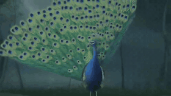</a> <b><a href="https://x.com/petergostev/status/2122816629402910859">薄雾森林中的逼真孔雀，用 SVG 绘制</a></b> <a href="https://x.com/petergostev">@petergostev</a> · 0:55 · <a href="https://x.com/petergostev/status/2122816629402910859">X 原帖</a></td>
<td width="33%" valign="top"> <b><a href="https://x.com/lepadphone/status/2122760193226449212">斗篷少女立于镜面湖上的 3D 网页，High 强度耗时 13 分 32 秒</a></b> <a href="https://x.com/lepadphone">@lepadphone</a> · 0:56 · <a href="https://x.com/lepadphone/status/2122760193226449212">X 原帖</a></td>
<td width="33%" valign="top"> <b><a href="https://x.com/benchmark_lb900/status/2122761948903449045">像素风精灵角色设定表，四个方向的行走动画</a></b> <a href="https://x.com/benchmark_lb900">@benchmark_lb900</a> · 0:07 · <a href="https://x.com/benchmark_lb900/status/2122761948903449045">X 原帖</a></td>
</tr>
<tr>
<td width="33%" valign="top"><a href="https://x.com/studio_yebisu/status/2122766921498325224">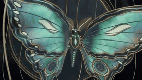</a> <b><a href="https://x.com/studio_yebisu/status/2122766921498325224">金色笼中的飞蛾，three.js 音乐 MV 演示</a></b> <a href="https://x.com/studio_yebisu">@studio_yebisu</a> · 1:07 · <a href="https://x.com/studio_yebisu/status/2122766921498325224">X 原帖</a></td>
<td width="33%" valign="top"> <b><a href="https://x.com/clairevo/status/2122845185512271959">女孩和小幽灵跟随鼠标移动的互动绘本</a></b> <a href="https://x.com/clairevo">@clairevo</a> · 0:12 · <a href="https://x.com/clairevo/status/2122845185512271959">X 原帖</a></td>
<td width="33%" valign="top"> <b><a href="https://x.com/GKev1n/status/2122887519864070480">奔跑穿过草地的奶牛，SVG 动画</a></b> <a href="https://x.com/GKev1n">@GKev1n</a> · 0:12 · <a href="https://x.com/GKev1n/status/2122887519864070480">X 原帖</a></td>
</tr>
<tr>
<td width="33%" valign="top"><a href="https://x.com/ShadeLurk/status/2122831337321349384">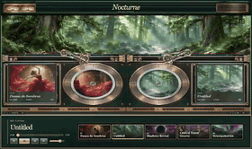</a> <b><a href="https://x.com/ShadeLurk/status/2122831337321349384">在浏览器中运行的 CD 点唱机，5 首歌都装在一个 HTML 文件里</a></b> <a href="https://x.com/ShadeLurk">@ShadeLurk</a> · 0:20 · <a href="https://x.com/ShadeLurk/status/2122831337321349384">X 原帖</a></td>
<td width="33%" valign="top"> <b><a href="https://x.com/Leviwoyun/status/2122846422676701267">同一提示的 15 秒动态图形短片：Astra 对比 Sol</a></b> <a href="https://x.com/Leviwoyun">@Leviwoyun</a> · 0:15 · <a href="https://x.com/Leviwoyun/status/2122846422676701267">X 原帖</a></td>
</tr>
</table>

## 讲解视频

<table>
<tr>
<td width="33%" valign="top"><a href="https://x.com/gabrielchua/status/2122772868270579949">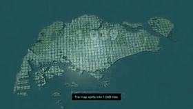</a> <b><a href="https://x.com/gabrielchua/status/2122772868270579949">讲解新加坡复刻模型如何做成的短视频</a></b> <a href="https://x.com/gabrielchua">@gabrielchua</a> · 1:59 · <a href="https://x.com/gabrielchua/status/2122772868270579949">X 原帖</a></td>
</tr>
</table>

## 3D 场景与游戏

<table>
<tr>
<td width="33%" valign="top"> <b><a href="https://x.com/soyukke_game/status/2122767541823225891">穿行于粉色空中城市的小火车，xhigh 强度</a></b> <a href="https://x.com/soyukke_game">@soyukke_game</a> · 0:24 · <a href="https://x.com/soyukke_game/status/2122767541823225891">X 原帖</a></td>
<td width="33%" valign="top"> <b><a href="https://x.com/Dimillian/status/2122753859281928626">1:1 还原的巴黎，可步行可驾车，有交通和 50 多座地标</a></b> <a href="https://x.com/Dimillian">@Dimillian</a> · 0:30 · <a href="https://x.com/Dimillian/status/2122753859281928626">X 原帖</a></td>
<td width="33%" valign="top"> <b><a href="https://x.com/Dimillian/status/2122750651998355800">依照片和历史平面图重现的巴黎圣母院中殿，虚幻引擎 5 制作</a></b> <a href="https://x.com/Dimillian">@Dimillian</a> · 0:56 · <a href="https://x.com/Dimillian/status/2122750651998355800">X 原帖</a></td>
</tr>
<tr>
<td width="33%" valign="top"><a href="https://x.com/givros/status/2122816304071803109">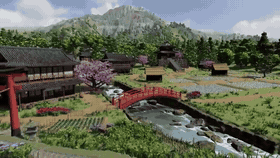</a> <b><a href="https://x.com/givros/status/2122816304071803109">Kasane Valley：绿色山谷中的日式村落，Blender 与 three.js 制作</a></b> <a href="https://x.com/givros">@givros</a> · 1:20 · <a href="https://x.com/givros/status/2122816304071803109">X 原帖</a></td>
<td width="33%" valign="top"><a href="https://x.com/vib3coded/status/2122800268706259244">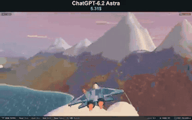</a> <b><a href="https://x.com/vib3coded/status/2122800268706259244">单个 HTML 文件的像素风喷气机游戏，耗时 36 分钟、花费 5.31 美元</a></b> <a href="https://x.com/vib3coded">@vib3coded</a> · 0:14 · <a href="https://x.com/vib3coded/status/2122800268706259244">X 原帖</a></td>
<td width="33%" valign="top"> <b><a href="https://x.com/Da7_Tech/status/2122826218764439645">夕阳下扬着骷髅旗帆的海盗船</a></b> <a href="https://x.com/Da7_Tech">@Da7_Tech</a> · 0:29 · <a href="https://x.com/Da7_Tech/status/2122826218764439645">X 原帖</a></td>
</tr>
<tr>
<td width="33%" valign="top"><a href="https://x.com/soya_da_yoot/status/2122801036247376224">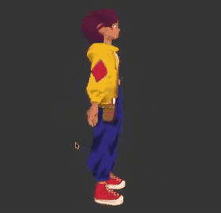</a> <b><a href="https://x.com/soya_da_yoot/status/2122801036247376224">穿黄色夹克的风格化 3D 女孩，模型仍在生成中</a></b> <a href="https://x.com/soya_da_yoot">@soya_da_yoot</a> · 0:19 · <a href="https://x.com/soya_da_yoot/status/2122801036247376224">X 原帖</a></td>
<td width="33%" valign="top"> <b><a href="https://x.com/AmirMushich/status/2122790354781192518">Blender 中的机械手，与参考图并排对照</a></b> <a href="https://x.com/AmirMushich">@AmirMushich</a> · 0:12 · <a href="https://x.com/AmirMushich/status/2122790354781192518">X 原帖</a></td>
<td width="33%" valign="top"> <b><a href="https://x.com/emollick/status/2122781928726437902">驾驶海岸警卫队巡逻舰穿越回独立战争的游戏，Blender 与 Unity 制作</a></b> <a href="https://x.com/emollick">@emollick</a> · 0:45 · <a href="https://x.com/emollick/status/2122781928726437902">X 原帖</a></td>
</tr>
<tr>
<td width="33%" valign="top"><a href="https://x.com/gabrielchua/status/2122762679760883967">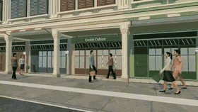</a> <b><a href="https://x.com/gabrielchua/status/2122762679760883967">1:1 比例的整个新加坡岛，耗时 100 多个小时</a></b> <a href="https://x.com/gabrielchua">@gabrielchua</a> · 0:30 · <a href="https://x.com/gabrielchua/status/2122762679760883967">X 原帖</a></td>
<td width="33%" valign="top"> <b><a href="https://x.com/gamemangaanime/status/2122810072447521194">依参考图一次生成的 Q 版 3D 角色，使用 Blender MCP</a></b> <a href="https://x.com/gamemangaanime">@gamemangaanime</a> · 0:11 · <a href="https://x.com/gamemangaanime/status/2122810072447521194">X 原帖</a></td>
<td width="33%" valign="top"><a href="https://x.com/Super_Nius/status/2122755138414920061">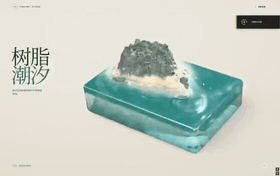</a> <b><a href="https://x.com/Super_Nius/status/2122755138414920061">果冻海中的小岛，可调海面高度和光照，Sol 用时 14 分钟</a></b> <a href="https://x.com/Super_Nius">@Super_Nius</a> · 0:32 · <a href="https://x.com/Super_Nius/status/2122755138414920061">X 原帖</a></td>
</tr>
<tr>
<td width="33%" valign="top"> <b><a href="https://x.com/aarondelasy/status/2122784351322865740">雪中撑伞人群穿行的城市路口，Blender 一次生成</a></b> <a href="https://x.com/aarondelasy">@aarondelasy</a> · 0:14 · <a href="https://x.com/aarondelasy/status/2122784351322865740">X 原帖</a></td>
<td width="33%" valign="top"> <b><a href="https://x.com/Bhavani_00007/status/2122767429193646141">《Meridian Sound Racing》：一款 3D 竞速游戏</a></b> <a href="https://x.com/Bhavani_00007">@Bhavani_00007</a> · 1:00 · <a href="https://x.com/Bhavani_00007/status/2122767429193646141">X 原帖</a></td>
<td width="33%" valign="top"> <b><a href="https://x.com/Dimillian/status/2122799400061960611">带 VHS 摄像机质感的后室漫游，道具和区域丰富</a></b> <a href="https://x.com/Dimillian">@Dimillian</a> · 0:40 · <a href="https://x.com/Dimillian/status/2122799400061960611">X 原帖</a></td>
</tr>
<tr>
<td width="33%" valign="top"><a href="https://x.com/Dimillian/status/2122783245976908195">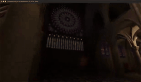</a> <b><a href="https://x.com/Dimillian/status/2122783245976908195">从网页移植到虚幻引擎 5 后，在巴黎圣母院内漫步</a></b> <a href="https://x.com/Dimillian">@Dimillian</a> · 1:21 · <a href="https://x.com/Dimillian/status/2122783245976908195">X 原帖</a></td>
<td width="33%" valign="top"><a href="https://x.com/FlorianGallwitz/status/2122805196938231879">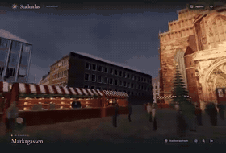</a> <b><a href="https://x.com/FlorianGallwitz/status/2122805196938231879">可步行游览的纽伦堡圣诞市场，同一提示半年后的成果</a></b> <a href="https://x.com/FlorianGallwitz">@FlorianGallwitz</a> · 1:23 · <a href="https://x.com/FlorianGallwitz/status/2122805196938231879">X 原帖</a></td>
<td width="33%" valign="top"><a href="https://x.com/DeryaTR_/status/2122814594737684568">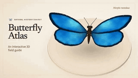</a> <b><a href="https://x.com/DeryaTR_/status/2122814594737684568">用 Sol 和 Blender 做的蝴蝶画廊网站</a></b> <a href="https://x.com/DeryaTR_">@DeryaTR_</a> · 1:30 · <a href="https://x.com/DeryaTR_/status/2122814594737684568">X 原帖</a></td>
</tr>
<tr>
<td width="33%" valign="top"><a href="https://x.com/KanaWorks_AI/status/2122878806436589861">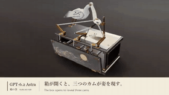</a> <b><a href="https://x.com/KanaWorks_AI/status/2122878806436589861">白瓷仙鹤机械为兔子画尾巴，运行 4 小时的成果</a></b> <a href="https://x.com/KanaWorks_AI">@KanaWorks_AI</a> · 0:25 · <a href="https://x.com/KanaWorks_AI/status/2122878806436589861">X 原帖</a></td>
<td width="33%" valign="top"><a href="https://x.com/Ananth7e/status/2122764162124353906">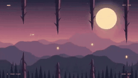</a> <b><a href="https://x.com/Ananth7e/status/2122764162124353906">60 秒做出的夜间飞行游戏，飞越月下山丘</a></b> <a href="https://x.com/Ananth7e">@Ananth7e</a> · 0:30 · <a href="https://x.com/Ananth7e/status/2122764162124353906">X 原帖</a></td>
<td width="33%" valign="top"><a href="https://x.com/klausbrave/status/2122808960071917953">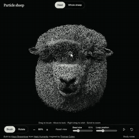</a> <b><a href="https://x.com/klausbrave/status/2122808960071917953">《Particle Sheep》粒子绵羊，参考一段视频 20 分钟做成</a></b> <a href="https://x.com/klausbrave">@klausbrave</a> · 0:15 · <a href="https://x.com/klausbrave/status/2122808960071917953">X 原帖</a></td>
</tr>
<tr>
<td width="33%" valign="top"><a href="https://x.com/JesusIsGod/status/2122899824722772297">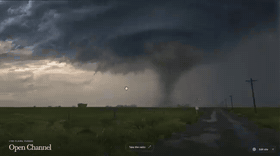</a> <b><a href="https://x.com/JesusIsGod/status/2122899824722772297">《Open Channel》：暴风雨笼罩空旷公路的小游戏，1 小时做成</a></b> <a href="https://x.com/JesusIsGod">@JesusIsGod</a> · 1:57 · <a href="https://x.com/JesusIsGod/status/2122899824722772297">X 原帖</a></td>
<td width="33%" valign="top"><a href="https://x.com/fxtrader/status/2122756192791662752">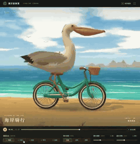</a> <b><a href="https://x.com/fxtrader/status/2122756192791662752">海滩上骑车的鹈鹕，three.js 仅凭内部知识制作，High 强度</a></b> <a href="https://x.com/fxtrader">@fxtrader</a> · 1:14 · <a href="https://x.com/fxtrader/status/2122756192791662752">X 原帖</a></td>
<td width="33%" valign="top"> <b><a href="https://x.com/danveloper/status/2122766260811313326">梯田式高楼组成的绿色城市，Ultra 强度 16 分钟完成</a></b> <a href="https://x.com/danveloper">@danveloper</a> · 0:12 · <a href="https://x.com/danveloper/status/2122766260811313326">X 原帖</a></td>
</tr>
<tr>
<td width="33%" valign="top"> <b><a href="https://x.com/CodeByNZ/status/2122760051454562368">可飞行的 3D 直升机，带组装与爆炸视图，Sol 用时 7 分钟</a></b> <a href="https://x.com/CodeByNZ">@CodeByNZ</a> · 1:15 · <a href="https://x.com/CodeByNZ/status/2122760051454562368">X 原帖</a></td>
<td width="33%" valign="top"> <b><a href="https://x.com/Masimo_Blue/status/2122846803477537071">《Coral Garden》：可在海中畅游的网站，还能戳小鱼</a></b> <a href="https://x.com/Masimo_Blue">@Masimo_Blue</a> · 2:18 · <a href="https://x.com/Masimo_Blue/status/2122846803477537071">X 原帖</a></td>
<td width="33%" valign="top"><a href="https://x.com/lucian__03/status/2122782073102663874">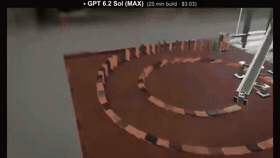</a> <b><a href="https://x.com/lucian__03/status/2122782073102663874">HTML 3D 鲁布·戈德堡机械，Sol 在 Max 强度下耗时 25 分钟、花费 3.03 美元</a></b> <a href="https://x.com/lucian__03">@lucian__03</a> · 0:21 · <a href="https://x.com/lucian__03/status/2122782073102663874">X 原帖</a></td>
</tr>
<tr>
<td width="33%" valign="top"><a href="https://x.com/lucian__03/status/2122770012234805383">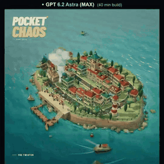</a> <b><a href="https://x.com/lucian__03/status/2122770012234805383">3D 城市灾难模拟器，有龙卷风、陨石和洪水，Max 强度约 40 分钟</a></b> <a href="https://x.com/lucian__03">@lucian__03</a> · 0:18 · <a href="https://x.com/lucian__03/status/2122770012234805383">X 原帖</a></td>
<td width="33%" valign="top"> <b><a href="https://x.com/Maxq5xs/status/2122772121940308343">系着红围巾、在夕阳海边骑车的逼真鹈鹕</a></b> <a href="https://x.com/Maxq5xs">@Maxq5xs</a> · 0:12 · <a href="https://x.com/Maxq5xs/status/2122772121940308343">X 原帖</a></td>
<td width="33%" valign="top"><a href="https://x.com/pankajkumar_dev/status/2122785662734868949">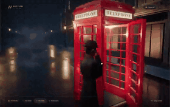</a> <b><a href="https://x.com/pankajkumar_dev/status/2122785662734868949">《The Last Phone Call》：雨雾中的黑色电影街道与红色电话亭</a></b> <a href="https://x.com/pankajkumar_dev">@pankajkumar_dev</a> · 0:31 · <a href="https://x.com/pankajkumar_dev/status/2122785662734868949">X 原帖</a></td>
</tr>
<tr>
<td width="33%" valign="top"> <b><a href="https://x.com/DFintelligence/status/2122798818274017712">3D 马赛，夕阳下的港口</a></b> <a href="https://x.com/DFintelligence">@DFintelligence</a> · 0:35 · <a href="https://x.com/DFintelligence/status/2122798818274017712">X 原帖</a></td>
</tr>
</table>

## 音乐

<table>
<tr>
<td width="33%" valign="top"> <b><a href="https://x.com/rvm0n_/status/2122768551354208665">一首原创古典钢琴曲，以下落音符呈现</a></b> <a href="https://x.com/rvm0n_">@rvm0n_</a> · 1:40 · <a href="https://x.com/rvm0n_/status/2122768551354208665">X 原帖</a></td>
<td width="33%" valign="top"> <b><a href="https://x.com/aug5thmusic/status/2122767673570607401">Bach Benchmark 上的一首众赞歌，以乐谱呈现</a></b> <a href="https://x.com/aug5thmusic">@aug5thmusic</a> · 0:51 · <a href="https://x.com/aug5thmusic/status/2122767673570607401">X 原帖</a></td>
<td width="33%" valign="top"> <b><a href="https://x.com/Angaisb_/status/2122759047107444948">《All the Swifts Return》：配插画港口小镇的一首歌</a></b> <a href="https://x.com/Angaisb_">@Angaisb_</a> · 1:50 · <a href="https://x.com/Angaisb_/status/2122759047107444948">X 原帖</a></td>
</tr>
<tr>
<td width="33%" valign="top"> <b><a href="https://x.com/aug5thmusic/status/2122773822348874149">用 LilyPond 写成的 C 小调管风琴赋格，Extra High 强度</a></b> <a href="https://x.com/aug5thmusic">@aug5thmusic</a> · 2:47 · <a href="https://x.com/aug5thmusic/status/2122773822348874149">X 原帖</a></td>
</tr>
</table>

## 模型对比

<table>
<tr>
<td width="33%" valign="top"><a href="https://x.com/EnvolDev/status/2122773694783349144">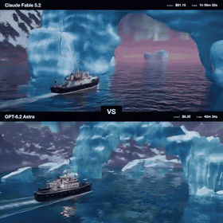</a> <b><a href="https://x.com/EnvolDev/status/2122773694783349144">同一提示的冰之大教堂：GPT-6.2 Astra 对比 Fable 5.2</a></b> <a href="https://x.com/EnvolDev">@EnvolDev</a> · 0:25 · <a href="https://x.com/EnvolDev/status/2122773694783349144">X 原帖</a></td>
<td width="33%" valign="top"><a href="https://x.com/EnvolDev/status/2122803967272866254">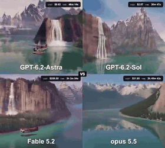</a> <b><a href="https://x.com/EnvolDev/status/2122803967272866254">同一 Alpine Gold 提示的飞机：GPT-6.2 Astra、GPT-6.2 Sol、Fable 5.2 与 Opus 5.5 对比</a></b> <a href="https://x.com/EnvolDev">@EnvolDev</a> · 0:25 · <a href="https://x.com/EnvolDev/status/2122803967272866254">X 原帖</a></td>
<td width="33%" valign="top"><a href="https://x.com/ChrisGPT/status/2122837291874070590">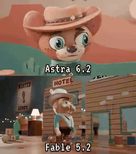</a> <b><a href="https://x.com/ChrisGPT/status/2122837291874070590">Blender 中 10 秒的牛仔玩具短片：GPT-6.2 Astra 对比 Fable 5.2</a></b> <a href="https://x.com/ChrisGPT">@ChrisGPT</a> · 0:10 · <a href="https://x.com/ChrisGPT/status/2122837291874070590">X 原帖</a></td>
</tr>
<tr>
<td width="33%" valign="top"> <b><a href="https://x.com/AmirMushich/status/2122815524124152216">在 Blender 中建模并制作动画的机械手：GPT-6.2 Astra 对比 Fable 5.2</a></b> <a href="https://x.com/AmirMushich">@AmirMushich</a> · 0:12 · <a href="https://x.com/AmirMushich/status/2122815524124152216">X 原帖</a></td>
<td width="33%" valign="top"><a href="https://x.com/dom_scholz/status/2122862040326807696">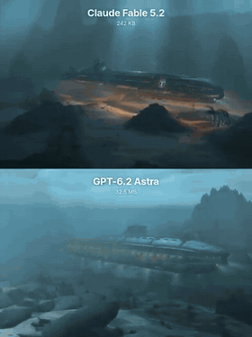</a> <b><a href="https://x.com/dom_scholz/status/2122862040326807696">three.js 海底潜艇：Fable 5.2 仅 242 KB，GPT-6.2 Astra 达 32.9 MB</a></b> <a href="https://x.com/dom_scholz">@dom_scholz</a> · 0:40 · <a href="https://x.com/dom_scholz/status/2122862040326807696">X 原帖</a></td>
<td width="33%" valign="top"> <b><a href="https://x.com/LuminaBench/status/2122758425520029886">3D 水上飞机测试：GPT-6.2 Sol 对比 GPT-6.1 Sol</a></b> <a href="https://x.com/LuminaBench">@LuminaBench</a> · 0:39 · <a href="https://x.com/LuminaBench/status/2122758425520029886">X 原帖</a></td>
</tr>
<tr>
<td width="33%" valign="top"><a href="https://x.com/MrTacticalX/status/2122806350543774075">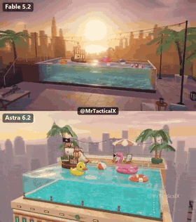</a> <b><a href="https://x.com/MrTacticalX/status/2122806350543774075">同一提示的玻璃泳池：Fable 5.2 对比 GPT-6.2 Astra</a></b> <a href="https://x.com/MrTacticalX">@MrTacticalX</a> · 0:30 · <a href="https://x.com/MrTacticalX/status/2122806350543774075">X 原帖</a></td>
<td width="33%" valign="top"> <b><a href="https://x.com/rubenssoto_ai/status/2122793788087193650">火车驶过的高山草甸：GPT-6.2 Astra 对比 Opus 5.5</a></b> <a href="https://x.com/rubenssoto_ai">@rubenssoto_ai</a> · 0:30 · <a href="https://x.com/rubenssoto_ai/status/2122793788087193650">X 原帖</a></td>
<td width="33%" valign="top"> <b><a href="https://x.com/simonw/status/2122822310428279136">扬克斯化身巨型机甲踏过纽约：GPT-6.2 Astra 对比 GPT-6.2 Sol</a></b> <a href="https://x.com/simonw">@simonw</a> · 0:20 · <a href="https://x.com/simonw/status/2122822310428279136">X 原帖</a></td>
</tr>
<tr>
<td width="33%" valign="top"><a href="https://x.com/rubenssoto_ai/status/2122879969420566740">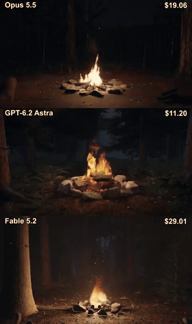</a> <b><a href="https://x.com/rubenssoto_ai/status/2122879969420566740">夜晚森林中的篝火：GPT-6.2 Astra、Fable 5.2 与 Opus 5.5 对比</a></b> <a href="https://x.com/rubenssoto_ai">@rubenssoto_ai</a> · 0:30 · <a href="https://x.com/rubenssoto_ai/status/2122879969420566740">X 原帖</a></td>
<td width="33%" valign="top"><a href="https://x.com/EnvolDev/status/2122788867694858629">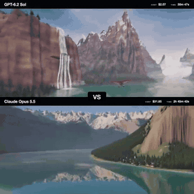</a> <b><a href="https://x.com/EnvolDev/status/2122788867694858629">Alpine Gold 飞机：GPT-6.2 Sol 花费 2.07 美元，Opus 5.5 花费 31.85 美元</a></b> <a href="https://x.com/EnvolDev">@EnvolDev</a> · 0:25 · <a href="https://x.com/EnvolDev/status/2122788867694858629">X 原帖</a></td>
<td width="33%" valign="top"><a href="https://x.com/PhysAIAnalysis/status/2122830478663434403">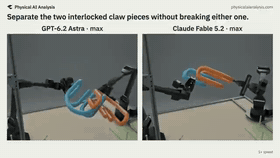</a> <b><a href="https://x.com/PhysAIAnalysis/status/2122830478663434403">拆开两个互锁的爪形零件：GPT-6.2 Astra 对比 Fable 5.2</a></b> <a href="https://x.com/PhysAIAnalysis">@PhysAIAnalysis</a> · 0:19 · <a href="https://x.com/PhysAIAnalysis/status/2122830478663434403">X 原帖</a></td>
</tr>
<tr>
<td width="33%" valign="top"> <b><a href="https://x.com/camperaigg/status/2122794828266377538">火光与声响全由代码生成的爆炸：GPT-6.2 Sol 对比 Opus 5.5，均为 Xhigh</a></b> <a href="https://x.com/camperaigg">@camperaigg</a> · 0:24 · <a href="https://x.com/camperaigg/status/2122794828266377538">X 原帖</a></td>
<td width="33%" valign="top"> <b><a href="https://x.com/R2Cdev_/status/2122763544194330627">孔雀 SVG 测试，Max 强度：GPT-6.2 Astra 对比 Fable 5.2</a></b> <a href="https://x.com/R2Cdev_">@R2Cdev_</a> · 0:16 · <a href="https://x.com/R2Cdev_/status/2122763544194330627">X 原帖</a></td>
<td width="33%" valign="top"><a href="https://x.com/Angaisb_/status/2122762815757017410">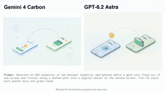</a> <b><a href="https://x.com/Angaisb_/status/2122762815757017410">金币在两部手机间飞过的 SVG 动画：Gemini 4 Carbon 对比 GPT-6.2 Astra</a></b> <a href="https://x.com/Angaisb_">@Angaisb_</a> · 0:28 · <a href="https://x.com/Angaisb_/status/2122762815757017410">X 原帖</a></td>
</tr>
<tr>
<td width="33%" valign="top"><a href="https://x.com/Da7_Tech/status/2122835492500893992">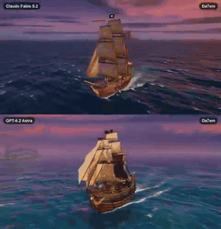</a> <b><a href="https://x.com/Da7_Tech/status/2122835492500893992">夕阳下的海盗船：GPT-6.2 Astra 对比 Fable 5.2</a></b> <a href="https://x.com/Da7_Tech">@Da7_Tech</a> · 0:29 · <a href="https://x.com/Da7_Tech/status/2122835492500893992">X 原帖</a></td>
<td width="33%" valign="top"><a href="https://x.com/sshayahmet/status/2122778769597554693">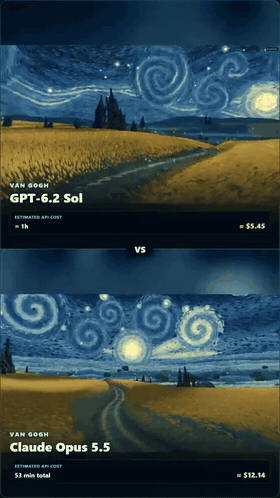</a> <b><a href="https://x.com/sshayahmet/status/2122778769597554693">梵高风格的高斯泼溅世界：GPT-6.2 Sol 对比 Opus 5.5</a></b> <a href="https://x.com/sshayahmet">@sshayahmet</a> · 0:20 · <a href="https://x.com/sshayahmet/status/2122778769597554693">X 原帖</a></td>
<td width="33%" valign="top"><a href="https://x.com/LuminaBench/status/2122768776663839206">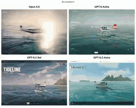</a> <b><a href="https://x.com/LuminaBench/status/2122768776663839206">3D 水上飞机测试，新加入 GPT-6.2 Astra</a></b> <a href="https://x.com/LuminaBench">@LuminaBench</a> · 0:39 · <a href="https://x.com/LuminaBench/status/2122768776663839206">X 原帖</a></td>
</tr>
<tr>
<td width="33%" valign="top"><a href="https://x.com/Super_Nius/status/2122763107793850483">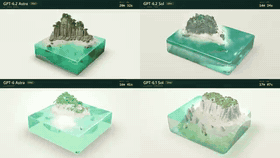</a> <b><a href="https://x.com/Super_Nius/status/2122763107793850483">透明海水方块中的小岛：GPT-6.2 Astra、Sol 对比 GPT-6 Astra、GPT-6.1 Sol</a></b> <a href="https://x.com/Super_Nius">@Super_Nius</a> · 0:24 · <a href="https://x.com/Super_Nius/status/2122763107793850483">X 原帖</a></td>
<td width="33%" valign="top"><a href="https://x.com/MrTacticalX/status/2122810159970029910">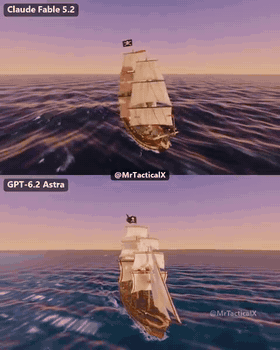</a> <b><a href="https://x.com/MrTacticalX/status/2122810159970029910">同一提示的海盗船：GPT-6.2 Astra 花费 3.20 美元，Fable 5.2 花费 34.41 美元</a></b> <a href="https://x.com/MrTacticalX">@MrTacticalX</a> · 0:25 · <a href="https://x.com/MrTacticalX/status/2122810159970029910">X 原帖</a></td>
<td width="33%" valign="top"> <b><a href="https://x.com/fawnunwrap/status/2122809542660825292">FawnBench 上的 3D 小鹿：GPT-6.2 Sol、Astra 对比 Opus 5.5、Fable 5.2</a></b> <a href="https://x.com/fawnunwrap">@fawnunwrap</a> · 0:16 · <a href="https://x.com/fawnunwrap/status/2122809542660825292">X 原帖</a></td>
</tr>
<tr>
<td width="33%" valign="top"> <b><a href="https://x.com/jony_palino/status/2122796926961647919">夕阳下奔驰的骏马：GPT-6.2 Astra 对比 GPT-6.2 Sol</a></b> <a href="https://x.com/jony_palino">@jony_palino</a> · 0:17 · <a href="https://x.com/jony_palino/status/2122796926961647919">X 原帖</a></td>
<td width="33%" valign="top"> <b><a href="https://x.com/thtbee_/status/2122810531669311645">机械蜜蜂：GPT-6.2 Astra 用时 1 小时 12 分，GPT-6.2 Sol 用时 43 分钟</a></b> <a href="https://x.com/thtbee_">@thtbee_</a> · 0:34 · <a href="https://x.com/thtbee_/status/2122810531669311645">X 原帖</a></td>
<td width="33%" valign="top"><a href="https://x.com/Angaisb_/status/2122808937154052311">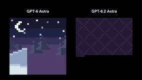</a> <b><a href="https://x.com/Angaisb_/status/2122808937154052311">像素画对比：GPT-6 Astra 与 GPT-6.2 Astra</a></b> <a href="https://x.com/Angaisb_">@Angaisb_</a> · 0:10 · <a href="https://x.com/Angaisb_/status/2122808937154052311">X 原帖</a></td>
</tr>
<tr>
<td width="33%" valign="top"><a href="https://x.com/maxt3chno/status/2122855198913663480">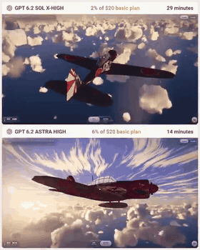</a> <b><a href="https://x.com/maxt3chno/status/2122855198913663480">云层之上的螺旋桨战斗机，Three.js：GPT-6.2 Sol 对比 GPT-6.2 Astra</a></b> <a href="https://x.com/maxt3chno">@maxt3chno</a> · 0:20 · <a href="https://x.com/maxt3chno/status/2122855198913663480">X 原帖</a></td>
<td width="33%" valign="top"><a href="https://x.com/RezAIT00/status/2122758069784621228">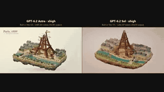</a> <b><a href="https://x.com/RezAIT00/status/2122758069784621228">埃菲尔铁塔巴黎微缩场景，xhigh 强度：GPT-6.2 Astra 对比 GPT-6.2 Sol</a></b> <a href="https://x.com/RezAIT00">@RezAIT00</a> · 0:14 · <a href="https://x.com/RezAIT00/status/2122758069784621228">X 原帖</a></td>
<td width="33%" valign="top"> <b><a href="https://x.com/itssotsot/status/2122815187010883798">墨滴在纸上晕开成罗夏墨迹：GPT-6.2 Astra 对比 Fable 5.2，均为 high</a></b> <a href="https://x.com/itssotsot">@itssotsot</a> · 0:17 · <a href="https://x.com/itssotsot/status/2122815187010883798">X 原帖</a></td>
</tr>
<tr>
<td width="33%" valign="top"><a href="https://x.com/vib3coded/status/2122871498792964445">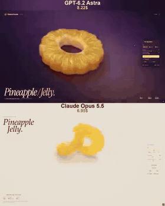</a> <b><a href="https://x.com/vib3coded/status/2122871498792964445">可以戳的晃动菠萝果冻：GPT-6.2 Astra 对比 Opus 5.5</a></b> <a href="https://x.com/vib3coded">@vib3coded</a> · 0:18 · <a href="https://x.com/vib3coded/status/2122871498792964445">X 原帖</a></td>
<td width="33%" valign="top"><a href="https://x.com/HyunSeob_/status/2122885341862645774">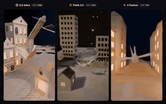</a> <b><a href="https://x.com/HyunSeob_/status/2122885341862645774">纸鹤展翅、桌上折出夜之城的 Blender 短片：GPT-6.2 Astra、Fable 5.2 与 Gemini 4 Carbon 对比</a></b> <a href="https://x.com/HyunSeob_">@HyunSeob_</a> · 0:24 · <a href="https://x.com/HyunSeob_/status/2122885341862645774">X 原帖</a></td>
<td width="33%" valign="top"><a href="https://x.com/kickingkeys/status/2122820440070693323">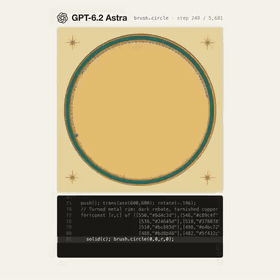</a> <b><a href="https://x.com/kickingkeys/status/2122820440070693323">写代码作画：GPT-6.2 Astra 对比 GPT-6 Astra、Fable 5.2 与 Gemini 4 Carbon</a></b> <a href="https://x.com/kickingkeys">@kickingkeys</a> · 0:26 · <a href="https://x.com/kickingkeys/status/2122820440070693323">X 原帖</a></td>
</tr>
<tr>
<td width="33%" valign="top"><a href="https://x.com/GKev1n/status/2122862960179884241">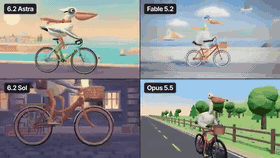</a> <b><a href="https://x.com/GKev1n/status/2122862960179884241">骑自行车的鹈鹕，纯代码制作：GPT-6.2 Astra 对比 Fable 5.2 与 Opus 5.5</a></b> <a href="https://x.com/GKev1n">@GKev1n</a> · 0:11 · <a href="https://x.com/GKev1n/status/2122862960179884241">X 原帖</a></td>
<td width="33%" valign="top"> <b><a href="https://x.com/Mr_Salio/status/2122790293095448948">礁石上的灯塔，各自渲染成片：GPT-6.2 Sol 对比 GPT-6.2 Astra</a></b> <a href="https://x.com/Mr_Salio">@Mr_Salio</a> · 0:20 · <a href="https://x.com/Mr_Salio/status/2122790293095448948">X 原帖</a></td>
<td width="33%" valign="top"> <b><a href="https://x.com/DanielZambrini/status/2122759375337214121">火柴人光刃对决，Ultra 强度：Astra 用时 13 分钟，Sol 用时 12 分钟</a></b> <a href="https://x.com/DanielZambrini">@DanielZambrini</a> · 0:15 · <a href="https://x.com/DanielZambrini/status/2122759375337214121">X 原帖</a></td>
</tr>
<tr>
<td width="33%" valign="top"><a href="https://x.com/MrTacticalX/status/2122790417628610914">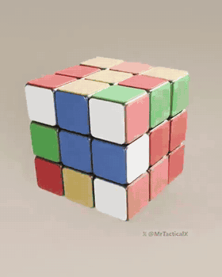</a> <b><a href="https://x.com/MrTacticalX/status/2122790417628610914">魔方碎裂：GPT-6.2 Astra 耗时 47 分钟、花费 3.77 美元，对比 Fable 5.2</a></b> <a href="https://x.com/MrTacticalX">@MrTacticalX</a> · 0:16 · <a href="https://x.com/MrTacticalX/status/2122790417628610914">X 原帖</a></td>
</tr>
</table>

## 自己做一支

- [Claude Fable 5.2 视频合集](https://claude-motion.com/zh/fable-5-2-videos)：Anthropic 模型的同类合集（[GitHub](https://github.com/hideewsj-maker/awesome-fable-5-2-videos)）。
- [HTML 转视频](https://claude-motion.com/zh/html-to-video)：粘贴模型写的 HTML，在浏览器里免费导出 MP4、GIF 或 WebM。
- [Motion Director](https://github.com/hideewsj-maker/motion-skills)：免费 Skill，在 Codex、Claude Code、Cursor 里做出带配乐的整支片子。

## 提交作品

提 issue 或 pull request，附上 X 原帖链接。原帖需要写明是用 GPT-6.2 Astra 或 Sol 做的。收录前会人工核对。

## 署名与下架

视频归创作者所有；每条都注明作者并链接到原帖。标题是对原帖内容的描述。如果其中有作品需要下架，请提 issue，或写信到 claude-motion.com 页脚的下架邮箱，会及时移除。

列表本身（标题、分类和本文）采用 CC BY 4.0。视频和提示词归各自作者所有。
