# GPT-6.2 Astra 与 Sol 视频作品合集

[English](README.md)

收录 **226 条用 OpenAI GPT-6.2 Astra 和 Sol 做出的视频**，都是 2026 年 11 月 17 日发布以来创作者在 X 上分享的：3D 场景、小游戏、动态图形、音乐，以及和其他模型的同题对比。每一帧都由模型写的代码画出来。

带分类筛选的完整合集： **[claude-motion.com/gpt-6-2-videos](https://claude-motion.com/zh/gpt-6-2-videos)**

## 动态图形

<table>
<tr>
<td width="33%" valign="top"> <b><a href="https://x.com/viktoroddy/status/2123932620212072581">《Thought That Lasts》：点云大理石半身像随鼠标转动的落地页</a></b> <a href="https://x.com/viktoroddy">@viktoroddy</a> · 0:07 · <a href="https://x.com/viktoroddy/status/2123932620212072581">X 原帖</a></td>
<td width="33%" valign="top"> <b><a href="https://x.com/soya_da_yoot/status/2123268369369514311">可操控测试场景中奔跑跳跃的风格化女孩</a></b> <a href="https://x.com/soya_da_yoot">@soya_da_yoot</a> · 0:16 · <a href="https://x.com/soya_da_yoot/status/2123268369369514311">X 原帖</a></td>
<td width="33%" valign="top"> <b><a href="https://x.com/petergostev/status/2122816629402910859">薄雾森林中的逼真孔雀，用 SVG 绘制</a></b> <a href="https://x.com/petergostev">@petergostev</a> · 0:55 · <a href="https://x.com/petergostev/status/2122816629402910859">X 原帖</a></td>
</tr>
<tr>
<td width="33%" valign="top"><a href="https://x.com/MengTo/status/2123794210721804750">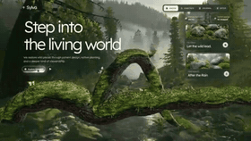</a> <b><a href="https://x.com/MengTo/status/2123794210721804750">长满青苔的岩石与段落间流动雾气的 three.js 落地页</a></b> <a href="https://x.com/MengTo">@MengTo</a> · 0:30 · <a href="https://x.com/MengTo/status/2123794210721804750">X 原帖</a></td>
<td width="33%" valign="top"> <b><a href="https://x.com/JungleSilicon/status/2123198696867373386">像素风高斯泼溅特效：拖着光粒穿过黑暗传送门的粉色小怪物</a></b> <a href="https://x.com/JungleSilicon">@JungleSilicon</a> · 0:10 · <a href="https://x.com/JungleSilicon/status/2123198696867373386">X 原帖</a></td>
<td width="33%" valign="top"> <b><a href="https://x.com/gokayfem/status/2123776799188672521">薄雾与松林环绕的日出高山湖，用着色器绘制</a></b> <a href="https://x.com/gokayfem">@gokayfem</a> · 0:05 · <a href="https://x.com/gokayfem/status/2123776799188672521">X 原帖</a></td>
</tr>
<tr>
<td width="33%" valign="top"> <b><a href="https://x.com/lepadphone/status/2122760193226449212">斗篷少女立于镜面湖上的 3D 网页，High 强度耗时 13 分 32 秒</a></b> <a href="https://x.com/lepadphone">@lepadphone</a> · 0:56 · <a href="https://x.com/lepadphone/status/2122760193226449212">X 原帖</a></td>
<td width="33%" valign="top"><a href="https://x.com/gokayfem/status/2123083869562003745">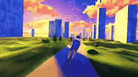</a> <b><a href="https://x.com/gokayfem/status/2123083869562003745">《Sunset Ride》：骑车人驶向蓝色巨石的着色器短片，仅 10 KB 代码</a></b> <a href="https://x.com/gokayfem">@gokayfem</a> · 0:28 · <a href="https://x.com/gokayfem/status/2123083869562003745">X 原帖</a></td>
<td width="33%" valign="top"><a href="https://x.com/ryoma_nakajima/status/2122995414878269633">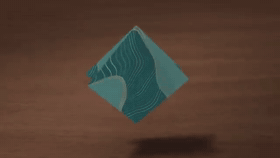</a> <b><a href="https://x.com/ryoma_nakajima/status/2122995414878269633">在木桌上自己折成的纸鹤</a></b> <a href="https://x.com/ryoma_nakajima">@ryoma_nakajima</a> · 0:26 · <a href="https://x.com/ryoma_nakajima/status/2122995414878269633">X 原帖</a></td>
</tr>
<tr>
<td width="33%" valign="top"> <b><a href="https://x.com/ryanflorence/status/2123809517758713977">持剑盾的风格化少女角色与战斗动画</a></b> <a href="https://x.com/ryanflorence">@ryanflorence</a> · 0:12 · <a href="https://x.com/ryanflorence/status/2123809517758713977">X 原帖</a></td>
<td width="33%" valign="top"><a href="https://x.com/p_rabtsevich/status/2123045457958191393">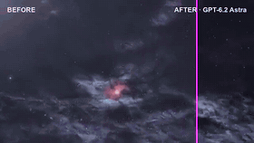</a> <b><a href="https://x.com/p_rabtsevich/status/2123045457958191393">游戏星云着色器经 GPT-6.2 Astra 改进的前后对比</a></b> <a href="https://x.com/p_rabtsevich">@p_rabtsevich</a> · 0:10 · <a href="https://x.com/p_rabtsevich/status/2123045457958191393">X 原帖</a></td>
<td width="33%" valign="top"> <b><a href="https://x.com/benchmark_lb900/status/2122761948903449045">像素风精灵角色设定表，四个方向的行走动画</a></b> <a href="https://x.com/benchmark_lb900">@benchmark_lb900</a> · 0:07 · <a href="https://x.com/benchmark_lb900/status/2122761948903449045">X 原帖</a></td>
</tr>
<tr>
<td width="33%" valign="top"> <b><a href="https://x.com/studio_yebisu/status/2122766921498325224">金色笼中的飞蛾，three.js 音乐 MV 演示</a></b> <a href="https://x.com/studio_yebisu">@studio_yebisu</a> · 1:07 · <a href="https://x.com/studio_yebisu/status/2122766921498325224">X 原帖</a></td>
<td width="33%" valign="top"> <b><a href="https://x.com/LurkShade/status/2122874484046901613">海报风动态图形：摆出怪异姿势的角色</a></b> <a href="https://x.com/LurkShade">@LurkShade</a> · 0:22 · <a href="https://x.com/LurkShade/status/2122874484046901613">X 原帖</a></td>
<td width="33%" valign="top"> <b><a href="https://x.com/clairevo/status/2122845185512271959">女孩和小幽灵跟随鼠标移动的互动绘本</a></b> <a href="https://x.com/clairevo">@clairevo</a> · 0:12 · <a href="https://x.com/clairevo/status/2122845185512271959">X 原帖</a></td>
</tr>
<tr>
<td width="33%" valign="top"> <b><a href="https://x.com/loktar00/status/2123674453120840143">像素风快递骑手游戏，穿行于流动的风景</a></b> <a href="https://x.com/loktar00">@loktar00</a> · 0:30 · <a href="https://x.com/loktar00/status/2123674453120840143">X 原帖</a></td>
<td width="33%" valign="top"> <b><a href="https://x.com/GKev1n/status/2122887519864070480">奔跑穿过草地的奶牛，SVG 动画</a></b> <a href="https://x.com/GKev1n">@GKev1n</a> · 0:12 · <a href="https://x.com/GKev1n/status/2122887519864070480">X 原帖</a></td>
<td width="33%" valign="top"> <b><a href="https://x.com/ShadeLurk/status/2122831337321349384">在浏览器中运行的 CD 点唱机，5 首歌都装在一个 HTML 文件里</a></b> <a href="https://x.com/ShadeLurk">@ShadeLurk</a> · 0:20 · <a href="https://x.com/ShadeLurk/status/2122831337321349384">X 原帖</a></td>
</tr>
<tr>
<td width="33%" valign="top"> <b><a href="https://x.com/Leviwoyun/status/2123681305951187449">达达风格纸拼贴动画：鼓手与小号手，带音效</a></b> <a href="https://x.com/Leviwoyun">@Leviwoyun</a> · 0:59 · <a href="https://x.com/Leviwoyun/status/2123681305951187449">X 原帖</a></td>
<td width="33%" valign="top"> <b><a href="https://x.com/Leviwoyun/status/2122846422676701267">同一提示的 15 秒动态图形短片：Astra 对比 Sol</a></b> <a href="https://x.com/Leviwoyun">@Leviwoyun</a> · 0:15 · <a href="https://x.com/Leviwoyun/status/2122846422676701267">X 原帖</a></td>
<td width="33%" valign="top"> <b><a href="https://x.com/camperaigg/status/2123061165735686224">背着整座小镇的像素风世界龟，用时 23 分钟、花费 2.88 美元</a></b> <a href="https://x.com/camperaigg">@camperaigg</a> · 0:30 · <a href="https://x.com/camperaigg/status/2123061165735686224">X 原帖</a></td>
</tr>
<tr>
<td width="33%" valign="top"> <b><a href="https://x.com/AINetworkTech/status/2124780083294437585">全自动完成设计、绑定骨骼并制作握拳动作的 3D 手部</a></b> <a href="https://x.com/AINetworkTech">@AINetworkTech</a> · 0:04 · <a href="https://x.com/AINetworkTech/status/2124780083294437585">X 原帖</a></td>
<td width="33%" valign="top"> <b><a href="https://x.com/momotomo1/status/2122931210917990653">《An Ocean of One》：6200 条鱼里的一条红鱼，鱼群最终聚成一头鲸</a></b> <a href="https://x.com/momotomo1">@momotomo1</a> · 0:18 · <a href="https://x.com/momotomo1/status/2122931210917990653">X 原帖</a></td>
</tr>
</table>

## 讲解视频

<table>
<tr>
<td width="33%" valign="top"> <b><a href="https://x.com/TokenGremlin/status/2124171631320875451">罐车液体晃动模拟，带流体热力图，Blender 建模</a></b> <a href="https://x.com/TokenGremlin">@TokenGremlin</a> · 0:44 · <a href="https://x.com/TokenGremlin/status/2124171631320875451">X 原帖</a></td>
<td width="33%" valign="top"> <b><a href="https://x.com/gabrielchua/status/2122772868270579949">讲解新加坡复刻模型如何做成的短视频</a></b> <a href="https://x.com/gabrielchua">@gabrielchua</a> · 1:59 · <a href="https://x.com/gabrielchua/status/2122772868270579949">X 原帖</a></td>
<td width="33%" valign="top"> <b><a href="https://x.com/csaba_kissi/status/2124806236696891466">《Cycle Lab》：互动式热泵讲解，含 3D 机组和旁白</a></b> <a href="https://x.com/csaba_kissi">@csaba_kissi</a> · 1:32 · <a href="https://x.com/csaba_kissi/status/2124806236696891466">X 原帖</a></td>
</tr>
<tr>
<td width="33%" valign="top"><a href="https://x.com/MelissaKampers/status/2124286667288891534">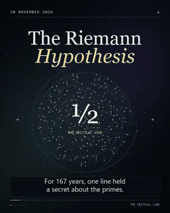</a> <b><a href="https://x.com/MelissaKampers/status/2124286667288891534">黎曼猜想短讲解片，每一帧画面和声音都由代码生成，Sol 用时 12 分钟</a></b> <a href="https://x.com/MelissaKampers">@MelissaKampers</a> · 0:59 · <a href="https://x.com/MelissaKampers/status/2124286667288891534">X 原帖</a></td>
<td width="33%" valign="top"><a href="https://x.com/RohanArun/status/2123601627412038120">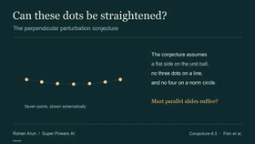</a> <b><a href="https://x.com/RohanArun/status/2123601627412038120">GPT-6.2 Astra 如何在 30 分钟内推翻一个几何猜想，用曲线上的点讲清楚</a></b> <a href="https://x.com/RohanArun">@RohanArun</a> · 1:53 · <a href="https://x.com/RohanArun/status/2123601627412038120">X 原帖</a></td>
<td width="33%" valign="top"><a href="https://x.com/Skoorbkaz/status/2123205785245134924">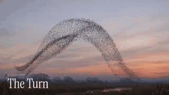</a> <b><a href="https://x.com/Skoorbkaz/status/2123205785245134924">《The Paths They Took》：椋鸟群飞化作粒子轨迹的诠释性解说</a></b> <a href="https://x.com/Skoorbkaz">@Skoorbkaz</a> · 2:00 · <a href="https://x.com/Skoorbkaz/status/2123205785245134924">X 原帖</a></td>
</tr>
</table>

## 动画短片

<table>
<tr>
<td width="33%" valign="top"> <b><a href="https://x.com/chetaslua/status/2123051098730799214">海边骑自行车的鹈鹕，纯代码制作的手绘风短片</a></b> <a href="https://x.com/chetaslua">@chetaslua</a> · 0:57 · <a href="https://x.com/chetaslua/status/2123051098730799214">X 原帖</a></td>
<td width="33%" valign="top"><a href="https://x.com/rockeymen/status/2123605250825486383">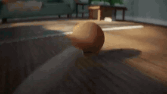</a> <b><a href="https://x.com/rockeymen/status/2123605250825486383">小猫在房间里的冒险，3D 场景加代码渲染，代码以 MIT 协议开源</a></b> <a href="https://x.com/rockeymen">@rockeymen</a> · 0:20 · <a href="https://x.com/rockeymen/status/2123605250825486383">X 原帖</a></td>
<td width="33%" valign="top"> <b><a href="https://x.com/dingchilling/status/2124166516476461488">卡通小探险家穿越沙漠寻得宝箱，Blender 制作</a></b> <a href="https://x.com/dingchilling">@dingchilling</a> · 0:27 · <a href="https://x.com/dingchilling/status/2124166516476461488">X 原帖</a></td>
</tr>
<tr>
<td width="33%" valign="top"> <b><a href="https://x.com/notjazii/status/2123455282806456524">《Last Train to Saturn》：驶向土星的列车，在 Blender 中制作、用 Unreal Engine 渲染</a></b> <a href="https://x.com/notjazii">@notjazii</a> · 1:22 · <a href="https://x.com/notjazii/status/2123455282806456524">X 原帖</a></td>
<td width="33%" valign="top"> <b><a href="https://x.com/sarischerika/status/2123631976284602806">《调皮天使驰骋宫都》：3D 由 GPT-6.2 Astra 制作，影像与音乐由 Fable 5.2 完成</a></b> <a href="https://x.com/sarischerika">@sarischerika</a> · 0:36 · <a href="https://x.com/sarischerika/status/2123631976284602806">X 原帖</a></td>
<td width="33%" valign="top"> <b><a href="https://x.com/sonuv_dev/status/2124757635530698771">纸艺风动画：乘船的小老鼠，音效也全由代码生成，耗时 30 分钟</a></b> <a href="https://x.com/sonuv_dev">@sonuv_dev</a> · 0:28 · <a href="https://x.com/sonuv_dev/status/2124757635530698771">X 原帖</a></td>
</tr>
</table>

## 3D 场景与游戏

<table>
<tr>
<td width="33%" valign="top"> <b><a href="https://x.com/soyukke_game/status/2122767541823225891">穿行于粉色空中城市的小火车，xhigh 强度</a></b> <a href="https://x.com/soyukke_game">@soyukke_game</a> · 0:24 · <a href="https://x.com/soyukke_game/status/2122767541823225891">X 原帖</a></td>
<td width="33%" valign="top"><a href="https://x.com/anshuc/status/2124295323602542976">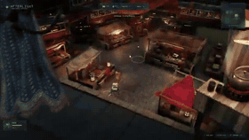</a> <b><a href="https://x.com/anshuc/status/2124295323602542976">可自由探索的机器人城市，由 28 个 Astra 子代理在 6 小时内建成</a></b> <a href="https://x.com/anshuc">@anshuc</a> · 0:28 · <a href="https://x.com/anshuc/status/2124295323602542976">X 原帖</a></td>
<td width="33%" valign="top"> <b><a href="https://x.com/Aprilzz423/status/2123788440714260673">《Pocket City》：依据 OpenStreetMap 测绘的手绘迷你城市</a></b> <a href="https://x.com/Aprilzz423">@Aprilzz423</a> · 0:24 · <a href="https://x.com/Aprilzz423/status/2123788440714260673">X 原帖</a></td>
</tr>
<tr>
<td width="33%" valign="top"><a href="https://x.com/MengTo/status/2124431846859813234">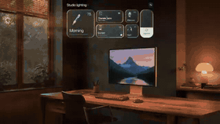</a> <b><a href="https://x.com/MengTo/status/2124431846859813234">窗边书桌的 three.js 场景，玻璃质感界面一键切换到日落光线</a></b> <a href="https://x.com/MengTo">@MengTo</a> · 0:33 · <a href="https://x.com/MengTo/status/2124431846859813234">X 原帖</a></td>
<td width="33%" valign="top"> <b><a href="https://x.com/Aprilzz423/status/2123250179952484477">《Pocket City》街景版：阿姆斯特丹运河一角与上海安福路，四季可切换</a></b> <a href="https://x.com/Aprilzz423">@Aprilzz423</a> · 0:32 · <a href="https://x.com/Aprilzz423/status/2123250179952484477">X 原帖</a></td>
<td width="33%" valign="top"> <b><a href="https://x.com/Dimillian/status/2122753859281928626">1:1 还原的巴黎，可步行可驾车，有交通和 50 多座地标</a></b> <a href="https://x.com/Dimillian">@Dimillian</a> · 0:30 · <a href="https://x.com/Dimillian/status/2122753859281928626">X 原帖</a></td>
</tr>
<tr>
<td width="33%" valign="top"><a href="https://x.com/Dimillian/status/2122750651998355800">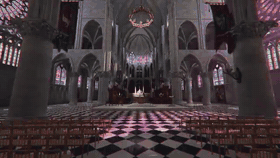</a> <b><a href="https://x.com/Dimillian/status/2122750651998355800">依照片和历史平面图重现的巴黎圣母院中殿，虚幻引擎 5 制作</a></b> <a href="https://x.com/Dimillian">@Dimillian</a> · 0:56 · <a href="https://x.com/Dimillian/status/2122750651998355800">X 原帖</a></td>
<td width="33%" valign="top"><a href="https://x.com/HaileyAILabs/status/2123240665794687370">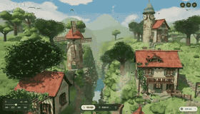</a> <b><a href="https://x.com/HaileyAILabs/status/2123240665794687370">一张参考图做出的 3D 童话小镇，8 栋房子可走近细看，水车转动</a></b> <a href="https://x.com/HaileyAILabs">@HaileyAILabs</a> · 0:31 · <a href="https://x.com/HaileyAILabs/status/2123240665794687370">X 原帖</a></td>
<td width="33%" valign="top"> <b><a href="https://x.com/givros/status/2122816304071803109">Kasane Valley：绿色山谷中的日式村落，Blender 与 three.js 制作</a></b> <a href="https://x.com/givros">@givros</a> · 1:20 · <a href="https://x.com/givros/status/2122816304071803109">X 原帖</a></td>
</tr>
<tr>
<td width="33%" valign="top"><a href="https://x.com/mark_k/status/2123027307560583230">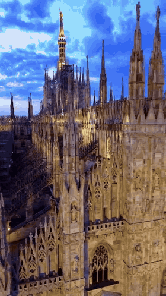</a> <b><a href="https://x.com/mark_k/status/2123027307560583230">蓝天下的写实哥特式大教堂立面</a></b> <a href="https://x.com/mark_k">@mark_k</a> · 0:14 · <a href="https://x.com/mark_k/status/2123027307560583230">X 原帖</a></td>
<td width="33%" valign="top"> <b><a href="https://x.com/vib3coded/status/2122800268706259244">单个 HTML 文件的像素风喷气机游戏，耗时 36 分钟、花费 5.31 美元</a></b> <a href="https://x.com/vib3coded">@vib3coded</a> · 0:14 · <a href="https://x.com/vib3coded/status/2122800268706259244">X 原帖</a></td>
<td width="33%" valign="top"><a href="https://x.com/neviannn/status/2123859318936064193">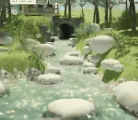</a> <b><a href="https://x.com/neviannn/status/2123859318936064193">月光下的林间小溪与山坡小屋，可在浏览器中自由探索</a></b> <a href="https://x.com/neviannn">@neviannn</a> · 0:57 · <a href="https://x.com/neviannn/status/2123859318936064193">X 原帖</a></td>
</tr>
<tr>
<td width="33%" valign="top"><a href="https://x.com/javpixel_art/status/2124209140700533065">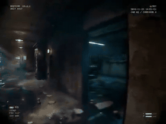</a> <b><a href="https://x.com/javpixel_art/status/2124209140700533065">《The Hall》：漫步黑暗科幻走廊，全部由 three.js 程序化几何构建</a></b> <a href="https://x.com/javpixel_art">@javpixel_art</a> · 0:28 · <a href="https://x.com/javpixel_art/status/2124209140700533065">X 原帖</a></td>
<td width="33%" valign="top"><a href="https://x.com/Da7_Tech/status/2122826218764439645">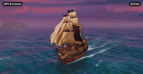</a> <b><a href="https://x.com/Da7_Tech/status/2122826218764439645">夕阳下扬着骷髅旗帆的海盗船</a></b> <a href="https://x.com/Da7_Tech">@Da7_Tech</a> · 0:29 · <a href="https://x.com/Da7_Tech/status/2122826218764439645">X 原帖</a></td>
<td width="33%" valign="top"> <b><a href="https://x.com/soya_da_yoot/status/2122801036247376224">穿黄色夹克的风格化 3D 女孩，模型仍在生成中</a></b> <a href="https://x.com/soya_da_yoot">@soya_da_yoot</a> · 0:19 · <a href="https://x.com/soya_da_yoot/status/2122801036247376224">X 原帖</a></td>
</tr>
<tr>
<td width="33%" valign="top"><a href="https://x.com/AmirMushich/status/2122790354781192518">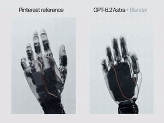</a> <b><a href="https://x.com/AmirMushich/status/2122790354781192518">Blender 中的机械手，与参考图并排对照</a></b> <a href="https://x.com/AmirMushich">@AmirMushich</a> · 0:12 · <a href="https://x.com/AmirMushich/status/2122790354781192518">X 原帖</a></td>
<td width="33%" valign="top"><a href="https://x.com/givros/status/2124404063802429838">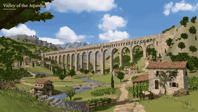</a> <b><a href="https://x.com/givros/status/2124404063802429838">《Valley of the Aqueduct》：漫步葡萄园与罗马式引水渡槽，Sol 用时 44 分钟</a></b> <a href="https://x.com/givros">@givros</a> · 1:12 · <a href="https://x.com/givros/status/2124404063802429838">X 原帖</a></td>
<td width="33%" valign="top"><a href="https://x.com/givros/status/2123306526878437857">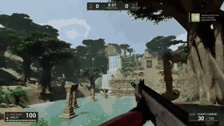</a> <b><a href="https://x.com/givros/status/2123306526878437857">《Temple of the Canopy》：用 Blender、Three.js 与 Unreal Engine 5.9 在 4 小时 54 分内做出的 FPS</a></b> <a href="https://x.com/givros">@givros</a> · 1:28 · <a href="https://x.com/givros/status/2123306526878437857">X 原帖</a></td>
</tr>
<tr>
<td width="33%" valign="top"><a href="https://x.com/RicardoJrkxl/status/2123753043971784997">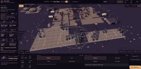</a> <b><a href="https://x.com/RicardoJrkxl/status/2123753043971784997">月球战役地图上的战术自走棋游戏，不到 1 小时做成</a></b> <a href="https://x.com/RicardoJrkxl">@RicardoJrkxl</a> · 0:42 · <a href="https://x.com/RicardoJrkxl/status/2123753043971784997">X 原帖</a></td>
<td width="33%" valign="top"> <b><a href="https://x.com/BeamManP/status/2123695711120420988">用堆叠精灵制作的像素小岛，小船划出涟漪</a></b> <a href="https://x.com/BeamManP">@BeamManP</a> · 0:25 · <a href="https://x.com/BeamManP/status/2123695711120420988">X 原帖</a></td>
<td width="33%" valign="top"> <b><a href="https://x.com/emollick/status/2122781928726437902">驾驶海岸警卫队巡逻舰穿越回独立战争的游戏，Blender 与 Unity 制作</a></b> <a href="https://x.com/emollick">@emollick</a> · 0:45 · <a href="https://x.com/emollick/status/2122781928726437902">X 原帖</a></td>
</tr>
<tr>
<td width="33%" valign="top"> <b><a href="https://x.com/gabrielchua/status/2122762679760883967">1:1 比例的整个新加坡岛，耗时 100 多个小时</a></b> <a href="https://x.com/gabrielchua">@gabrielchua</a> · 0:30 · <a href="https://x.com/gabrielchua/status/2122762679760883967">X 原帖</a></td>
<td width="33%" valign="top"><a href="https://x.com/diegocabezas01/status/2124854982235373664">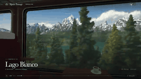</a> <b><a href="https://x.com/diegocabezas01/status/2124854982235373664">穿越瑞士阿尔卑斯山的火车靠窗座位，纯代码单个 HTML 文件</a></b> <a href="https://x.com/diegocabezas01">@diegocabezas01</a> · 0:46 · <a href="https://x.com/diegocabezas01/status/2124854982235373664">X 原帖</a></td>
<td width="33%" valign="top"><a href="https://x.com/vib3coded/status/2123475293575037089">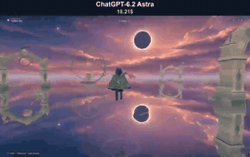</a> <b><a href="https://x.com/vib3coded/status/2123475293575037089">在映着日食的镜面海上奔跑的 Three.js 游戏，花费 18.21 美元</a></b> <a href="https://x.com/vib3coded">@vib3coded</a> · 0:18 · <a href="https://x.com/vib3coded/status/2123475293575037089">X 原帖</a></td>
</tr>
<tr>
<td width="33%" valign="top"> <b><a href="https://x.com/MengTo/status/2123079701384269871">three.js 与 Blender 网页场景：灯笼照亮的室内、通往宝塔的石阶与雾中瀑布</a></b> <a href="https://x.com/MengTo">@MengTo</a> · 0:39 · <a href="https://x.com/MengTo/status/2123079701384269871">X 原帖</a></td>
<td width="33%" valign="top"> <b><a href="https://x.com/givros/status/2123133158124036295">《Gullwatch Isle》：漫步木构村庄、崖边小径与日落城堡废墟，Blender + three.js</a></b> <a href="https://x.com/givros">@givros</a> · 1:29 · <a href="https://x.com/givros/status/2123133158124036295">X 原帖</a></td>
<td width="33%" valign="top"> <b><a href="https://x.com/emollick/status/2123256864125202670">程序化生成的沉没新哥特城市着色器，海浪在尖塔间翻涌</a></b> <a href="https://x.com/emollick">@emollick</a> · 0:20 · <a href="https://x.com/emollick/status/2123256864125202670">X 原帖</a></td>
</tr>
<tr>
<td width="33%" valign="top"> <b><a href="https://x.com/Fomsky_Wei/status/2123114460470747220">three.js 打造的写实湖畔小屋，镜头沿木码头滑过小船</a></b> <a href="https://x.com/Fomsky_Wei">@Fomsky_Wei</a> · 0:12 · <a href="https://x.com/Fomsky_Wei/status/2123114460470747220">X 原帖</a></td>
<td width="33%" valign="top"> <b><a href="https://x.com/TokenGremlin/status/2123797090274885924">漂浮小球随波起伏的海洋模拟，依参考图制作，单个 HTML 文件</a></b> <a href="https://x.com/TokenGremlin">@TokenGremlin</a> · 0:16 · <a href="https://x.com/TokenGremlin/status/2123797090274885924">X 原帖</a></td>
<td width="33%" valign="top"> <b><a href="https://x.com/gamemangaanime/status/2122810072447521194">依参考图一次生成的 Q 版 3D 角色，使用 Blender MCP</a></b> <a href="https://x.com/gamemangaanime">@gamemangaanime</a> · 0:11 · <a href="https://x.com/gamemangaanime/status/2122810072447521194">X 原帖</a></td>
</tr>
<tr>
<td width="33%" valign="top"> <b><a href="https://x.com/TokenGremlin/status/2124186601118990667">茅草屋与村民等 3D 村庄素材，Sol 在 Blender 中建模、Astra 制作动画</a></b> <a href="https://x.com/TokenGremlin">@TokenGremlin</a> · 0:19 · <a href="https://x.com/TokenGremlin/status/2124186601118990667">X 原帖</a></td>
<td width="33%" valign="top"><a href="https://x.com/vib3coded/status/2124460137976942676">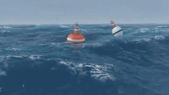</a> <b><a href="https://x.com/vib3coded/status/2124460137976942676">浮标随波起伏的暴风雨海面，15 分钟完成、花费 11.87 美元</a></b> <a href="https://x.com/vib3coded">@vib3coded</a> · 0:18 · <a href="https://x.com/vib3coded/status/2124460137976942676">X 原帖</a></td>
<td width="33%" valign="top"> <b><a href="https://x.com/itssotsot/status/2123752414679334944">蜘蛛视角爬过房间，画面中可见蛛腿</a></b> <a href="https://x.com/itssotsot">@itssotsot</a> · 0:38 · <a href="https://x.com/itssotsot/status/2123752414679334944">X 原帖</a></td>
</tr>
<tr>
<td width="33%" valign="top"><a href="https://x.com/TokenGremlin/status/2123973599488798865">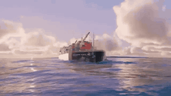</a> <b><a href="https://x.com/TokenGremlin/status/2123973599488798865">有风暴和海怪的海上求生游戏，Blender 素材装进单个 three.js HTML 文件</a></b> <a href="https://x.com/TokenGremlin">@TokenGremlin</a> · 1:25 · <a href="https://x.com/TokenGremlin/status/2123973599488798865">X 原帖</a></td>
<td width="33%" valign="top"><a href="https://x.com/imnotchalk/status/2123164754898514354">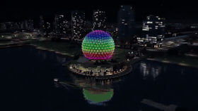</a> <b><a href="https://x.com/imnotchalk/status/2123164754898514354">夜色中的温哥华科学世界与 SkyTrain 轻轨，Blender + three.js</a></b> <a href="https://x.com/imnotchalk">@imnotchalk</a> · 1:00 · <a href="https://x.com/imnotchalk/status/2123164754898514354">X 原帖</a></td>
<td width="33%" valign="top"><a href="https://x.com/diegocabezas01/status/2123040525997719797">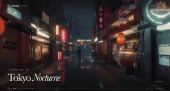</a> <b><a href="https://x.com/diegocabezas01/status/2123040525997719797">《Tokyo Nocturne》：漫步雨夜霓虹东京小巷，GPT-6.2 Astra Ultra</a></b> <a href="https://x.com/diegocabezas01">@diegocabezas01</a> · 1:28 · <a href="https://x.com/diegocabezas01/status/2123040525997719797">X 原帖</a></td>
</tr>
<tr>
<td width="33%" valign="top"> <b><a href="https://x.com/PawelJLisowski/status/2122977741993660867">夜间暴风雨中的礁岸灯塔，单个 Python 脚本在 Blender 中生成，GPT-6.2 Astra 版本</a></b> <a href="https://x.com/PawelJLisowski">@PawelJLisowski</a> · 0:10 · <a href="https://x.com/PawelJLisowski/status/2122977741993660867">X 原帖</a></td>
<td width="33%" valign="top"> <b><a href="https://x.com/diegocabezas01/status/2124125928640885180">从山谷仰望夜间沿山脊燃烧的山火，单个 HTML 文件</a></b> <a href="https://x.com/diegocabezas01">@diegocabezas01</a> · 0:48 · <a href="https://x.com/diegocabezas01/status/2124125928640885180">X 原帖</a></td>
<td width="33%" valign="top"> <b><a href="https://x.com/ouchi/status/2123707803932274901">从图片生成 3D 模型的可爱机器人，可在浏览器中走动</a></b> <a href="https://x.com/ouchi">@ouchi</a> · 0:20 · <a href="https://x.com/ouchi/status/2123707803932274901">X 原帖</a></td>
</tr>
<tr>
<td width="33%" valign="top"> <b><a href="https://x.com/Dimillian/status/2123065728697778446">同一片黄昏森林的三种风格：写实、绘本与液态玻璃</a></b> <a href="https://x.com/Dimillian">@Dimillian</a> · 0:30 · <a href="https://x.com/Dimillian/status/2123065728697778446">X 原帖</a></td>
<td width="33%" valign="top"><a href="https://x.com/semichenkko/status/2123837890182414567">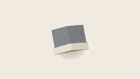</a> <b><a href="https://x.com/semichenkko/status/2123837890182414567">用堆叠精灵逐步搭起的漂浮纽约微缩景观</a></b> <a href="https://x.com/semichenkko">@semichenkko</a> · 0:24 · <a href="https://x.com/semichenkko/status/2123837890182414567">X 原帖</a></td>
<td width="33%" valign="top"><a href="https://x.com/HaileyAILabs/status/2123938048996245591">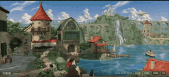</a> <b><a href="https://x.com/HaileyAILabs/status/2123938048996245591">《风眠镇》：纯代码打造的宫崎骏风 3D 梦幻小镇，前后打磨 7 个版本</a></b> <a href="https://x.com/HaileyAILabs">@HaileyAILabs</a> · 0:24 · <a href="https://x.com/HaileyAILabs/status/2123938048996245591">X 原帖</a></td>
</tr>
<tr>
<td width="33%" valign="top"> <b><a href="https://x.com/LuminaBench/status/2123833392386957812">可完整操控飞行的 3D 水上飞机，飞越阿拉斯加群山中的湖泊</a></b> <a href="https://x.com/LuminaBench">@LuminaBench</a> · 1:42 · <a href="https://x.com/LuminaBench/status/2123833392386957812">X 原帖</a></td>
<td width="33%" valign="top"><a href="https://x.com/petergostev/status/2123175702719824292">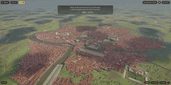</a> <b><a href="https://x.com/petergostev/status/2123175702719824292">可飞越俯瞰的古罗马，一路降入斗兽场看角斗士</a></b> <a href="https://x.com/petergostev">@petergostev</a> · 1:56 · <a href="https://x.com/petergostev/status/2123175702719824292">X 原帖</a></td>
<td width="33%" valign="top"> <b><a href="https://x.com/venturetwins/status/2123609687484698714">可漫步的卢浮宫复刻，从大阶梯到《蒙娜丽莎》展厅，每幅画都有介绍卡</a></b> <a href="https://x.com/venturetwins">@venturetwins</a> · 0:49 · <a href="https://x.com/venturetwins/status/2123609687484698714">X 原帖</a></td>
</tr>
<tr>
<td width="33%" valign="top"> <b><a href="https://x.com/Super_Nius/status/2122755138414920061">果冻海中的小岛，可调海面高度和光照，Sol 用时 14 分钟</a></b> <a href="https://x.com/Super_Nius">@Super_Nius</a> · 0:32 · <a href="https://x.com/Super_Nius/status/2122755138414920061">X 原帖</a></td>
<td width="33%" valign="top"><a href="https://x.com/neviannn/status/2124130353480626223">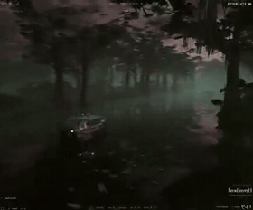</a> <b><a href="https://x.com/neviannn/status/2124130353480626223">柏树林立、小船漂荡的月夜沼泽，可在浏览器中自由探索</a></b> <a href="https://x.com/neviannn">@neviannn</a> · 0:18 · <a href="https://x.com/neviannn/status/2124130353480626223">X 原帖</a></td>
<td width="33%" valign="top"><a href="https://x.com/_satyam_ai/status/2123787482747764918">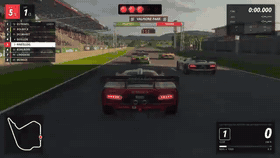</a> <b><a href="https://x.com/_satyam_ai/status/2123787482747764918">在 Chrome 中以 WebGPU 运行的赛车游戏，引擎从零自研</a></b> <a href="https://x.com/_satyam_ai">@_satyam_ai</a> · 1:09 · <a href="https://x.com/_satyam_ai/status/2123787482747764918">X 原帖</a></td>
</tr>
<tr>
<td width="33%" valign="top"><a href="https://x.com/Avenoxai/status/2122989369783206203">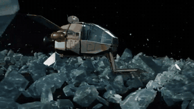</a> <b><a href="https://x.com/Avenoxai/status/2122989369783206203">在土星环中采矿的飞船，Blender 制作</a></b> <a href="https://x.com/Avenoxai">@Avenoxai</a> · 0:36 · <a href="https://x.com/Avenoxai/status/2122989369783206203">X 原帖</a></td>
<td width="33%" valign="top"><a href="https://x.com/lemomo_ai/status/2122978121444184315">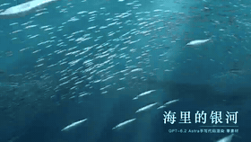</a> <b><a href="https://x.com/lemomo_ai/status/2122978121444184315">《海里的银河》：一万条沙丁鱼遇捕食者炸开又聚成鱼球，纯手写代码</a></b> <a href="https://x.com/lemomo_ai">@lemomo_ai</a> · 0:20 · <a href="https://x.com/lemomo_ai/status/2122978121444184315">X 原帖</a></td>
<td width="33%" valign="top"> <b><a href="https://x.com/aarondelasy/status/2122784351322865740">雪中撑伞人群穿行的城市路口，Blender 一次生成</a></b> <a href="https://x.com/aarondelasy">@aarondelasy</a> · 0:14 · <a href="https://x.com/aarondelasy/status/2122784351322865740">X 原帖</a></td>
</tr>
<tr>
<td width="33%" valign="top"> <b><a href="https://x.com/Bhavani_00007/status/2122767429193646141">《Meridian Sound Racing》：一款 3D 竞速游戏</a></b> <a href="https://x.com/Bhavani_00007">@Bhavani_00007</a> · 1:00 · <a href="https://x.com/Bhavani_00007/status/2122767429193646141">X 原帖</a></td>
<td width="33%" valign="top"> <b><a href="https://x.com/Mortezabihzadeh/status/2122996874827210922">弹珠滚过机关的 3D 桌面世界，可在浏览器中把玩</a></b> <a href="https://x.com/Mortezabihzadeh">@Mortezabihzadeh</a> · 0:49 · <a href="https://x.com/Mortezabihzadeh/status/2122996874827210922">X 原帖</a></td>
<td width="33%" valign="top"><a href="https://x.com/Dimillian/status/2122799400061960611">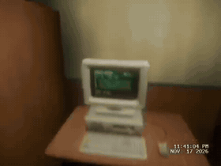</a> <b><a href="https://x.com/Dimillian/status/2122799400061960611">带 VHS 摄像机质感的后室漫游，道具和区域丰富</a></b> <a href="https://x.com/Dimillian">@Dimillian</a> · 0:40 · <a href="https://x.com/Dimillian/status/2122799400061960611">X 原帖</a></td>
</tr>
<tr>
<td width="33%" valign="top"> <b><a href="https://x.com/kloss_xyz/status/2124646782433124652">三个用原生 WebGL 和 GLSL 着色器做的超写实场景，各为单个 HTML 文件</a></b> <a href="https://x.com/kloss_xyz">@kloss_xyz</a> · 0:28 · <a href="https://x.com/kloss_xyz/status/2124646782433124652">X 原帖</a></td>
<td width="33%" valign="top"> <b><a href="https://x.com/Akki_AI7/status/2123211478241271829">日出时云海之上的富士山，15 秒全部由代码绘制</a></b> <a href="https://x.com/Akki_AI7">@Akki_AI7</a> · 0:15 · <a href="https://x.com/Akki_AI7/status/2123211478241271829">X 原帖</a></td>
<td width="33%" valign="top"> <b><a href="https://x.com/Dimillian/status/2122783245976908195">从网页移植到虚幻引擎 5 后，在巴黎圣母院内漫步</a></b> <a href="https://x.com/Dimillian">@Dimillian</a> · 1:21 · <a href="https://x.com/Dimillian/status/2122783245976908195">X 原帖</a></td>
</tr>
<tr>
<td width="33%" valign="top"> <b><a href="https://x.com/LexnLin/status/2123156510339465525">冬日花岗岩峭壁上泛着橙光的“火瀑布”，纯代码</a></b> <a href="https://x.com/LexnLin">@LexnLin</a> · 0:40 · <a href="https://x.com/LexnLin/status/2123156510339465525">X 原帖</a></td>
<td width="33%" valign="top"> <b><a href="https://x.com/coldmountainlab/status/2123075963965898864">水墨风 3D 武侠游戏，角色、场景、特效、音乐与界面均由 AI 生成</a></b> <a href="https://x.com/coldmountainlab">@coldmountainlab</a> · 1:00 · <a href="https://x.com/coldmountainlab/status/2123075963965898864">X 原帖</a></td>
<td width="33%" valign="top"> <b><a href="https://x.com/FlorianGallwitz/status/2122805196938231879">可步行游览的纽伦堡圣诞市场，同一提示半年后的成果</a></b> <a href="https://x.com/FlorianGallwitz">@FlorianGallwitz</a> · 1:23 · <a href="https://x.com/FlorianGallwitz/status/2122805196938231879">X 原帖</a></td>
</tr>
<tr>
<td width="33%" valign="top"> <b><a href="https://x.com/DeryaTR_/status/2122814594737684568">用 Sol 和 Blender 做的蝴蝶画廊网站</a></b> <a href="https://x.com/DeryaTR_">@DeryaTR_</a> · 1:30 · <a href="https://x.com/DeryaTR_/status/2122814594737684568">X 原帖</a></td>
<td width="33%" valign="top"><a href="https://x.com/dken_w/status/2123081219537785006">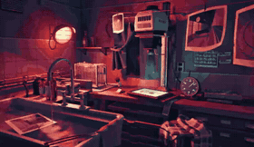</a> <b><a href="https://x.com/dken_w/status/2123081219537785006">红色安全灯下的摄影暗房，约 2500 行纯 C++ 绘制</a></b> <a href="https://x.com/dken_w">@dken_w</a> · 0:14 · <a href="https://x.com/dken_w/status/2123081219537785006">X 原帖</a></td>
<td width="33%" valign="top"><a href="https://x.com/loktar00/status/2123778891642998857">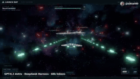</a> <b><a href="https://x.com/loktar00/status/2123778891642998857">战机与爆炸交织的太空大战</a></b> <a href="https://x.com/loktar00">@loktar00</a> · 0:30 · <a href="https://x.com/loktar00/status/2123778891642998857">X 原帖</a></td>
</tr>
<tr>
<td width="33%" valign="top"> <b><a href="https://x.com/Ssr360535694/status/2124359724837863588">《余辉》：飞越湖泊与秋日山丘的 68 KB 像素风飞行游戏</a></b> <a href="https://x.com/Ssr360535694">@Ssr360535694</a> · 0:20 · <a href="https://x.com/Ssr360535694/status/2124359724837863588">X 原帖</a></td>
<td width="33%" valign="top"> <b><a href="https://x.com/KanaWorks_AI/status/2122878806436589861">白瓷仙鹤机械为兔子画尾巴，运行 4 小时的成果</a></b> <a href="https://x.com/KanaWorks_AI">@KanaWorks_AI</a> · 0:25 · <a href="https://x.com/KanaWorks_AI/status/2122878806436589861">X 原帖</a></td>
<td width="33%" valign="top"> <b><a href="https://x.com/Ananth7e/status/2122764162124353906">60 秒做出的夜间飞行游戏，飞越月下山丘</a></b> <a href="https://x.com/Ananth7e">@Ananth7e</a> · 0:30 · <a href="https://x.com/Ananth7e/status/2122764162124353906">X 原帖</a></td>
</tr>
<tr>
<td width="33%" valign="top"> <b><a href="https://x.com/majidmanzarpour/status/2123986686107377776">《KILLFEED》：由 100 多个 AI 代理打造的快节奏浏览器 FPS</a></b> <a href="https://x.com/majidmanzarpour">@majidmanzarpour</a> · 1:16 · <a href="https://x.com/majidmanzarpour/status/2123986686107377776">X 原帖</a></td>
<td width="33%" valign="top"> <b><a href="https://x.com/klausbrave/status/2122808960071917953">《Particle Sheep》粒子绵羊，参考一段视频 20 分钟做成</a></b> <a href="https://x.com/klausbrave">@klausbrave</a> · 0:15 · <a href="https://x.com/klausbrave/status/2122808960071917953">X 原帖</a></td>
<td width="33%" valign="top"><a href="https://x.com/xikhar/status/2123124656316219725">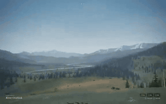</a> <b><a href="https://x.com/xikhar/status/2123124656316219725">可狩猎、钓鱼、砍柴生火的荒野探索游戏，xhigh 强度运行 10 小时</a></b> <a href="https://x.com/xikhar">@xikhar</a> · 1:40 · <a href="https://x.com/xikhar/status/2123124656316219725">X 原帖</a></td>
</tr>
<tr>
<td width="33%" valign="top"> <b><a href="https://x.com/fleetingbits/status/2124998107884867704">绘画质感的菲利普·约翰逊玻璃屋 3D 渲染，秋日树林环绕，用于个人网站</a></b> <a href="https://x.com/fleetingbits">@fleetingbits</a> · 0:29 · <a href="https://x.com/fleetingbits/status/2124998107884867704">X 原帖</a></td>
<td width="33%" valign="top"> <b><a href="https://x.com/rubenssoto_ai/status/2124188465747173595">可真实撞车的开放公路驾驶游戏，Opus 5.5 与 Astra 合作 2 天完成</a></b> <a href="https://x.com/rubenssoto_ai">@rubenssoto_ai</a> · 0:40 · <a href="https://x.com/rubenssoto_ai/status/2124188465747173595">X 原帖</a></td>
<td width="33%" valign="top"> <b><a href="https://x.com/DeryaTR_/status/2122925157086114283">可漫游的纽约：乘地铁穿过东河底，再走楼梯回到街头</a></b> <a href="https://x.com/DeryaTR_">@DeryaTR_</a> · 2:00 · <a href="https://x.com/DeryaTR_/status/2122925157086114283">X 原帖</a></td>
</tr>
<tr>
<td width="33%" valign="top"> <b><a href="https://x.com/loktar00/status/2124876876003058040">《The Forager》：向日葵上的逼真蜜蜂</a></b> <a href="https://x.com/loktar00">@loktar00</a> · 0:30 · <a href="https://x.com/loktar00/status/2124876876003058040">X 原帖</a></td>
<td width="33%" valign="top"> <b><a href="https://x.com/pritopian/status/2122955868497178905">3D 重现拉贾·拉维·瓦尔马名画《月光下的拉达》，纱丽纹样与首饰细致入微</a></b> <a href="https://x.com/pritopian">@pritopian</a> · 0:20 · <a href="https://x.com/pritopian/status/2122955868497178905">X 原帖</a></td>
<td width="33%" valign="top"> <b><a href="https://x.com/JesusIsGod/status/2122899824722772297">《Open Channel》：暴风雨笼罩空旷公路的小游戏，1 小时做成</a></b> <a href="https://x.com/JesusIsGod">@JesusIsGod</a> · 1:57 · <a href="https://x.com/JesusIsGod/status/2122899824722772297">X 原帖</a></td>
</tr>
<tr>
<td width="33%" valign="top"> <b><a href="https://x.com/op7418/status/2123071662199583137">云中盘绕在中式宝塔上的石龙</a></b> <a href="https://x.com/op7418">@op7418</a> · 0:08 · <a href="https://x.com/op7418/status/2123071662199583137">X 原帖</a></td>
<td width="33%" valign="top"> <b><a href="https://x.com/OmoiroProject/status/2122954817144512612">无人机视角飞越京都风街景，three.js + Blender</a></b> <a href="https://x.com/OmoiroProject">@OmoiroProject</a> · 0:30 · <a href="https://x.com/OmoiroProject/status/2122954817144512612">X 原帖</a></td>
<td width="33%" valign="top"> <b><a href="https://x.com/kloss_xyz/status/2125038756264837301">苔藓森林中巨型粉色蘑菇下的机器人，单个 HTML 文件一次生成</a></b> <a href="https://x.com/kloss_xyz">@kloss_xyz</a> · 0:29 · <a href="https://x.com/kloss_xyz/status/2125038756264837301">X 原帖</a></td>
</tr>
<tr>
<td width="33%" valign="top"><a href="https://x.com/Lokastaz/status/2123072990359232690">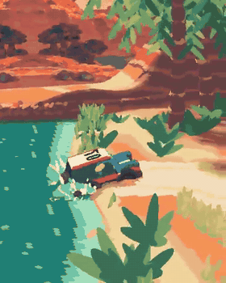</a> <b><a href="https://x.com/Lokastaz/status/2123072990359232690">像素风泼溅小游戏：小四驱车飞跃坡道、冲进水里</a></b> <a href="https://x.com/Lokastaz">@Lokastaz</a> · 0:11 · <a href="https://x.com/Lokastaz/status/2123072990359232690">X 原帖</a></td>
<td width="33%" valign="top"> <b><a href="https://x.com/baku_lab/status/2122900918941434287">《Orbit Arcade》：带熊猫角色的弹珠游戏，仅 2.74 MB，未使用 Unity</a></b> <a href="https://x.com/baku_lab">@baku_lab</a> · 0:14 · <a href="https://x.com/baku_lab/status/2122900918941434287">X 原帖</a></td>
<td width="33%" valign="top"> <b><a href="https://x.com/maxt3chno/status/2123064075802296326">由 Opus 5.5 与 GPT-6.2 并行协作做出的可玩战舰小游戏</a></b> <a href="https://x.com/maxt3chno">@maxt3chno</a> · 1:10 · <a href="https://x.com/maxt3chno/status/2123064075802296326">X 原帖</a></td>
</tr>
<tr>
<td width="33%" valign="top"> <b><a href="https://x.com/fxtrader/status/2122756192791662752">海滩上骑车的鹈鹕，three.js 仅凭内部知识制作，High 强度</a></b> <a href="https://x.com/fxtrader">@fxtrader</a> · 1:14 · <a href="https://x.com/fxtrader/status/2122756192791662752">X 原帖</a></td>
<td width="33%" valign="top"> <b><a href="https://x.com/danveloper/status/2122766260811313326">梯田式高楼组成的绿色城市，Ultra 强度 16 分钟完成</a></b> <a href="https://x.com/danveloper">@danveloper</a> · 0:12 · <a href="https://x.com/danveloper/status/2122766260811313326">X 原帖</a></td>
<td width="33%" valign="top"> <b><a href="https://x.com/yyuntng177680/status/2123258802334310455">摆着皮质扶手椅的写实书房，仅凭一张模糊截图建模并光追渲染</a></b> <a href="https://x.com/yyuntng177680">@yyuntng177680</a> · 0:14 · <a href="https://x.com/yyuntng177680/status/2123258802334310455">X 原帖</a></td>
</tr>
<tr>
<td width="33%" valign="top"><a href="https://x.com/muku_sns/status/2123048325247373643">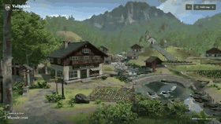</a> <b><a href="https://x.com/muku_sns/status/2123048325247373643">《Valbrune》：瑞士山村，全程无人动手操作 Blender</a></b> <a href="https://x.com/muku_sns">@muku_sns</a> · 0:29 · <a href="https://x.com/muku_sns/status/2123048325247373643">X 原帖</a></td>
<td width="33%" valign="top"><a href="https://x.com/CodeByNZ/status/2122760051454562368">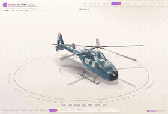</a> <b><a href="https://x.com/CodeByNZ/status/2122760051454562368">可飞行的 3D 直升机，带组装与爆炸视图，Sol 用时 7 分钟</a></b> <a href="https://x.com/CodeByNZ">@CodeByNZ</a> · 1:15 · <a href="https://x.com/CodeByNZ/status/2122760051454562368">X 原帖</a></td>
<td width="33%" valign="top"><a href="https://x.com/Masimo_Blue/status/2122846803477537071">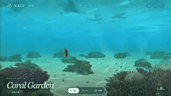</a> <b><a href="https://x.com/Masimo_Blue/status/2122846803477537071">《Coral Garden》：可在海中畅游的网站，还能戳小鱼</a></b> <a href="https://x.com/Masimo_Blue">@Masimo_Blue</a> · 2:18 · <a href="https://x.com/Masimo_Blue/status/2122846803477537071">X 原帖</a></td>
</tr>
<tr>
<td width="33%" valign="top"> <b><a href="https://x.com/pieash4/status/2124489245343760883">《Yakiimo Catch》：猫咪店员招待客人的可爱像素游戏，Sol 只用 5 条消息</a></b> <a href="https://x.com/pieash4">@pieash4</a> · 0:14 · <a href="https://x.com/pieash4/status/2124489245343760883">X 原帖</a></td>
<td width="33%" valign="top"> <b><a href="https://x.com/lucian__03/status/2122782073102663874">HTML 3D 鲁布·戈德堡机械，Sol 在 Max 强度下耗时 25 分钟、花费 3.03 美元</a></b> <a href="https://x.com/lucian__03">@lucian__03</a> · 0:21 · <a href="https://x.com/lucian__03/status/2122782073102663874">X 原帖</a></td>
<td width="33%" valign="top"> <b><a href="https://x.com/mansfieldrv6/status/2123508977224831336">依据机主照片与图纸做出的小型特技飞机，飞越群山与湖泊</a></b> <a href="https://x.com/mansfieldrv6">@mansfieldrv6</a> · 1:02 · <a href="https://x.com/mansfieldrv6/status/2123508977224831336">X 原帖</a></td>
</tr>
<tr>
<td width="33%" valign="top"> <b><a href="https://x.com/lucian__03/status/2122770012234805383">3D 城市灾难模拟器，有龙卷风、陨石和洪水，Max 强度约 40 分钟</a></b> <a href="https://x.com/lucian__03">@lucian__03</a> · 0:18 · <a href="https://x.com/lucian__03/status/2122770012234805383">X 原帖</a></td>
<td width="33%" valign="top"> <b><a href="https://x.com/pr0mptcat/status/2123188810942931447">夕阳下航行的电影感海盗船，花费 4.86 美元</a></b> <a href="https://x.com/pr0mptcat">@pr0mptcat</a> · 0:16 · <a href="https://x.com/pr0mptcat/status/2123188810942931447">X 原帖</a></td>
<td width="33%" valign="top"> <b><a href="https://x.com/koguGameDev/status/2123414745034400161">《mlegged》：暗色坡道上的巨型蜘蛛机器人与爬行机，可玩的 Three.js 网页</a></b> <a href="https://x.com/koguGameDev">@koguGameDev</a> · 2:03 · <a href="https://x.com/koguGameDev/status/2123414745034400161">X 原帖</a></td>
</tr>
<tr>
<td width="33%" valign="top"> <b><a href="https://x.com/lemomo_ai/status/2122916161839038862">《午后的水池》：五颜六色的小黄鸭漂在泳池上，32 KB 手写 WebGL 网页，不用任何图片</a></b> <a href="https://x.com/lemomo_ai">@lemomo_ai</a> · 0:20 · <a href="https://x.com/lemomo_ai/status/2122916161839038862">X 原帖</a></td>
<td width="33%" valign="top"><a href="https://x.com/Maxq5xs/status/2122772121940308343">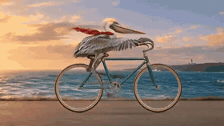</a> <b><a href="https://x.com/Maxq5xs/status/2122772121940308343">系着红围巾、在夕阳海边骑车的逼真鹈鹕</a></b> <a href="https://x.com/Maxq5xs">@Maxq5xs</a> · 0:12 · <a href="https://x.com/Maxq5xs/status/2122772121940308343">X 原帖</a></td>
<td width="33%" valign="top"> <b><a href="https://x.com/pankajkumar_dev/status/2122785662734868949">《The Last Phone Call》：雨雾中的黑色电影街道与红色电话亭</a></b> <a href="https://x.com/pankajkumar_dev">@pankajkumar_dev</a> · 0:31 · <a href="https://x.com/pankajkumar_dev/status/2122785662734868949">X 原帖</a></td>
</tr>
<tr>
<td width="33%" valign="top"> <b><a href="https://x.com/DFintelligence/status/2122798818274017712">3D 马赛，夕阳下的港口</a></b> <a href="https://x.com/DFintelligence">@DFintelligence</a> · 0:35 · <a href="https://x.com/DFintelligence/status/2122798818274017712">X 原帖</a></td>
</tr>
</table>

## 音乐

<table>
<tr>
<td width="33%" valign="top"> <b><a href="https://x.com/rvm0n_/status/2122768551354208665">一首原创古典钢琴曲，以下落音符呈现</a></b> <a href="https://x.com/rvm0n_">@rvm0n_</a> · 1:40 · <a href="https://x.com/rvm0n_/status/2122768551354208665">X 原帖</a></td>
<td width="33%" valign="top"><a href="https://x.com/aug5thmusic/status/2122767673570607401">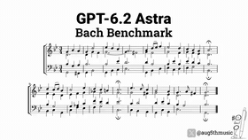</a> <b><a href="https://x.com/aug5thmusic/status/2122767673570607401">Bach Benchmark 上的一首众赞歌，以乐谱呈现</a></b> <a href="https://x.com/aug5thmusic">@aug5thmusic</a> · 0:51 · <a href="https://x.com/aug5thmusic/status/2122767673570607401">X 原帖</a></td>
<td width="33%" valign="top"> <b><a href="https://x.com/Angaisb_/status/2122759047107444948">《All the Swifts Return》：配插画港口小镇的一首歌</a></b> <a href="https://x.com/Angaisb_">@Angaisb_</a> · 1:50 · <a href="https://x.com/Angaisb_/status/2122759047107444948">X 原帖</a></td>
</tr>
<tr>
<td width="33%" valign="top"><a href="https://x.com/aug5thmusic/status/2122773822348874149">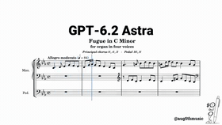</a> <b><a href="https://x.com/aug5thmusic/status/2122773822348874149">用 LilyPond 写成的 C 小调管风琴赋格，Extra High 强度</a></b> <a href="https://x.com/aug5thmusic">@aug5thmusic</a> · 2:47 · <a href="https://x.com/aug5thmusic/status/2122773822348874149">X 原帖</a></td>
<td width="33%" valign="top"> <b><a href="https://x.com/aug5thmusic/status/2123140487368642799">《Alder Mill》：复古掌机风像素 RPG，配乐用 LilyPond 写成，Extra High 强度</a></b> <a href="https://x.com/aug5thmusic">@aug5thmusic</a> · 1:47 · <a href="https://x.com/aug5thmusic/status/2123140487368642799">X 原帖</a></td>
</tr>
</table>

## 模型对比

<table>
<tr>
<td width="33%" valign="top"> <b><a href="https://x.com/kinderlayer/status/2124465319087308918">剖面中点火运转的发动机气缸：Fable 5.2、GPT-6.2 Astra、Gemini 4 Neon 与 Grok 4.7 对比</a></b> <a href="https://x.com/kinderlayer">@kinderlayer</a> · 0:12 · <a href="https://x.com/kinderlayer/status/2124465319087308918">X 原帖</a></td>
<td width="33%" valign="top"> <b><a href="https://x.com/eliadele/status/2123878763624857693">OutputBench 上降落波拉波拉岛的水上飞机：Gemini 4 Neon、Fable 5.2、GPT-6.2 Astra 与 Opus 5.5 对比</a></b> <a href="https://x.com/eliadele">@eliadele</a> · 1:16 · <a href="https://x.com/eliadele/status/2123878763624857693">X 原帖</a></td>
<td width="33%" valign="top"> <b><a href="https://x.com/mizugame_22/status/2123756243827486822">一句话在 Blender 中生成的京都雨夜小巷：Fable 5.2、GPT-6.2 Astra 与 Gemini 4 Neon 对比</a></b> <a href="https://x.com/mizugame_22">@mizugame_22</a> · 0:13 · <a href="https://x.com/mizugame_22/status/2123756243827486822">X 原帖</a></td>
</tr>
<tr>
<td width="33%" valign="top"> <b><a href="https://x.com/EnvolDev/status/2122773694783349144">同一提示的冰之大教堂：GPT-6.2 Astra 对比 Fable 5.2</a></b> <a href="https://x.com/EnvolDev">@EnvolDev</a> · 0:25 · <a href="https://x.com/EnvolDev/status/2122773694783349144">X 原帖</a></td>
<td width="33%" valign="top"> <b><a href="https://x.com/jony_palino/status/2123889278501495127">夕阳下骑行的 2D 骑手：Gemini 4 Neon、GPT-6.2 Sol、DeepSeek V4.1 Flash 与 Fable 5.2 对比</a></b> <a href="https://x.com/jony_palino">@jony_palino</a> · 0:16 · <a href="https://x.com/jony_palino/status/2123889278501495127">X 原帖</a></td>
<td width="33%" valign="top"> <b><a href="https://x.com/EnvolDev/status/2122803967272866254">同一 Alpine Gold 提示的飞机：GPT-6.2 Astra、GPT-6.2 Sol、Fable 5.2 与 Opus 5.5 对比</a></b> <a href="https://x.com/EnvolDev">@EnvolDev</a> · 0:25 · <a href="https://x.com/EnvolDev/status/2122803967272866254">X 原帖</a></td>
</tr>
<tr>
<td width="33%" valign="top"> <b><a href="https://x.com/ChrisGPT/status/2122837291874070590">Blender 中 10 秒的牛仔玩具短片：GPT-6.2 Astra 对比 Fable 5.2</a></b> <a href="https://x.com/ChrisGPT">@ChrisGPT</a> · 0:10 · <a href="https://x.com/ChrisGPT/status/2122837291874070590">X 原帖</a></td>
<td width="33%" valign="top"> <b><a href="https://x.com/AmirMushich/status/2122815524124152216">在 Blender 中建模并制作动画的机械手：GPT-6.2 Astra 对比 Fable 5.2</a></b> <a href="https://x.com/AmirMushich">@AmirMushich</a> · 0:12 · <a href="https://x.com/AmirMushich/status/2122815524124152216">X 原帖</a></td>
<td width="33%" valign="top"> <b><a href="https://x.com/dom_scholz/status/2122862040326807696">three.js 海底潜艇：Fable 5.2 仅 242 KB，GPT-6.2 Astra 达 32.9 MB</a></b> <a href="https://x.com/dom_scholz">@dom_scholz</a> · 0:40 · <a href="https://x.com/dom_scholz/status/2122862040326807696">X 原帖</a></td>
</tr>
<tr>
<td width="33%" valign="top"><a href="https://x.com/LuminaBench/status/2122758425520029886">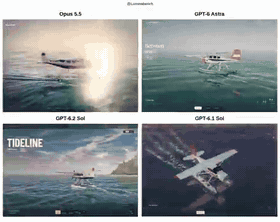</a> <b><a href="https://x.com/LuminaBench/status/2122758425520029886">3D 水上飞机测试：GPT-6.2 Sol 对比 GPT-6.1 Sol</a></b> <a href="https://x.com/LuminaBench">@LuminaBench</a> · 0:39 · <a href="https://x.com/LuminaBench/status/2122758425520029886">X 原帖</a></td>
<td width="33%" valign="top"> <b><a href="https://x.com/MrTacticalX/status/2122806350543774075">同一提示的玻璃泳池：Fable 5.2 对比 GPT-6.2 Astra</a></b> <a href="https://x.com/MrTacticalX">@MrTacticalX</a> · 0:30 · <a href="https://x.com/MrTacticalX/status/2122806350543774075">X 原帖</a></td>
<td width="33%" valign="top"> <b><a href="https://x.com/lemomo_ai/status/2123305001804333337">冰块里的草莓慢慢融化，均为 High：GPT-6.2 Astra、Gemini 4 Neon、Fable 5.2 与 Opus 5.5 对比</a></b> <a href="https://x.com/lemomo_ai">@lemomo_ai</a> · 0:20 · <a href="https://x.com/lemomo_ai/status/2123305001804333337">X 原帖</a></td>
</tr>
<tr>
<td width="33%" valign="top"> <b><a href="https://x.com/N1n3VASthR33H/status/2122972313989845173">带码头和红船的湖畔小屋：GPT-6 Astra 对比 GPT-6.2 Astra</a></b> <a href="https://x.com/N1n3VASthR33H">@N1n3VASthR33H</a> · 0:08 · <a href="https://x.com/N1n3VASthR33H/status/2122972313989845173">X 原帖</a></td>
<td width="33%" valign="top"><a href="https://x.com/nicochristie/status/2123185990923874325">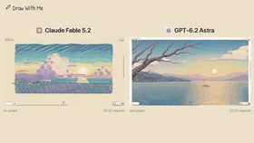</a> <b><a href="https://x.com/nicochristie/status/2123185990923874325">《Draw With Me》逐笔绘出海边樱花风景：Fable 5.2 对比 GPT-6.2 Astra</a></b> <a href="https://x.com/nicochristie">@nicochristie</a> · 0:30 · <a href="https://x.com/nicochristie/status/2123185990923874325">X 原帖</a></td>
<td width="33%" valign="top"> <b><a href="https://x.com/ZryMiller/status/2124897056280219998">飘落穿越四季的一片叶子：GPT-6.2 Astra 花费 10.15 美元，Gemini 4 Neon 花费 15.36 美元</a></b> <a href="https://x.com/ZryMiller">@ZryMiller</a> · 0:20 · <a href="https://x.com/ZryMiller/status/2124897056280219998">X 原帖</a></td>
</tr>
<tr>
<td width="33%" valign="top"><a href="https://x.com/rubenssoto_ai/status/2122793788087193650">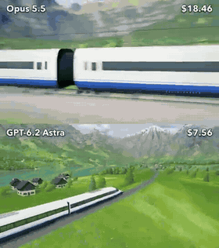</a> <b><a href="https://x.com/rubenssoto_ai/status/2122793788087193650">火车驶过的高山草甸：GPT-6.2 Astra 对比 Opus 5.5</a></b> <a href="https://x.com/rubenssoto_ai">@rubenssoto_ai</a> · 0:30 · <a href="https://x.com/rubenssoto_ai/status/2122793788087193650">X 原帖</a></td>
<td width="33%" valign="top"> <b><a href="https://x.com/vib3coded/status/2124245249786855836">低多边形群山上空的飞行模拟：GPT-6.2 Astra 花费 5.31 美元，Fable 5.2 花费 22.78 美元</a></b> <a href="https://x.com/vib3coded">@vib3coded</a> · 0:16 · <a href="https://x.com/vib3coded/status/2124245249786855836">X 原帖</a></td>
<td width="33%" valign="top"><a href="https://x.com/vib3coded/status/2124612292490752267">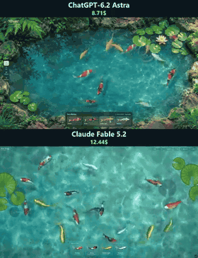</a> <b><a href="https://x.com/vib3coded/status/2124612292490752267">俯瞰锦鲤池：GPT-6.2 Astra 耗时 28 分钟、花费 8.71 美元，Fable 5.2 耗时 16 分钟、花费 12.44 美元</a></b> <a href="https://x.com/vib3coded">@vib3coded</a> · 0:17 · <a href="https://x.com/vib3coded/status/2124612292490752267">X 原帖</a></td>
</tr>
<tr>
<td width="33%" valign="top"><a href="https://x.com/DanielZambrini/status/2123891957529510012">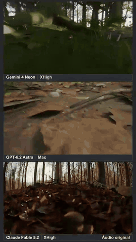</a> <b><a href="https://x.com/DanielZambrini/status/2123891957529510012">《Life in the Eyes of a Squirrel》30 秒纯代码短片：Gemini 4 Neon、GPT-6.2 Astra 与 Fable 5.2 对比</a></b> <a href="https://x.com/DanielZambrini">@DanielZambrini</a> · 0:30 · <a href="https://x.com/DanielZambrini/status/2123891957529510012">X 原帖</a></td>
<td width="33%" valign="top"><a href="https://x.com/ivanainai/status/2123406931075441111">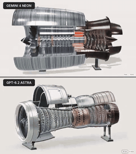</a> <b><a href="https://x.com/ivanainai/status/2123406931075441111">喷气发动机剖面：Gemini 4 Neon 对比 GPT-6.2 Astra</a></b> <a href="https://x.com/ivanainai">@ivanainai</a> · 0:26 · <a href="https://x.com/ivanainai/status/2123406931075441111">X 原帖</a></td>
<td width="33%" valign="top"> <b><a href="https://x.com/EnvolDev/status/2123815633347543159">一次生成的冬日城堡：GPT-6.2 Astra 耗时 54 分钟、花费 11.15 美元，Fable 5.2 耗时 2 小时 57 分、花费 131.31 美元</a></b> <a href="https://x.com/EnvolDev">@EnvolDev</a> · 0:25 · <a href="https://x.com/EnvolDev/status/2123815633347543159">X 原帖</a></td>
</tr>
<tr>
<td width="33%" valign="top"> <b><a href="https://x.com/simonw/status/2122822310428279136">扬克斯化身巨型机甲踏过纽约：GPT-6.2 Astra 对比 GPT-6.2 Sol</a></b> <a href="https://x.com/simonw">@simonw</a> · 0:20 · <a href="https://x.com/simonw/status/2122822310428279136">X 原帖</a></td>
<td width="33%" valign="top"> <b><a href="https://x.com/rubenssoto_ai/status/2122879969420566740">夜晚森林中的篝火：GPT-6.2 Astra、Fable 5.2 与 Opus 5.5 对比</a></b> <a href="https://x.com/rubenssoto_ai">@rubenssoto_ai</a> · 0:30 · <a href="https://x.com/rubenssoto_ai/status/2122879969420566740">X 原帖</a></td>
<td width="33%" valign="top"> <b><a href="https://x.com/EnvolDev/status/2122788867694858629">Alpine Gold 飞机：GPT-6.2 Sol 花费 2.07 美元，Opus 5.5 花费 31.85 美元</a></b> <a href="https://x.com/EnvolDev">@EnvolDev</a> · 0:25 · <a href="https://x.com/EnvolDev/status/2122788867694858629">X 原帖</a></td>
</tr>
<tr>
<td width="33%" valign="top"> <b><a href="https://x.com/PhysAIAnalysis/status/2122830478663434403">拆开两个互锁的爪形零件：GPT-6.2 Astra 对比 Fable 5.2</a></b> <a href="https://x.com/PhysAIAnalysis">@PhysAIAnalysis</a> · 0:19 · <a href="https://x.com/PhysAIAnalysis/status/2122830478663434403">X 原帖</a></td>
<td width="33%" valign="top"> <b><a href="https://x.com/ZryMiller/status/2123228351984980040">骑独轮车的章鱼水手：GPT-6.2 Astra 用时 21 分钟、花费 2.52 美元，对比 Gemini 4 Neon 用时 41 分钟、花费 4.02 美元</a></b> <a href="https://x.com/ZryMiller">@ZryMiller</a> · 0:12 · <a href="https://x.com/ZryMiller/status/2123228351984980040">X 原帖</a></td>
<td width="33%" valign="top"> <b><a href="https://x.com/Da7_Tech/status/2123712489443713478">夕阳下航行的高桅帆船：Fable 5.2、GPT-6.2 Astra 与 Gemini 4 Neon 对比</a></b> <a href="https://x.com/Da7_Tech">@Da7_Tech</a> · 0:29 · <a href="https://x.com/Da7_Tech/status/2123712489443713478">X 原帖</a></td>
</tr>
<tr>
<td width="33%" valign="top"> <b><a href="https://x.com/kinderlayer/status/2123379979119444471">从地毯中起身走进雪地的熊：Fable 5.2 对比 GPT-6.2 Astra</a></b> <a href="https://x.com/kinderlayer">@kinderlayer</a> · 0:30 · <a href="https://x.com/kinderlayer/status/2123379979119444471">X 原帖</a></td>
<td width="33%" valign="top"> <b><a href="https://x.com/teddyaisi/status/2124353151646200097">three.js 中 20 秒漫步巴洛克图书馆：GPT-6.2 Astra 对比 Gemini 4 Neon</a></b> <a href="https://x.com/teddyaisi">@teddyaisi</a> · 0:20 · <a href="https://x.com/teddyaisi/status/2124353151646200097">X 原帖</a></td>
<td width="33%" valign="top"> <b><a href="https://x.com/jony_palino/status/2123521701891748223">奔驰的骏马：GPT-6.2 Astra、GPT-6.2 Sol、Gemini 4 Neon 与 Fable 5.2 对比</a></b> <a href="https://x.com/jony_palino">@jony_palino</a> · 0:16 · <a href="https://x.com/jony_palino/status/2123521701891748223">X 原帖</a></td>
</tr>
<tr>
<td width="33%" valign="top"> <b><a href="https://x.com/camperaigg/status/2122794828266377538">火光与声响全由代码生成的爆炸：GPT-6.2 Sol 对比 Opus 5.5，均为 Xhigh</a></b> <a href="https://x.com/camperaigg">@camperaigg</a> · 0:24 · <a href="https://x.com/camperaigg/status/2122794828266377538">X 原帖</a></td>
<td width="33%" valign="top"> <b><a href="https://x.com/0xShoopy/status/2123518721981374468">一次生成的浮空岛 3D 应用：GPT-6.2 Astra 1.10 美元、Fable 5.2 9.77 美元与 Opus 5.5（Fable 顾问）5.94 美元对比</a></b> <a href="https://x.com/0xShoopy">@0xShoopy</a> · 0:20 · <a href="https://x.com/0xShoopy/status/2123518721981374468">X 原帖</a></td>
<td width="33%" valign="top"> <b><a href="https://x.com/EnvolDev/status/2124238419140444661">同一 Alpine Gold 提示的峡湾瀑布水上飞机：GPT-6.2 Astra、Fable 5.2、Gemini 4 Neon 与 Gemini 4 Argon 对比</a></b> <a href="https://x.com/EnvolDev">@EnvolDev</a> · 0:25 · <a href="https://x.com/EnvolDev/status/2124238419140444661">X 原帖</a></td>
</tr>
<tr>
<td width="33%" valign="top"> <b><a href="https://x.com/R2Cdev_/status/2122763544194330627">孔雀 SVG 测试，Max 强度：GPT-6.2 Astra 对比 Fable 5.2</a></b> <a href="https://x.com/R2Cdev_">@R2Cdev_</a> · 0:16 · <a href="https://x.com/R2Cdev_/status/2122763544194330627">X 原帖</a></td>
<td width="33%" valign="top"> <b><a href="https://x.com/ivanainai/status/2123160875611623711">一步步搭建起来的哥特式大教堂：Fable 5.2 对比 GPT-6.2 Astra</a></b> <a href="https://x.com/ivanainai">@ivanainai</a> · 0:35 · <a href="https://x.com/ivanainai/status/2123160875611623711">X 原帖</a></td>
<td width="33%" valign="top"> <b><a href="https://x.com/Dav338876/status/2123811456525459754">风格化的灯塔海岸：GPT-6.2 Astra 用时 31 分 46 秒，Gemini 4 Neon 用时 16 分 28 秒</a></b> <a href="https://x.com/Dav338876">@Dav338876</a> · 0:16 · <a href="https://x.com/Dav338876/status/2123811456525459754">X 原帖</a></td>
</tr>
<tr>
<td width="33%" valign="top"> <b><a href="https://x.com/vib3coded/status/2124999025505993078">《Bloom Pool》水面漂花的泳池：GPT-6.2 Astra 用时 25 分钟，Fable 5.2 用时 1 小时 12 分</a></b> <a href="https://x.com/vib3coded">@vib3coded</a> · 0:18 · <a href="https://x.com/vib3coded/status/2124999025505993078">X 原帖</a></td>
<td width="33%" valign="top"> <b><a href="https://x.com/Layton_Gott/status/2123202081259495833">日落时分的二战海战：GPT-6.2 Astra 约 68 美元、3 小时 49 分，对比 Fable 5.2 约 111 美元、6 小时 19 分</a></b> <a href="https://x.com/Layton_Gott">@Layton_Gott</a> · 2:00 · <a href="https://x.com/Layton_Gott/status/2123202081259495833">X 原帖</a></td>
<td width="33%" valign="top"> <b><a href="https://x.com/Angaisb_/status/2122762815757017410">金币在两部手机间飞过的 SVG 动画：Gemini 4 Carbon 对比 GPT-6.2 Astra</a></b> <a href="https://x.com/Angaisb_">@Angaisb_</a> · 0:28 · <a href="https://x.com/Angaisb_/status/2122762815757017410">X 原帖</a></td>
</tr>
<tr>
<td width="33%" valign="top"> <b><a href="https://x.com/MiaAI_lab/status/2123085518418182199">掉落后被压扁的亮晶晶小熊软糖：Gemini 4 Carbon 对比 GPT-6.2 Astra</a></b> <a href="https://x.com/MiaAI_lab">@MiaAI_lab</a> · 0:29 · <a href="https://x.com/MiaAI_lab/status/2123085518418182199">X 原帖</a></td>
<td width="33%" valign="top"> <b><a href="https://x.com/Da7_Tech/status/2122835492500893992">夕阳下的海盗船：GPT-6.2 Astra 对比 Fable 5.2</a></b> <a href="https://x.com/Da7_Tech">@Da7_Tech</a> · 0:29 · <a href="https://x.com/Da7_Tech/status/2122835492500893992">X 原帖</a></td>
<td width="33%" valign="top"> <b><a href="https://x.com/teddyaisi/status/2124190810900140286">three.js 中夕阳下乘贡多拉穿过威尼斯石桥：GPT-6.2 Astra 对比 Gemini 4 Neon</a></b> <a href="https://x.com/teddyaisi">@teddyaisi</a> · 0:20 · <a href="https://x.com/teddyaisi/status/2124190810900140286">X 原帖</a></td>
</tr>
<tr>
<td width="33%" valign="top"> <b><a href="https://x.com/choopyplug1/status/2123105267139383530">夜晚海边灯塔的四个镜头：GPT-6.2 Astra 约 5.54 美元、Fable 5.2 18.40 美元与 Opus 5.5 21.95 美元对比</a></b> <a href="https://x.com/choopyplug1">@choopyplug1</a> · 0:24 · <a href="https://x.com/choopyplug1/status/2123105267139383530">X 原帖</a></td>
<td width="33%" valign="top"> <b><a href="https://x.com/alohaproxy/status/2123030965777821985">自行组装并升空的科幻机甲，Three.js：GPT-6.2 Astra 对比 GPT-6.2 Sol</a></b> <a href="https://x.com/alohaproxy">@alohaproxy</a> · 0:48 · <a href="https://x.com/alohaproxy/status/2123030965777821985">X 原帖</a></td>
<td width="33%" valign="top"> <b><a href="https://x.com/rubenssoto_ai/status/2124335094819119426">红色方程式赛车：Opus 5.5、Gemini 4 Neon 与 GPT-6.2 Astra 对比</a></b> <a href="https://x.com/rubenssoto_ai">@rubenssoto_ai</a> · 0:40 · <a href="https://x.com/rubenssoto_ai/status/2124335094819119426">X 原帖</a></td>
</tr>
<tr>
<td width="33%" valign="top"> <b><a href="https://x.com/RezAIT00/status/2124923926522614078">豪华腕表拆解成零件：Gemini 4 Neon 约 7.26 美元，GPT-6.2 Sol 约 1.50 美元</a></b> <a href="https://x.com/RezAIT00">@RezAIT00</a> · 0:30 · <a href="https://x.com/RezAIT00/status/2124923926522614078">X 原帖</a></td>
<td width="33%" valign="top"> <b><a href="https://x.com/argofowl/status/2123100495976046964">深夜把书桌上的东西拨下去的猫：GPT-6.2 Astra 花费 9.43 美元，Fable 5.2 花费 116.68 美元</a></b> <a href="https://x.com/argofowl">@argofowl</a> · 0:40 · <a href="https://x.com/argofowl/status/2123100495976046964">X 原帖</a></td>
<td width="33%" valign="top"> <b><a href="https://x.com/maxt3chno/status/2123911052832190818">无参考的 Blender MCP 盲测中的战斧：GPT-6.2 Astra、Gemini 4 Neon 与 Opus 5.5 对比</a></b> <a href="https://x.com/maxt3chno">@maxt3chno</a> · 0:40 · <a href="https://x.com/maxt3chno/status/2123911052832190818">X 原帖</a></td>
</tr>
<tr>
<td width="33%" valign="top"> <b><a href="https://x.com/aura_uniiiii/status/2122915684086849611">用 Remotion 制作的钢笔书写“ChatGPT”签名，均为 Max：GPT-6.2 Astra 对比 GPT-6.2 Sol</a></b> <a href="https://x.com/aura_uniiiii">@aura_uniiiii</a> · 0:30 · <a href="https://x.com/aura_uniiiii/status/2122915684086849611">X 原帖</a></td>
<td width="33%" valign="top"> <b><a href="https://x.com/sshayahmet/status/2122778769597554693">梵高风格的高斯泼溅世界：GPT-6.2 Sol 对比 Opus 5.5</a></b> <a href="https://x.com/sshayahmet">@sshayahmet</a> · 0:20 · <a href="https://x.com/sshayahmet/status/2122778769597554693">X 原帖</a></td>
<td width="33%" valign="top"> <b><a href="https://x.com/LuminaBench/status/2122768776663839206">3D 水上飞机测试，新加入 GPT-6.2 Astra</a></b> <a href="https://x.com/LuminaBench">@LuminaBench</a> · 0:39 · <a href="https://x.com/LuminaBench/status/2122768776663839206">X 原帖</a></td>
</tr>
<tr>
<td width="33%" valign="top"> <b><a href="https://x.com/Super_Nius/status/2123169627815698522">雨夜里的等距视角便利店：GPT-6.2 Sol 用时 5 分 29 秒，Gemini 4 Neon 用时 2 分钟</a></b> <a href="https://x.com/Super_Nius">@Super_Nius</a> · 0:24 · <a href="https://x.com/Super_Nius/status/2123169627815698522">X 原帖</a></td>
<td width="33%" valign="top"> <b><a href="https://x.com/Bhavani_00007/status/2124203254011854973">three.js 中的埃菲尔铁塔：Gemini 4 Neon、GPT-6.2 Astra、GPT-6.2 Sol 与 Opus 5.5 对比</a></b> <a href="https://x.com/Bhavani_00007">@Bhavani_00007</a> · 0:30 · <a href="https://x.com/Bhavani_00007/status/2124203254011854973">X 原帖</a></td>
<td width="33%" valign="top"> <b><a href="https://x.com/Super_Nius/status/2122763107793850483">透明海水方块中的小岛：GPT-6.2 Astra、Sol 对比 GPT-6 Astra、GPT-6.1 Sol</a></b> <a href="https://x.com/Super_Nius">@Super_Nius</a> · 0:24 · <a href="https://x.com/Super_Nius/status/2122763107793850483">X 原帖</a></td>
</tr>
<tr>
<td width="33%" valign="top"> <b><a href="https://x.com/AIMind_Ai/status/2124474268079567329">冰封西瓜融化后炸开：Fable 5.2、Opus 5.5、Gemini 4 Neon 与 GPT-6.2 Astra 对比</a></b> <a href="https://x.com/AIMind_Ai">@AIMind_Ai</a> · 0:32 · <a href="https://x.com/AIMind_Ai/status/2124474268079567329">X 原帖</a></td>
<td width="33%" valign="top"> <b><a href="https://x.com/kinderlayer/status/2124840020691284174">利刃击中宫殿地面，冰封猛犸破地而出：Fable 5.2 对比 GPT-6.2 Astra</a></b> <a href="https://x.com/kinderlayer">@kinderlayer</a> · 0:25 · <a href="https://x.com/kinderlayer/status/2124840020691284174">X 原帖</a></td>
<td width="33%" valign="top"> <b><a href="https://x.com/MrTacticalX/status/2122810159970029910">同一提示的海盗船：GPT-6.2 Astra 花费 3.20 美元，Fable 5.2 花费 34.41 美元</a></b> <a href="https://x.com/MrTacticalX">@MrTacticalX</a> · 0:25 · <a href="https://x.com/MrTacticalX/status/2122810159970029910">X 原帖</a></td>
</tr>
<tr>
<td width="33%" valign="top"> <b><a href="https://x.com/fawnunwrap/status/2122809542660825292">FawnBench 上的 3D 小鹿：GPT-6.2 Sol、Astra 对比 Opus 5.5、Fable 5.2</a></b> <a href="https://x.com/fawnunwrap">@fawnunwrap</a> · 0:16 · <a href="https://x.com/fawnunwrap/status/2122809542660825292">X 原帖</a></td>
<td width="33%" valign="top"> <b><a href="https://x.com/jony_palino/status/2122796926961647919">夕阳下奔驰的骏马：GPT-6.2 Astra 对比 GPT-6.2 Sol</a></b> <a href="https://x.com/jony_palino">@jony_palino</a> · 0:17 · <a href="https://x.com/jony_palino/status/2122796926961647919">X 原帖</a></td>
<td width="33%" valign="top"> <b><a href="https://x.com/thtbee_/status/2122810531669311645">机械蜜蜂：GPT-6.2 Astra 用时 1 小时 12 分，GPT-6.2 Sol 用时 43 分钟</a></b> <a href="https://x.com/thtbee_">@thtbee_</a> · 0:34 · <a href="https://x.com/thtbee_/status/2122810531669311645">X 原帖</a></td>
</tr>
<tr>
<td width="33%" valign="top"> <b><a href="https://x.com/Angaisb_/status/2122808937154052311">像素画对比：GPT-6 Astra 与 GPT-6.2 Astra</a></b> <a href="https://x.com/Angaisb_">@Angaisb_</a> · 0:10 · <a href="https://x.com/Angaisb_/status/2122808937154052311">X 原帖</a></td>
<td width="33%" valign="top"> <b><a href="https://x.com/ivanainai/status/2123787634787098976">山间碎石路上的拉力赛车：Opus 5.5、Gemini 4 Neon 与 GPT-6.2 Astra 对比</a></b> <a href="https://x.com/ivanainai">@ivanainai</a> · 0:16 · <a href="https://x.com/ivanainai/status/2123787634787098976">X 原帖</a></td>
<td width="33%" valign="top"> <b><a href="https://x.com/maxt3chno/status/2122855198913663480">云层之上的螺旋桨战斗机，Three.js：GPT-6.2 Sol 对比 GPT-6.2 Astra</a></b> <a href="https://x.com/maxt3chno">@maxt3chno</a> · 0:20 · <a href="https://x.com/maxt3chno/status/2122855198913663480">X 原帖</a></td>
</tr>
<tr>
<td width="33%" valign="top"> <b><a href="https://x.com/PawelJLisowski/status/2123177445150859743">90 分钟内做出的浮空群岛飞行游戏：GPT-6.2 Astra、Fable 5.2、GPT-6.2 Sol 与 Opus 5.5 对比</a></b> <a href="https://x.com/PawelJLisowski">@PawelJLisowski</a> · 0:38 · <a href="https://x.com/PawelJLisowski/status/2123177445150859743">X 原帖</a></td>
<td width="33%" valign="top"> <b><a href="https://x.com/marcthecreatorr/status/2123004538974294470">《Tandem Ride》SVG，女孩与猫骑自行车：GPT-6.2 Sol 花费约 1.9 美元，Opus 5.5 花费约 18 美元</a></b> <a href="https://x.com/marcthecreatorr">@marcthecreatorr</a> · 0:28 · <a href="https://x.com/marcthecreatorr/status/2123004538974294470">X 原帖</a></td>
<td width="33%" valign="top"> <b><a href="https://x.com/RezAIT00/status/2122758069784621228">埃菲尔铁塔巴黎微缩场景，xhigh 强度：GPT-6.2 Astra 对比 GPT-6.2 Sol</a></b> <a href="https://x.com/RezAIT00">@RezAIT00</a> · 0:14 · <a href="https://x.com/RezAIT00/status/2122758069784621228">X 原帖</a></td>
</tr>
<tr>
<td width="33%" valign="top"> <b><a href="https://x.com/FabianoFirmo/status/2124112687668109752">幽暗水中的潜艇：GPT-6.2 Astra 对比 Fable 5.2</a></b> <a href="https://x.com/FabianoFirmo">@FabianoFirmo</a> · 0:40 · <a href="https://x.com/FabianoFirmo/status/2124112687668109752">X 原帖</a></td>
<td width="33%" valign="top"> <b><a href="https://x.com/EnvolDev/status/2124178021154431319">同一 Black Coast Burns 提示的熔岩入海：GPT-6.2 Astra 花费 10.19 美元，Fable 5.2 花费 41.11 美元</a></b> <a href="https://x.com/EnvolDev">@EnvolDev</a> · 0:25 · <a href="https://x.com/EnvolDev/status/2124178021154431319">X 原帖</a></td>
<td width="33%" valign="top"> <b><a href="https://x.com/itssotsot/status/2122815187010883798">墨滴在纸上晕开成罗夏墨迹：GPT-6.2 Astra 对比 Fable 5.2，均为 high</a></b> <a href="https://x.com/itssotsot">@itssotsot</a> · 0:17 · <a href="https://x.com/itssotsot/status/2122815187010883798">X 原帖</a></td>
</tr>
<tr>
<td width="33%" valign="top"> <b><a href="https://x.com/PawelJLisowski/status/2123035052992762312">由概念图做成带骨骼动画的蒸汽朋克 3D 角色，Blender：GPT-6.2 Astra、GPT-6.2 Sol 与 Fable 5.2 对比</a></b> <a href="https://x.com/PawelJLisowski">@PawelJLisowski</a> · 0:20 · <a href="https://x.com/PawelJLisowski/status/2123035052992762312">X 原帖</a></td>
<td width="33%" valign="top"> <b><a href="https://x.com/yohakujpn/status/2123309854227915031">霓虹光环与星芒：Gemini 4 Neon 用时 5 分钟、花费 0.3 美元，对比 GPT-6.2 Astra 用时 19 分钟、花费 1.2 美元</a></b> <a href="https://x.com/yohakujpn">@yohakujpn</a> · 0:20 · <a href="https://x.com/yohakujpn/status/2123309854227915031">X 原帖</a></td>
<td width="33%" valign="top"> <b><a href="https://x.com/riffydays/status/2123334046797410563">一句提示执导的卡通短片，运河边咖啡馆里的男人：Opus 5.5、Gemini 4 Neon 与 GPT-6.2 Astra 对比</a></b> <a href="https://x.com/riffydays">@riffydays</a> · 0:46 · <a href="https://x.com/riffydays/status/2123334046797410563">X 原帖</a></td>
</tr>
<tr>
<td width="33%" valign="top"> <b><a href="https://x.com/vib3coded/status/2122871498792964445">可以戳的晃动菠萝果冻：GPT-6.2 Astra 对比 Opus 5.5</a></b> <a href="https://x.com/vib3coded">@vib3coded</a> · 0:18 · <a href="https://x.com/vib3coded/status/2122871498792964445">X 原帖</a></td>
<td width="33%" valign="top"> <b><a href="https://x.com/HyunSeob_/status/2122885341862645774">纸鹤展翅、桌上折出夜之城的 Blender 短片：GPT-6.2 Astra、Fable 5.2 与 Gemini 4 Carbon 对比</a></b> <a href="https://x.com/HyunSeob_">@HyunSeob_</a> · 0:24 · <a href="https://x.com/HyunSeob_/status/2122885341862645774">X 原帖</a></td>
<td width="33%" valign="top"> <b><a href="https://x.com/kickingkeys/status/2122820440070693323">写代码作画：GPT-6.2 Astra 对比 GPT-6 Astra、Fable 5.2 与 Gemini 4 Carbon</a></b> <a href="https://x.com/kickingkeys">@kickingkeys</a> · 0:26 · <a href="https://x.com/kickingkeys/status/2122820440070693323">X 原帖</a></td>
</tr>
<tr>
<td width="33%" valign="top"> <b><a href="https://x.com/AI_Screening/status/2122923183812776157">驰骋草原的斑马：Fable 5.2、Opus 5.5、GPT-6.2 Astra 与 GPT-6.2 Sol 对比</a></b> <a href="https://x.com/AI_Screening">@AI_Screening</a> · 0:18 · <a href="https://x.com/AI_Screening/status/2122923183812776157">X 原帖</a></td>
<td width="33%" valign="top"> <b><a href="https://x.com/thomas_guilcher/status/2123019185554862135">重现迪南的 Jerzual 街：GPT-6 Astra 对比 GPT-6.2 Astra</a></b> <a href="https://x.com/thomas_guilcher">@thomas_guilcher</a> · 1:12 · <a href="https://x.com/thomas_guilcher/status/2123019185554862135">X 原帖</a></td>
<td width="33%" valign="top"> <b><a href="https://x.com/takamasa045/status/2122842995162763637">安土桃山时代城下町的 Three.js 微缩场景，均为 Max：GPT-6.2 Astra 对比 GPT-6.2 Sol</a></b> <a href="https://x.com/takamasa045">@takamasa045</a> · 0:30 · <a href="https://x.com/takamasa045/status/2122842995162763637">X 原帖</a></td>
</tr>
<tr>
<td width="33%" valign="top"> <b><a href="https://x.com/tobiadonadon_/status/2123126087269957998">照参考图在 Blender 中建模并制作动画的机器人头部：Fable 5.2 对比 GPT-6.2 Astra</a></b> <a href="https://x.com/tobiadonadon_">@tobiadonadon_</a> · 0:12 · <a href="https://x.com/tobiadonadon_/status/2123126087269957998">X 原帖</a></td>
<td width="33%" valign="top"> <b><a href="https://x.com/camperaigg/status/2123438651656818901">Three.js 中穿越森林奔跑的雪狼：Gemini 4 Neon 用时 25 分钟、花费 5.45 美元，对比 GPT-6.2 Astra 用时 7 分钟、花费 1.56 美元</a></b> <a href="https://x.com/camperaigg">@camperaigg</a> · 0:10 · <a href="https://x.com/camperaigg/status/2123438651656818901">X 原帖</a></td>
<td width="33%" valign="top"> <b><a href="https://x.com/GKev1n/status/2122862960179884241">骑自行车的鹈鹕，纯代码制作：GPT-6.2 Astra 对比 Fable 5.2 与 Opus 5.5</a></b> <a href="https://x.com/GKev1n">@GKev1n</a> · 0:11 · <a href="https://x.com/GKev1n/status/2122862960179884241">X 原帖</a></td>
</tr>
<tr>
<td width="33%" valign="top"> <b><a href="https://x.com/One2xDatalab/status/2122961497748029811">Blender 中骑自行车的鹈鹕：GPT-6.2 Sol 对比 GPT-6.2 Astra、GPT-6 Astra、Gemini 4 Carbon、Gemini 4 Hydrogen 与 Gemini 4 Argon</a></b> <a href="https://x.com/One2xDatalab">@One2xDatalab</a> · 0:06 · <a href="https://x.com/One2xDatalab/status/2122961497748029811">X 原帖</a></td>
<td width="33%" valign="top"> <b><a href="https://x.com/Mr_Salio/status/2122790293095448948">礁石上的灯塔，各自渲染成片：GPT-6.2 Sol 对比 GPT-6.2 Astra</a></b> <a href="https://x.com/Mr_Salio">@Mr_Salio</a> · 0:20 · <a href="https://x.com/Mr_Salio/status/2122790293095448948">X 原帖</a></td>
<td width="33%" valign="top"> <b><a href="https://x.com/aapakari/status/2123407849829404984">夜晚礁岸灯塔的单页网页：Gemini 4 Neon 用时 3 分 38 秒，GPT-6.2 Sol 用时 4 分 03 秒</a></b> <a href="https://x.com/aapakari">@aapakari</a> · 0:10 · <a href="https://x.com/aapakari/status/2123407849829404984">X 原帖</a></td>
</tr>
<tr>
<td width="33%" valign="top"> <b><a href="https://x.com/YxzRainy/status/2123090720072650988">玻璃球里的赛博朋克城市：GPT-6.2 Astra 对比 Opus 5.5</a></b> <a href="https://x.com/YxzRainy">@YxzRainy</a> · 0:13 · <a href="https://x.com/YxzRainy/status/2123090720072650988">X 原帖</a></td>
<td width="33%" valign="top"> <b><a href="https://x.com/DanielZambrini/status/2122759375337214121">火柴人光刃对决，Ultra 强度：Astra 用时 13 分钟，Sol 用时 12 分钟</a></b> <a href="https://x.com/DanielZambrini">@DanielZambrini</a> · 0:15 · <a href="https://x.com/DanielZambrini/status/2122759375337214121">X 原帖</a></td>
<td width="33%" valign="top"> <b><a href="https://x.com/mylesBaiM/status/2122983459585216607">雨夜山城的末班电车，Three.js，均为 Max：GPT-6.2 Astra 对比 GPT-6.2 Sol</a></b> <a href="https://x.com/mylesBaiM">@mylesBaiM</a> · 0:15 · <a href="https://x.com/mylesBaiM/status/2122983459585216607">X 原帖</a></td>
</tr>
<tr>
<td width="33%" valign="top"> <b><a href="https://x.com/MrTacticalX/status/2122790417628610914">魔方碎裂：GPT-6.2 Astra 耗时 47 分钟、花费 3.77 美元，对比 Fable 5.2</a></b> <a href="https://x.com/MrTacticalX">@MrTacticalX</a> · 0:16 · <a href="https://x.com/MrTacticalX/status/2122790417628610914">X 原帖</a></td>
<td width="33%" valign="top"> <b><a href="https://x.com/exploraX_/status/2124760284338221241">《Proper Kick》依参考图制作的动态美食网站：GPT-6.2 Sol 对比 Opus 5.5</a></b> <a href="https://x.com/exploraX_">@exploraX_</a> · 0:42 · <a href="https://x.com/exploraX_/status/2124760284338221241">X 原帖</a></td>
</tr>
</table>

## 自己做一支

- [Claude Fable 5.2 视频合集](https://claude-motion.com/zh/fable-5-2-videos)：Anthropic 模型的同类合集（[GitHub](https://github.com/hideewsj-maker/awesome-fable-5-2-videos)）。
- [HTML 转视频](https://claude-motion.com/zh/html-to-video)：粘贴模型写的 HTML，在浏览器里免费导出 MP4、GIF 或 WebM。
- [Motion Director](https://github.com/hideewsj-maker/motion-skills)：免费 Skill，在 Codex、Claude Code、Cursor 里做出带配乐的整支片子。

## 提交作品

提 issue 或 pull request，附上 X 原帖链接。原帖需要写明是用 GPT-6.2 Astra 或 Sol 做的。收录前会人工核对。

## 署名与下架

视频归创作者所有；每条都注明作者并链接到原帖。标题是对原帖内容的描述。如果其中有作品需要下架，请提 issue，或写信到 claude-motion.com 页脚的下架邮箱，会及时移除。

列表本身（标题、分类和本文）采用 CC BY 4.0。视频和提示词归各自作者所有。
